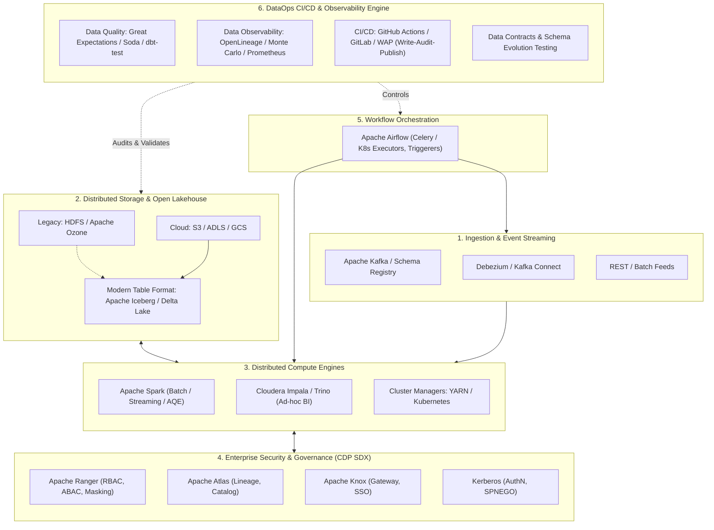

# 🎓 The DataOps & Big Data Engineering Masterclass
### *Authored by a 20-Year Veteran Distinguished Architect & Professor*

Welcome to the definitive curriculum on **Modern DataOps and Enterprise Big Data Systems**. 

Over the last two decades, I have designed, scaled, debugged, and modernized distributed data platforms—from bare-metal 1,000-node Hadoop clusters running MapReduce v1 in 2006, through the Cloudera CDH/HDP era, the rise of Apache Spark and Apache Airflow, to modern Kubernetes-native DataOps platforms running Apache Iceberg Lakehouses, Apache Kafka, and automated CI/CD data pipelines.

This curriculum is engineered to transform you from someone who simply "knows the tools" into a **Staff/Principal DataOps Engineer** capable of passing the most rigorous system design and technical interviews at Tier-1 tech giants, sovereign wealth funds, and Fortune 50 enterprises.

---

## 🏛️ Modern DataOps Enterprise Architecture Blueprint

---

## 🗺️ Master Curriculum Navigation

Click any module below to dive straight into the deep-dive lectures, architectural diagrams, war stories, and interview gauntlets:

### 1. ⚙️ [DataOps Foundations & Modern Lifecycle](file:///d:/self-learning/dataops/README.md)
*The philosophy, testing automation, observability, and release engineering for mission-critical data pipelines.*
- **[01. Philosophy, Principles & Lifecycle](file:///d:/self-learning/dataops/01_dataops_philosophy_and_lifecycle.md)**: DataOps vs DevOps, 6 Core Pillars, Maturity Model, and Organizational Topologies.
- **[02. CI/CD for Data Pipelines](file:///d:/self-learning/dataops/02_cicd_for_data_pipelines.md)**: Git-based workflows, SQLFluff, dbt testing, ephemeral test environments, Write-Audit-Publish (WAP).
- **[03. Data Quality, Contracts & Observability](file:///d:/self-learning/dataops/03_data_quality_and_observability.md)**: The 5 Pillars of Observability, Great Expectations, OpenLineage, Data Contracts, SLIs/SLOs/Error Budgets.
- **[04. DataOps Interview Mastery](file:///d:/self-learning/dataops/04_interview_mastery_dataops.md)**: System design scenarios, 3 AM pipeline disaster post-mortems, and FAANG interview questions.

---

### 2. 🐘 [Hadoop & Distributed Storage/Compute Foundations](file:///d:/self-learning/hadoop/README.md)
*The foundational distributed systems concepts that every tier-1 enterprise still expects you to understand deeply.*
- **[01. HDFS Architecture & Internals](file:///d:/self-learning/hadoop/01_hdfs_architecture_and_internals.md)**: NameNode, DataNodes, Block placement (Rack Awareness), QJM High Availability, SafeMode, EditLogs & FSImage compaction.
- **[02. YARN Resource Management](file:///d:/self-learning/hadoop/02_yarn_resource_management.md)**: ResourceManager, NodeManager, ApplicationMaster, Capacity vs Fair Schedulers, CGroups, Memory/vCore allocation formulas.
- **[03. MapReduce Internals & The Shuffle Phase](file:///d:/self-learning/hadoop/03_mapreduce_and_shuffle_deep_dive.md)**: InputSplit vs Block, In-memory buffer spilling (`io.sort.mb`), Combiners, HTTP pull shuffle, Speculative execution.
- **[04. Hadoop Interview Mastery](file:///d:/self-learning/hadoop/04_interview_mastery_hadoop.md)**: NameNode heap sizing calculations, handling 50M small files disaster, Split-brain resolution in HA clusters.

---

### 3. ⚡ [Apache Spark Deep Dive & Performance Tuning](file:///d:/self-learning/spark/README.md)
*The de facto computational engine of modern big data. Internal architecture, memory layout, and query optimization.*
- **[01. Spark Core Engine Internals](file:///d:/self-learning/spark/01_spark_core_engine_internals.md)**: Driver, Executors, DAGScheduler (Stages & Narrow vs Wide Dependencies), TaskScheduler, Worker thread pools.
- **[02. Memory Management & Project Tungsten](file:///d:/self-learning/spark/02_memory_management_and_tungsten.md)**: Unified Memory Manager (Execution vs Storage), Off-heap allocation, Catalyst Optimizer (Logical/Physical plans, CBO), Whole-Stage CodeGen.
- **[03. Shuffling, Partitioning & Skew Mitigation](file:///d:/self-learning/spark/03_shuffling_partitioning_and_skew.md)**: SortShuffleManager, Partition sizing rules of thumb, AQE (Adaptive Query Execution), Salting, Broadcast vs Sort-Merge Joins.
- **[04. Structured Streaming & Exactly-Once](file:///d:/self-learning/spark/04_structured_streaming_and_microbatch.md)**: Triggers, Event-time Watermarking, StateStore (HDFS vs RocksDB provider), End-to-end fault tolerance & idempotent sinks.
- **[05. Spark Interview Mastery](file:///d:/self-learning/spark/05_interview_mastery_spark.md)**: Diagnosing Driver OOM vs Executor OOM, G1GC tuning recipes, resolving extreme data skew in multi-terabyte joins.

---

### 4. 🏢 [Cloudera Enterprise & CDP (Cloudera Data Platform)](file:///d:/self-learning/cloudera/README.md)
*Enterprise-grade security, governance, and hybrid cloud architecture across CDH, HDP, and CDP Private/Public Cloud.*
- **[01. CDP Architecture & Evolution](file:///d:/self-learning/cloudera/01_cdp_architecture_and_evolution.md)**: Evolution from CDH/HDP to CDP (Private Cloud Base vs Data Services), Cloudera Manager heartbeats, Agents, Supervisord, Parcels.
- **[02. SDX Security: Ranger, Atlas, Knox & Kerberos](file:///d:/self-learning/cloudera/02_sdx_ranger_atlas_knox_security.md)**: Shared Data Experience (SDX), Apache Ranger (RBAC, ABAC, dynamic masking), Apache Atlas (automated lineage, metadata classification), Apache Knox gateway, Kerberos ticket lifecycle.
- **[03. Query Engines & Modern Storage (Impala, Hive LLAP, Ozone)](file:///d:/self-learning/cloudera/03_cloudera_query_engines_and_storage.md)**: Apache Ozone (Object store scaling to billions of objects), Impala internals (Statestored, Catalogd, LLVM codegen), Hive LLAP daemon caching.
- **[04. Cloudera / CDP Interview Mastery](file:///d:/self-learning/cloudera/04_interview_mastery_cloudera_cdp.md)**: Enterprise migration strategies (CDH 5/6 to CDP), Kerberos keytab expiry troubleshooting, multi-tenant resource isolation.

---

### 5. 🌬️ [Apache Airflow Orchestration & Production Engineering](file:///d:/self-learning/airflow/README.md)
*Enterprise workflow orchestration, scheduler internals, distributed executors, and high-reliability patterns.*
- **[01. Airflow Architecture & Executor Internals](file:///d:/self-learning/airflow/01_airflow_architecture_and_components.md)**: Webserver, Scheduler (Heartbeat loop, DagFileProcessor, Mini-scheduler), Executors (Celery, Kubernetes, CeleryKubernetesExecutor).
- **[02. DAG Authoring & Scheduling Mechanics](file:///d:/self-learning/airflow/02_dag_authoring_and_scheduling_internals.md)**: Data intervals, `logical_date` vs `execution_date`, top-level code trap, dynamic DAG generation, TaskFlow API (`@task`, `@dag`).
- **[03. Production Hardening & Deferrable Operators](file:///d:/self-learning/airflow/03_production_patterns_and_deferrable_operators.md)**: Deferrable operators & Triggerer (asyncio event loop), Custom S3/GCS XCom backends, Connection pooling with PgBouncer, Zombie task prevention.
- **[04. Airflow Interview Mastery](file:///d:/self-learning/airflow/04_interview_mastery_airflow.md)**: Scheduler CPU spikes debugging, Zero-downtime DAG deployments, Handling backfills across 10 years of data safely.

---

### 6. 📨 [Apache Kafka & Real-Time Stream DataOps](file:///d:/self-learning/kafka/README.md) *(Added Technology)*
*The backbone of real-time enterprise pipelines. Broker internals, exactly-once processing, and schema governance.*
- **[01. Kafka Internals & Broker Architecture](file:///d:/self-learning/kafka/01_kafka_internals_and_architecture.md)**: Commit logs, OS page cache & Zero-Copy (`sendfile`), In-Sync Replicas (ISR), High Watermark, Log Compaction, Tiered Storage.
- **[02. Producers, Consumers & Schema Governance](file:///d:/self-learning/kafka/02_producers_consumers_and_stream_dataops.md)**: Producer acknowledgments (`acks=all`), Idempotent & Transactional producers (2PC), Rebalance protocol (Eager vs Cooperative Sticky), Schema Registry compatibility rules.
- **[03. Kafka Interview Mastery](file:///d:/self-learning/kafka/03_interview_mastery_kafka.md)**: Mitigating consumer rebalance storms, consumer lag troubleshooting, handling under-replicated partitions, poison pill isolation.

---

### 7. 🧊 [Modern Lakehouse & Open Table Formats](file:///d:/self-learning/lakehouse/README.md) *(Added Technology)*
*The replacement for Hive Metastore tables on cloud and modern on-prem storage.*
- **[01. Open Table Formats: Apache Iceberg vs Delta Lake](file:///d:/self-learning/lakehouse/01_table_formats_iceberg_and_delta.md)**: Why traditional directory-based tables fail, Iceberg metadata tree (Catalog -> Metadata -> Manifest List -> Manifests -> Data files), Snapshot Isolation, ACID on Object Storage.
- **[02. Lakehouse DataOps & Table Maintenance](file:///d:/self-learning/lakehouse/02_lakehouse_dataops_and_maintenance.md)**: Compaction algorithms (Bin-pack vs Sort/Z-Order), Orphan file cleaning, Snapshot expiration, Hidden Partitioning, Write-Audit-Publish (WAP).
- **[03. Lakehouse Interview Mastery](file:///d:/self-learning/lakehouse/03_interview_mastery_lakehouse.md)**: Architecting atomic batch updates, solving S3 503 SlowDown errors, Iceberg vs Delta feature matrix for enterprise selection.

---

## 🎯 How to Use This Repository for Tier-1 Technical Interviews
1. **Understand First Principles**: Every module starts with *why* an abstraction exists. Interviewers at big firms test your ability to reason about tradeoffs, not recite commands.
2. **Memorize the Formulas & Heuristics**: Master executor sizing, shuffle partition calculations, and memory overhead allocation. You will be asked these live on whiteboards/code screens.
3. **Internalize the Production War Stories**: Each section features real failure scenarios (split-brain, OOM, GC stalls, data corruption). Relate these to your own experience to stand out as a battle-tested leader.
