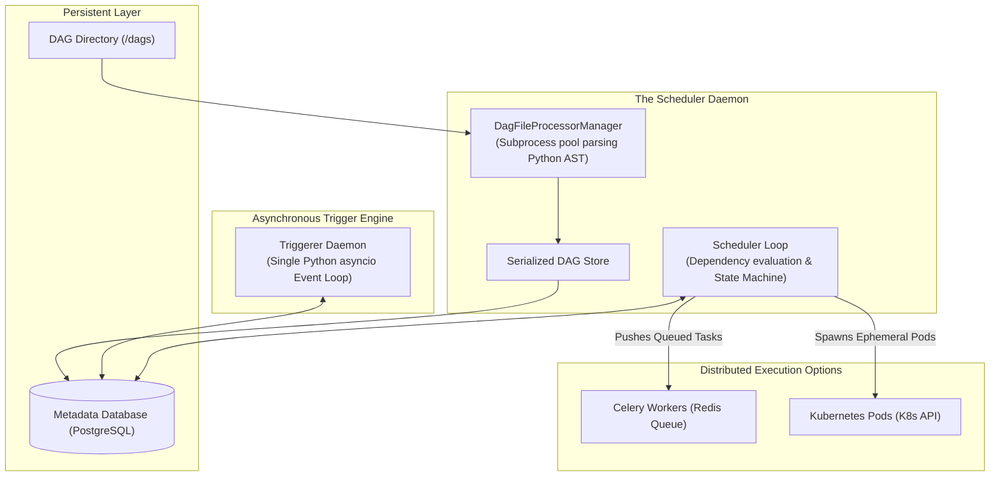
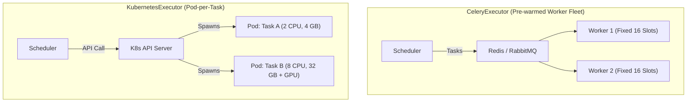
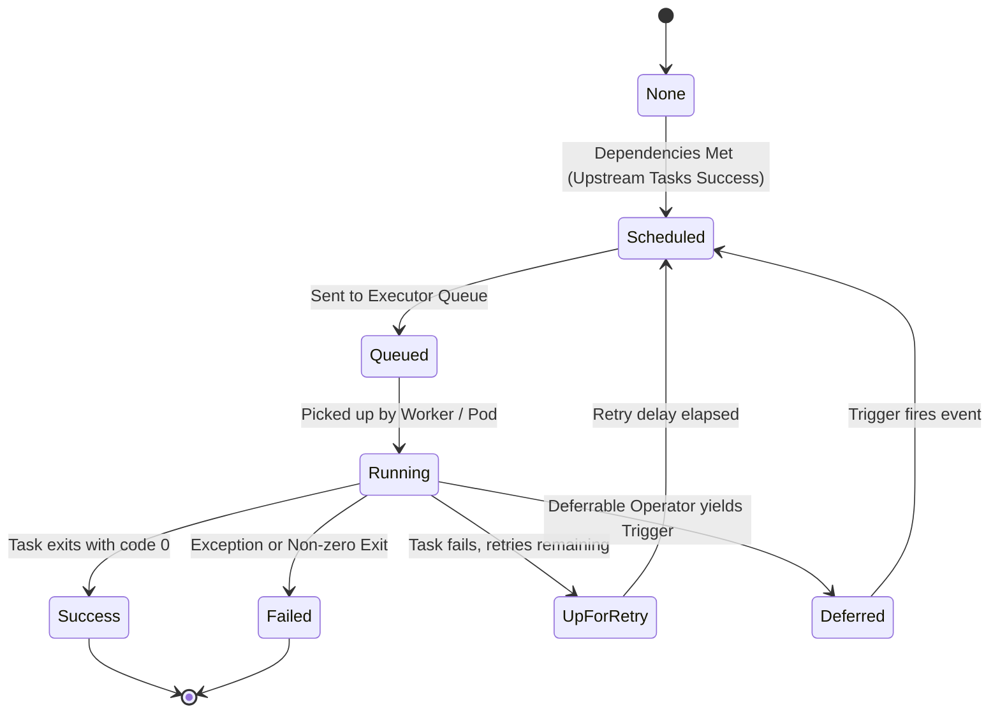

# ⚙️ Lecture 01: Airflow Architecture & Executor Internals
### *The Scheduler Engine, Triggerer, and Distributed Worker Topologies*

---

## 1. Airflow Core Architecture & Component Interactions

### The 4 Essential Daemons
1. **Webserver**: Lightweight UI serving status, logs, and manual triggers. In Airflow 2.x+, the webserver reads strictly from the database's `serialized_dag` table; it **never** parses DAG Python files directly, eliminating UI freezes.
2. **Scheduler**: The heart of Airflow. A multi-threaded process running a continuous loop:
   - Spawns background subprocesses to parse Python files into serialized representations.
   - Evaluates dependency state machines (`NONE` $\rightarrow$ `SCHEDULED` $\rightarrow$ `QUEUED` $\rightarrow$ `RUNNING`).
   - Delegates queued tasks to the Executor.
3. **Triggerer**: An event-loop daemon introduced to solve sensor starvation. Runs thousands of asynchronous waiting events in a single thread using Python `asyncio`.
4. **Metadata Database**: The single source of truth (PostgreSQL / MySQL) recording task states, connection secrets, DAG runs, and execution timestamps.

---

## 2. Distributed Executors Compared

Choosing the correct executor is one of the most critical architectural decisions for a DataOps platform.

### The Definitive Executor Tradeoff Matrix

| Feature | CeleryExecutor | KubernetesExecutor | CeleryKubernetesExecutor |
| :--- | :--- | :--- | :--- |
| **Worker Model** | Long-running, pre-warmed worker VMs/containers | Ephemeral: 1 dedicated Pod spawned per task | Hybrid: Pre-warmed fleet + on-demand Pods |
| **Task Startup Latency** | **Sub-second (< 200 ms)** | **5–15 seconds** (Container image pull & Pod schedule) | Fast for Celery; 5–15s for K8s |
| **Dependency Isolation** | Poor (All tasks share worker Python virtualenv) | **Total** (Each task can specify a unique Docker image) | Isolated on K8s queue; shared on Celery |
| **Resource Granularity** | Static (Workers sized uniformly) | **Dynamic** (Specify exact CPU/RAM/GPU per task) | Best of both worlds |
| **Infrastructure Cost** | Pays for idle workers 24/7 | **Scales to Zero** when no tasks are running | Optimized: small Celery baseline + K8s burst |
| **Best For** | High-throughput, short-running tasks (SQL triggers, sensors) | Heavy, heterogeneous data pipelines (Spark, ML, PyTorch) | **Large Enterprise Data Platforms** |

---

## 3. The Lifecycle of a Task Instance

Every task instance transitions through a deterministic state machine managed by the Scheduler:

### Preventing Zombie Tasks
A **Zombie Task** is a task instance that the metadata database thinks is in `RUNNING` status, but whose underlying worker thread or Kubernetes pod has crashed silently (e.g., node died, or pod was evicted by K8s OOMKiller).

The Airflow Scheduler runs a periodic zombie detection loop:
- Workers continuously send heartbeat timestamps to the DB (`task_instance.heartbeat`).
- If a task instance in `RUNNING` status has not updated its heartbeat within `scheduler.zombie_task_threshold` (default **300 seconds / 5 mins**), the Scheduler marks the task as `FAILED`, frees its slot, and triggers retry logic.
