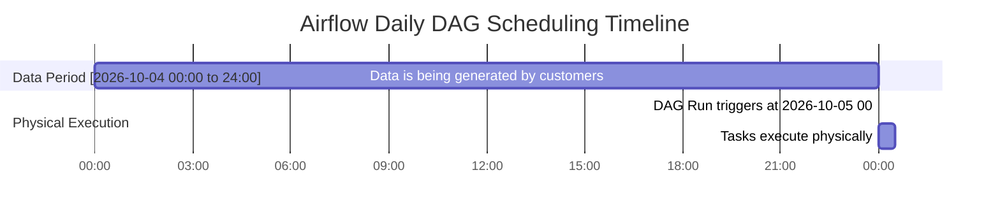
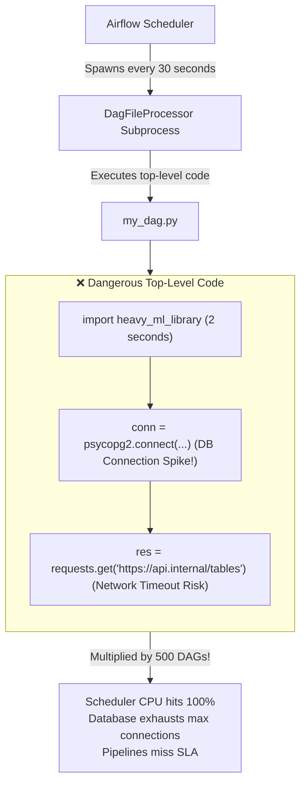
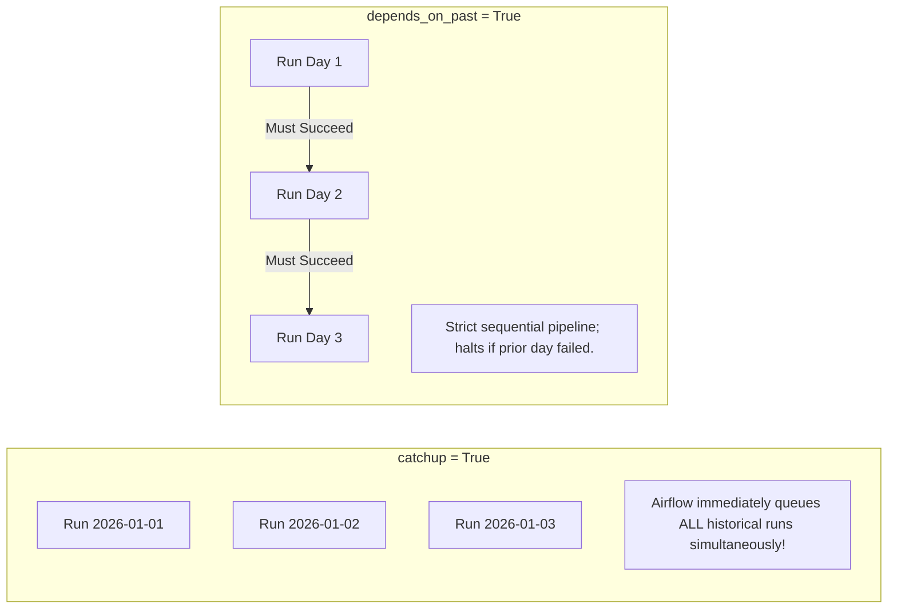

# ⏱️ Lecture 02: DAG Authoring & Scheduling Internals
### *Demystifying Time, Top-Level Traps & Modern TaskFlow API*

---

## 1. Demystifying Time: `logical_date` vs. `data_interval_end`

The single greatest source of confusion for engineers learning Airflow is the concept of scheduling time.



### The 3 Core Temporal Properties
Consider a DAG scheduled with `@daily`:
1. **`data_interval_start`**: `2026-10-04 00:00:00 UTC` (Beginning of the period covered).
2. **`data_interval_end`**: `2026-10-05 00:00:00 UTC` (End of the period covered).
3. **`logical_date`** (Legacy name: `execution_date`): Equal to `data_interval_start`. It identifies **which slice of historical data** this run is processing.
4. **`run_after`**: `2026-10-05 00:00:00 UTC`. A DAG covering the full 24 hours of Oct 4th cannot run until Oct 4th has completely concluded!

> **⚠️ The Professor's Golden Rule**:  
> In your ETL queries, never filter by `CURRENT_DATE()` or `NOW()`! Always filter using Airflow's Jinja templates:  
> `WHERE transaction_time >= '{{ data_interval_start }}' AND transaction_time < '{{ data_interval_end }}'`  
> This guarantees that whether the DAG runs today, or is backfilled 5 years later, it processes the exact same deterministic dataset.

---

## 2. The Top-Level Code Execution Trap

A catastrophic anti-pattern in Airflow authoring is writing executable business logic or network calls at the root level of a Python file.



### The Fix: Scope Imports & Calls Inside Tasks

```python
# ❌ INCORRECT: Executes on every scheduler parse loop (every 30s)
import pandas as pd
import requests

def get_active_users():
    return requests.get("https://api.internal/users").json()

active_users = get_active_users()  # 💥 FATAL TOP-LEVEL CALL


# ✅ CORRECT: Zero network calls or heavy imports during parsing
from airflow.decorators import dag, task
from datetime import datetime

@dag(schedule="@daily", start_date=datetime(2026, 1, 1), catchup=False)
def clean_pipeline():
    @task
    def fetch_users():
        # Imports and network calls happen ONLY on worker when task executes
        import requests
        response = requests.get("https://api.internal/users")
        return response.json()

    @task
    def process_users(users):
        import pandas as pd
        df = pd.DataFrame(users)
        return len(df)

    user_data = fetch_users()
    process_users(user_data)

clean_pipeline_instance = clean_pipeline()
```

---

## 3. Dynamic DAG Generation: Config-Driven Pipelines

In high-scale enterprise platforms, instead of writing 100 individual DAG files for 100 different tables, use a **Dynamic DAG Factory**.

```python
# dynamic_dag_factory.py
import yaml
from airflow import DAG
from airflow.operators.bash import BashOperator
from datetime import datetime

CONFIG_YAML = """
tables:
  - name: customers
    schedule: "0 1 * * *"
  - name: transactions
    schedule: "0 2 * * *"
  - name: merchants
    schedule: "0 3 * * *"
"""

config = yaml.safe_load(CONFIG_YAML)

for table_cfg in config["tables"]:
    table_name = table_cfg["name"]
    dag_id = f"etl_pipeline_{table_name}"
    
    dag = DAG(
        dag_id=dag_id,
        schedule=table_cfg["schedule"],
        start_date=datetime(2026, 1, 1),
        catchup=False,
        tags=["dynamic", "core_data"]
    )
    
    with dag:
        BashOperator(
            task_id=f"sync_{table_name}",
            bash_command=f"python -m etl.sync --table {table_name}"
        )
        
    # Crucial: Register in global scope so DagFileProcessor discovers it
    globals()[dag_id] = dag
```

---

## 4. `catchup` vs. `depends_on_past` vs. Backfills



- **`catchup=False`**: When deploying a new DAG with a `start_date` 6 months ago, Airflow runs **only the most recent completed interval**, ignoring historical dates.
- **`catchup=True`**: Airflow calculates all missed intervals between `start_date` and today, and queues them immediately.
  - *Warning*: If you set `catchup=True` on a DAG with `start_date=datetime(2020, 1, 1)` and no max active runs, Airflow will attempt to launch 2,000+ DAG runs concurrently, potentially crashing your worker cluster!
- **Controlled CLI Backfill**:
  ```bash
  # Backfill with strict concurrency caps
  airflow dags backfill \
      --start-date 2026-01-01 \
      --end-date 2026-06-01 \
      --max-active-runs 3 \
      --reset-dagruns \
      my_critical_dag
  ```
