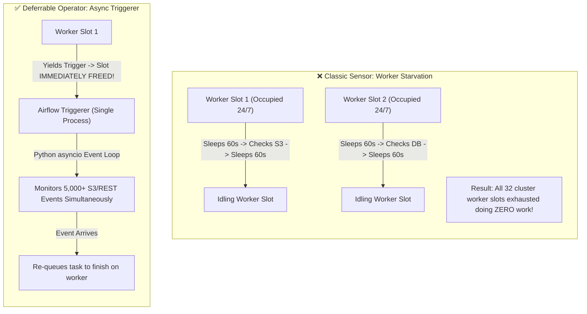
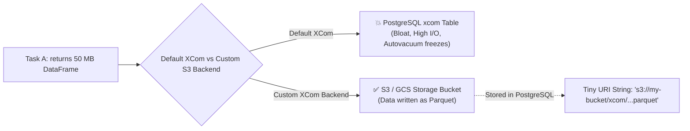
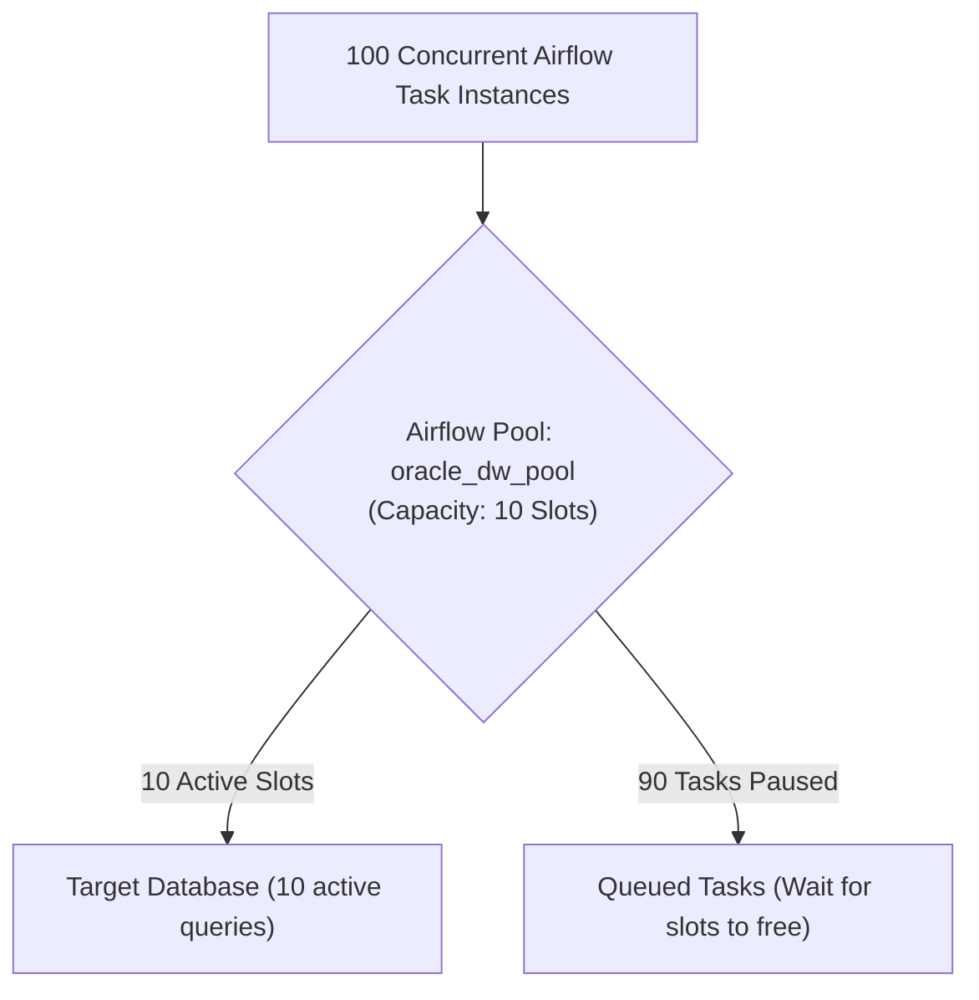

# ⚡ Lecture 03: Production Patterns & Deferrable Operators
### *Async Triggerers, Custom S3 XCom Backends & Worker Concurrency Controls*

---

## 1. Classic Sensors vs. Deferrable Operators

In large data architectures, hundreds of pipelines wait for external events (e.g., waiting for an S3 partition to land, waiting for a Databricks job, or waiting for an upstream DAG).



### Technical Mechanics of Deferral
1. **Initial Execution**: The task starts on a regular worker. It discovers the target condition is not yet met.
2. **Yielding a Trigger**: The operator calls `self.defer(trigger=DateTimeTrigger(...), method_name="execute_complete")`.
3. **Slot Deallocation**: The worker releases the execution slot immediately back to the pool.
4. **Triggerer Monitoring**: The **Triggerer** daemon picks up the trigger instance and polls asynchronously via non-blocking I/O (`aiohttp`, `aiobotocore`).
5. **Resume**: When the trigger fires, the task is returned to `QUEUED` status, executed on an available worker, and resumes from `execute_complete`.

```python
from airflow.sensors.base import BaseSensorOperator
from airflow.triggers.temporal import DateTimeTrigger
from airflow.utils import timezone
from datetime import timedelta

class SmartWaitOperator(BaseSensorOperator):
    def execute(self, context):
        target_time = timezone.utcnow() + timedelta(minutes=30)
        # Yield execution to Triggerer; free the worker slot immediately!
        self.defer(
            trigger=DateTimeTrigger(moment=target_time),
            method_name="execute_complete"
        )

    def execute_complete(self, context, event=None):
        self.log.info("30 minutes elapsed. Resuming pipeline execution!")
        return True
```

---

## 2. Custom XCom Backend: Preventing Metadata DB Collapse

By default, Airflow stores XCom (Cross-Communication) return values directly in PostgreSQL in the `xcom` table.



### Implementing a Production S3 Custom XCom Backend

```python
# custom_xcom_backend.py
import json
import uuid
import pandas as pd
import pyarrow.parquet as pq
from airflow.models.xcom import BaseXCom
from airflow.providers.amazon.aws.hooks.s3 import S3Hook

S3_BUCKET = "enterprise-dataops-xcom-storage"

class S3CustomXComBackend(BaseXCom):
    PREFIX = "xcom_s3://"

    @staticmethod
    def serialize_value(value, **kwargs):
        # If payload is a Pandas DataFrame or large dict, push to S3
        if isinstance(value, pd.DataFrame):
            s3_hook = S3Hook(aws_conn_id="aws_default")
            key = f"dataframes/{uuid.uuid4()}.parquet"
            
            # Serialize DataFrame to Parquet buffer
            parquet_buffer = value.to_parquet()
            s3_hook.load_bytes(parquet_buffer, key=key, bucket_name=S3_BUCKET, replace=True)
            
            # Return tiny reference string to save in PostgreSQL
            reference_uri = f"{S3CustomXComBackend.PREFIX}{S3_BUCKET}/{key}"
            return BaseXCom.serialize_value(reference_uri)

        # Standard small JSON payloads stay in DB
        return BaseXCom.serialize_value(value)

    @staticmethod
    def deserialize_value(result):
        serialized_val = BaseXCom.deserialize_value(result)
        if isinstance(serialized_val, str) and serialized_val.startswith(S3CustomXComBackend.PREFIX):
            s3_path = serialized_val.replace(S3CustomXComBackend.PREFIX, "")
            bucket, key = s3_path.split("/", 1)
            
            s3_hook = S3Hook(aws_conn_id="aws_default")
            file_obj = s3_hook.get_key(key, bucket_name=bucket)
            # Read Parquet back into DataFrame
            return pd.read_parquet(file_obj.get()["Body"])

        return serialized_val
```

To activate this in `airflow.cfg`:
```ini
[core]
xcom_backend = custom_xcom_backend.S3CustomXComBackend
```

---

## 3. High-Concurrency Resource Management: Airflow Pools

If you have 100 DAGs running concurrently, all executing queries against an external Oracle or Snowflake warehouse with a limit of 10 concurrent connections, Airflow will overwhelm the database without **Pools**.



```python
# Task definition utilizing pools & priority weights
extract_task = BashOperator(
    task_id="extract_from_oracle",
    bash_command="python extract.py",
    pool="oracle_dw_pool",        # Strict limit of 10 concurrent tasks
    priority_weight=100,          # High priority tasks grab slots first
    weight_rule="downstream"       # Automatically calculate priority based on downstream DAG size
)
```
