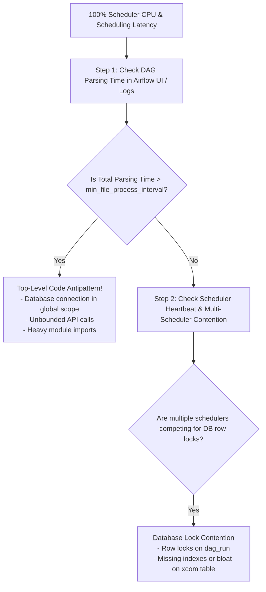
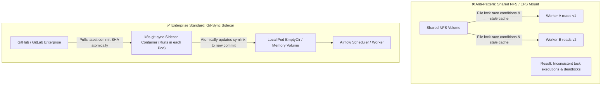
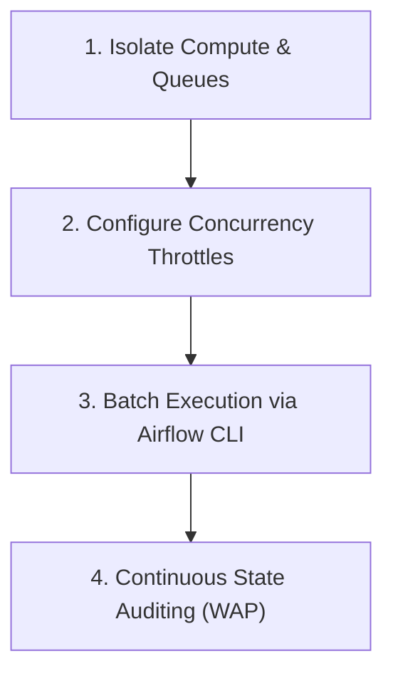

# 🎯 Lecture 04: Airflow Interview Mastery
### *Scheduler Forensics, Zero-Downtime Deployments, and Enterprise Backfills*

---

## 🏆 Question 1: The 100% Scheduler CPU Crisis

> **The Prompt**:  
> *"Our enterprise Airflow deployment has 1,200 DAGs. Over the last week, task scheduling latency jumped from 2 seconds to 12 minutes. The Scheduler host is pinned at 100% CPU usage, and the PostgreSQL database shows high connection counts and locks on the `dag_run` and `task_instance` tables. Walk me through your forensic investigation and remediation steps."*

### The Staff Engineer Solution Blueprint



### Forensic Triaging & Configuration Fixes

#### 1. Measure DAG File Parse Times
Run the CLI benchmark on the DAGs folder:
```bash
airflow dags report
```
- If any single DAG takes $> 0.5$ seconds to parse, inspect it immediately. Look for dynamic SQL queries or heavy Python imports at the global file level.

#### 2. Tune the DAG Processor Subprocess Interval
By default, Airflow tries to re-parse every single DAG file every 30 seconds:
```ini
[scheduler]
# Increase file parsing interval from default 30s to 120s or 300s
min_file_process_interval = 180

# Control concurrency of file parsing workers (match CPU cores)
parsing_processes = 4
```

#### 3. Introduce PgBouncer for Connection Pooling
Each Airflow worker task, scheduler thread, and webserver worker opens persistent direct connections to PostgreSQL, rapidly exceeding PostgreSQL's `max_connections` (e.g., 500 connections).
- Deploy **PgBouncer** in front of PostgreSQL using **Transaction Pooling** mode.
- PgBouncer multiplexes thousands of transient Airflow client connections over 20–30 long-lived PostgreSQL server connections, dropping database CPU utilization by 70%.

---

## 🚀 Question 2: Zero-Downtime DAG Deployment Architectures

> **The Prompt**:  
> *"How do you deploy DAG updates in a 24/7 mission-critical environment without restarting schedulers, dropping active tasks, or causing DAG parsing state inconsistency?"*



### The 3 Enterprise Deployment Models Compared
1. **NFS / EFS Shared Storage (Do Not Recommend)**:
   - *Failure Mode*: High latency on thousands of concurrent small file reads, file locking issues during updates, and stale filesystem cache across workers.
2. **Git-Sync Sidecar (Recommended for Dynamic Teams)**:
   - A lightweight Go binary (`git-sync`) runs as a sidecar container in every Scheduler and Worker Pod.
   - It clones the repo into a temporary folder and atomically switches a symlink (`/dags -> /git/rev-12345/dags`) when all files are downloaded.
   - Updates propagate within 15–30 seconds with zero service restarts.
3. **Baked Immutable Docker Images (Recommended for Strict Regulated Tech)**:
   - DAGs are `COPY`'d directly into the Docker image during CI/CD:
     `COPY --chown=airflow:root ./dags /opt/airflow/dags`
   - Every release produces an immutable tagged image (`airflow:2.8-prod-commit-a1b2c3d`).
   - Schedulers and worker fleets are updated via Kubernetes Rolling Updates. Guarantees 100% reproducibility and prevents partial state deployments.

---

## ⏳ Question 3: Running a 5-Year Historical Backfill Safely

> **The Prompt**:  
> *"You need to reprocess 5 years of daily financial data (1,825 partitions) due to a tax calculation formula update. The DAG has 15 tasks per run. How do you execute this backfill without crashing the production Airflow cluster or starving live daily pipelines?"*

### The Staff Architect Backfill Execution Plan



#### Step 1: Queue Isolation
- Do **not** run backfill tasks in the default `default` Celery/Kubernetes queue.
- Route backfill tasks to a dedicated queue: `queue = "backfill_queue"`. Live daily jobs continue running in `prod_critical_queue` without waiting behind thousands of historical tasks.

#### Step 2: Concurrency Throttling Inside DAG Definition
```python
@dag(
    dag_id="financial_tax_backfill",
    schedule="@daily",
    start_date=datetime(2021, 1, 1),
    catchup=False,                       # Never let UI automatically catchup!
    max_active_runs=4,                   # Process maximum 4 historical days concurrently
    max_active_tasks_per_dag=16          # Cap total task instances across all backfill runs
)
```

#### Step 3: Chunked CLI Backfill Execution
Never trigger all 5 years in one shot. Execute in monthly or quarterly windows:
```bash
airflow dags backfill \
    --start-date 2021-01-01 \
    --end-date 2021-03-31 \
    --max-active-runs 4 \
    --delay-on-limit 30 \
    financial_tax_backfill
```
*(Wait for Q1 audit to pass, then proceed to Q2).*
