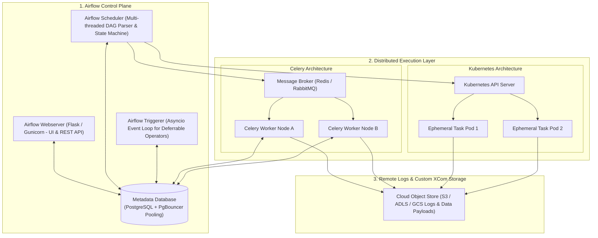

# 🌬️ Apache Airflow Orchestration & Production Engineering

> *"Airflow is not an execution engine; it is a workflow orchestrator. The moment you start loading 10 GB of data into memory inside an Airflow PythonOperator, you have violated its core design philosophy and guaranteed scheduler instability."*  
> — **Professor's Field Note**

---

## 🏛️ Airflow Distributed Architecture Blueprint

---

## 📖 Lecture Chapters

1. **[01. Airflow Architecture & Executor Internals](file:///d:/self-learning/airflow/01_airflow_architecture_and_components.md)**
   - Core daemons: Webserver, Scheduler, Triggerer, Metadata Database.
   - The Scheduler Heartbeat loop & `DagFileProcessorManager`.
   - Distributed Executors compared: `LocalExecutor`, `CeleryExecutor`, `KubernetesExecutor`, and `CeleryKubernetesExecutor`.

2. **[02. DAG Authoring & Scheduling Mechanics](file:///d:/self-learning/airflow/02_dag_authoring_and_scheduling_internals.md)**
   - Demystifying Time: `logical_date` (execution_date) vs `data_interval_start/end` vs `run_after`.
   - The Top-Level Code Trap: Why `import` and database queries outside tasks destroy scheduler performance.
   - TaskFlow API (`@task`, `@dag`) and dynamic DAG factory patterns.
   - Mastering `catchup`, `depends_on_past`, and distributed backfills.

3. **[03. Production Patterns & Deferrable Operators](file:///d:/self-learning/airflow/03_production_patterns_and_deferrable_operators.md)**
   - Smart Sensors vs Deferrable Operators (Freeing worker slots with `asyncio` Triggerers).
   - XCom Internals: Why default XComs destroy PostgreSQL databases, and configuring Custom Object Storage XCom backends (S3/GCS).
   - High-concurrency resource management: Pools, Priority Weights, and Slots.
   - Zombie task forensics and graceful heartbeat handling.

4. **[04. Airflow Interview Mastery](file:///d:/self-learning/airflow/04_interview_mastery_airflow.md)**
   - Debugging high Scheduler CPU and database connection starvation using PgBouncer.
   - Zero-Downtime DAG deployments: Git-Sync vs Immutable Docker images.
   - Safe historical backfills across millions of runs without destabilizing production queues.
