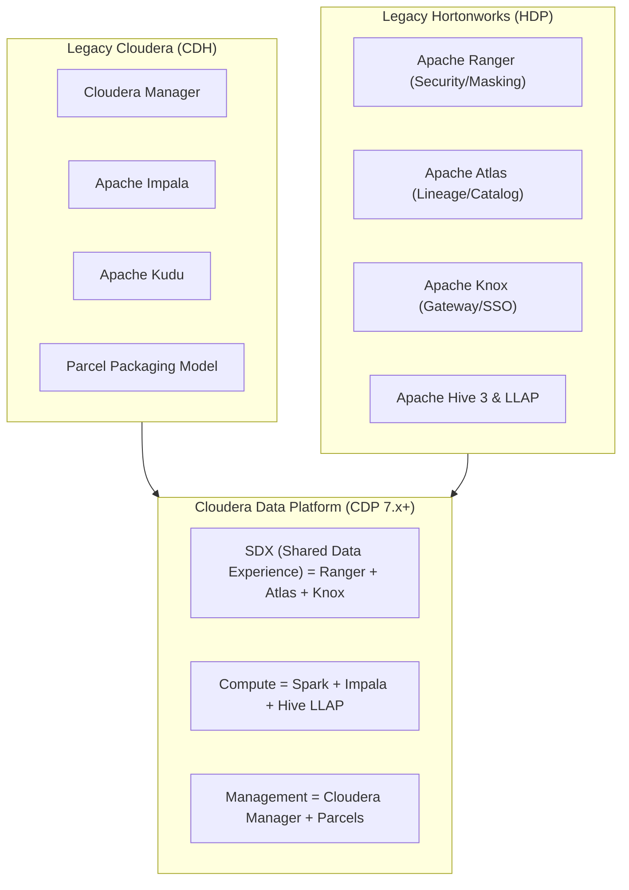
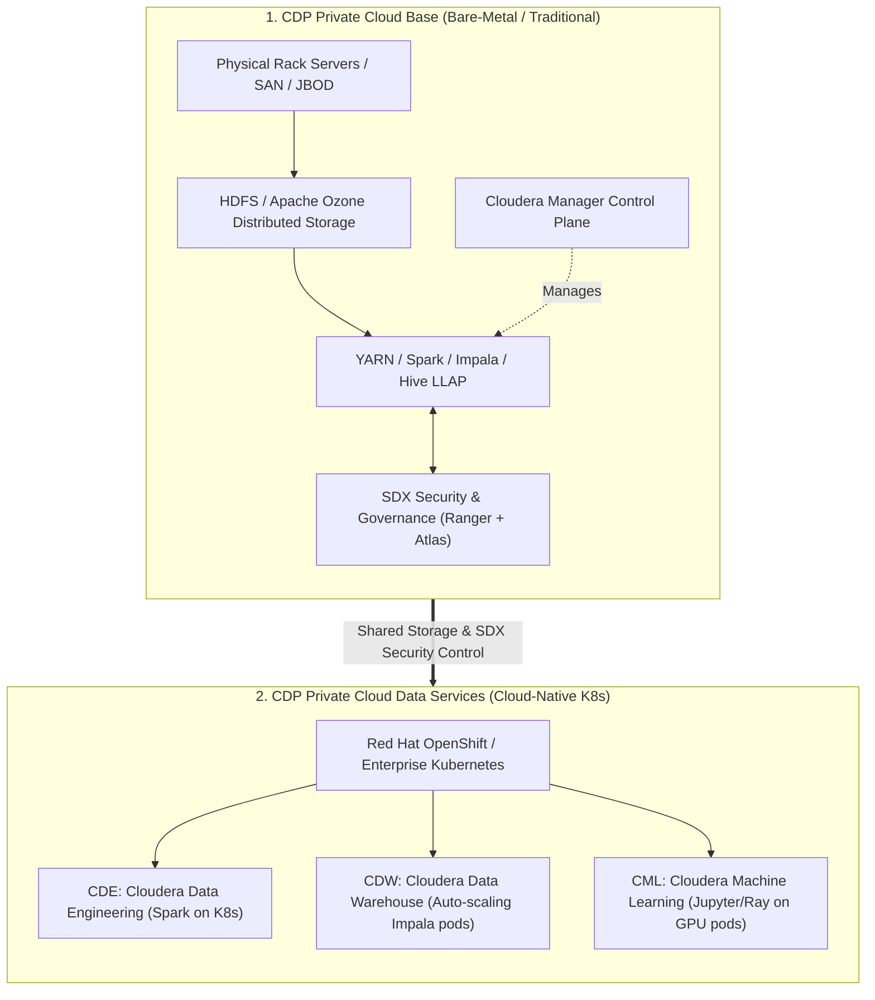
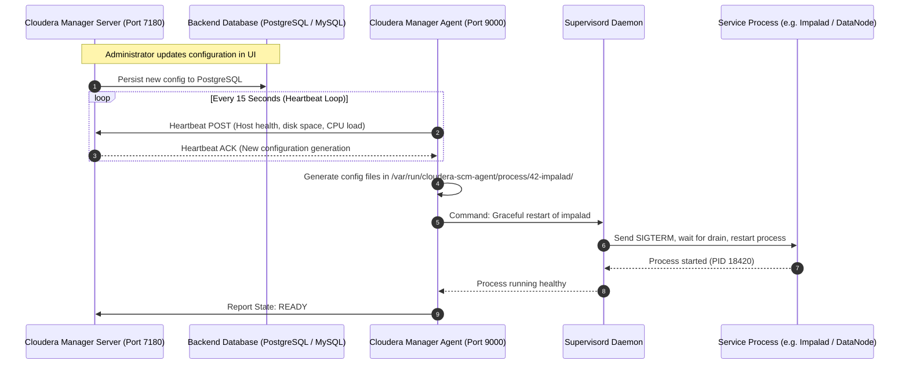

# 🏛️ Lecture 01: CDP Architecture & Evolution
### *From CDH & HDP to the Modern Cloudera Data Platform*

---

## 1. The Great Enterprise Merger: CDH + HDP = CDP

For a decade, the Big Data enterprise landscape was divided between two titans: **Cloudera (CDH)** and **Hortonworks (HDP)**. In 2018, the companies merged to unify their competing technologies into a single flagship platform: **Cloudera Data Platform (CDP 7.x+)**.

### The Best-of-Breed Technology Decisions

| Domain | Legacy CDH Choice | Legacy HDP Choice | CDP Unified Choice | Architectural Reason |
| :--- | :--- | :--- | :--- | :--- |
| **Management** | Cloudera Manager | Apache Ambari | **Cloudera Manager** | Superior enterprise HA, parcel management, and automated rolling upgrades. |
| **Authorization** | Apache Sentry | Apache Ranger | **Apache Ranger** | Ranger offered tag-based policies, dynamic row filtering, and column masking. |
| **Governance** | Cloudera Navigator | Apache Atlas | **Apache Atlas** | Atlas provided extensible open APIs and native Kafka hook integration. |
| **Interactive SQL**| Apache Impala | Hive LLAP | **Both Supported** | Impala for ultra-low latency BI; Hive LLAP for heavy federated SQL & ETL. |

---

## 2. CDP Deployment Flavors: Private vs. Public Cloud

1. **CDP Private Cloud Base**:
   - The foundation layer deployed directly on physical bare-metal servers.
   - Hosts persistent storage (HDFS / Apache Ozone) and classic YARN execution engines.
2. **CDP Private Cloud Data Services**:
   - Deployed on **Red Hat OpenShift (Kubernetes)**.
   - Decouples compute from storage: Spawns ephemeral, auto-scaling containers for Spark (CDE), Impala (CDW), and ML (CML) that read from the Base cluster's storage while sharing the exact same Ranger security policies.
3. **CDP Public Cloud**:
   - Fully managed control plane across AWS, Azure, and Google Cloud.
   - Replaces HDFS with cloud object stores (S3, ADLS Gen2, GCS) while keeping SDX security policies uniform across on-prem and multi-cloud environments.

---

## 3. Cloudera Manager (CM) Internals: Under the Hood

Cloudera Manager is the brain that automates the deployment, configuration, monitoring, and rolling upgrades of hundreds of distributed service daemons.

### Why Parcels Win Over OS Packages (RPMs/DEBs)
Legacy systems used standard Linux RPMs to install Hadoop. If you upgraded an RPM, it immediately altered system libraries in `/usr/lib`, making rollbacks almost impossible without cluster downtime.

**The Parcel Architecture**:
- A **Parcel** is a self-contained tarball containing binaries, libraries, and metadata for a service suite.
- Parcels are downloaded to `/opt/cloudera/parcel-repo` and unpacked into versioned directories:
  `/opt/cloudera/parcels/CDH-7.1.8-1.cdh7.1.8.p0.30990546/`
- When you "Activate" a parcel, Cloudera Manager simply swaps symbolic links (`/opt/cloudera/parcels/CDH -> ...`).
- **Advantage**: If a rolling upgrade encounters a critical bug, rolling back is instantaneous—CM simply repoints the symlink to the previous parcel version without modifying the host OS!
