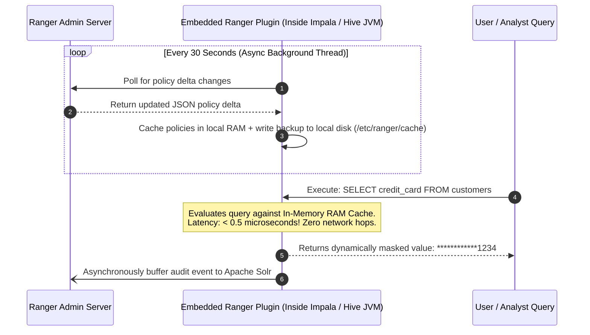
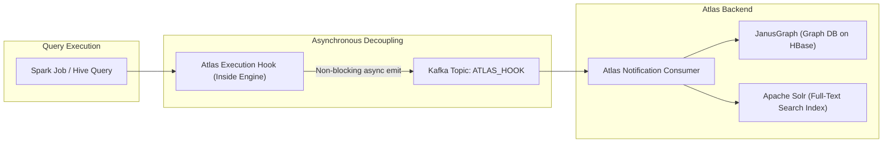
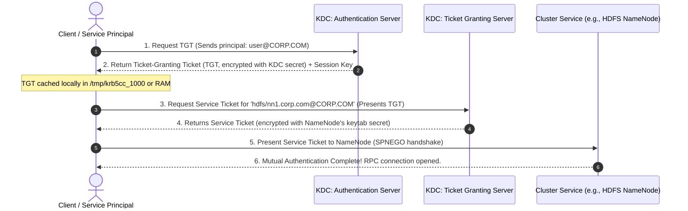

# 🛡️ Lecture 02: SDX Security: Ranger, Atlas, Knox & Kerberos
### *Shared Data Experience, Dynamic Masking, Lineage & Perimeter Defense*

---

## 1. SDX (Shared Data Experience) Philosophy

In fragmented architectures, each compute engine has its own security rules (e.g., configuring permissions in Hive Metastore, separately in Spark, separately in Impala, and separately in Kafka). This creates severe compliance holes.

**SDX** establishes a centralized, engine-agnostic governance and security plane: **Define policies once in Ranger and Atlas; enforce them automatically across every compute engine**.

```mermaid
flowchart TB
    subgraph SDXPlane["SDX Central Control Plane"]
        Ranger["Apache Ranger (Policies & Dynamic Masking)"]
        Atlas["Apache Atlas (Lineage, Classifications & Catalog)"]
        Atlas -->|Syncs Classification Tags (e.g. 'PII')| Ranger
    end

    subgraph ComputeEngines["Unified Multi-Engine Enforcement"]
        direction LR
        ImpalaEng["Apache Impala<br/>[Ranger Plugin]"]
        SparkEng["Apache Spark<br/>[Ranger Plugin]"]
        HiveEng["HiveServer2<br/>[Ranger Plugin]"]
        KafkaBrokers["Apache Kafka<br/>[Ranger Plugin]"]
    end

    Ranger -->|Pushes Policy Cache| ImpalaEng
    Ranger -->|Pushes Policy Cache| SparkEng
    Ranger -->|Pushes Policy Cache| HiveEng
    Ranger -->|Pushes Policy Cache| KafkaBrokers

    ImpalaEng -. Kafka Hook (Lineage) .-> Atlas
    SparkEng -. Kafka Hook (Lineage) .-> Atlas
    HiveEng -. Kafka Hook (Lineage) .-> Atlas
```

---

## 2. Apache Ranger Internals: Embedded Plugins & Sub-Microsecond Auth

A frequent interview question is: *"Does Apache Ranger become a network bottleneck when 10,000 queries run concurrently?"*

**The Answer**: **No**. Ranger does **not** sit in the critical network path of query execution.



### Dynamic Column Masking & Row Filtering
- **Dynamic Masking**: Evaluated at query runtime without modifying the underlying Parquet/ORC files on disk.
  - *Redact*: Replace all characters with `X` or `*`.
  - *Partial Mask*: Show last 4 digits (`************4821`).
  - *Hash*: Return SHA-256 cryptographic hash (permits joins across masked datasets without exposing plaintext).
- **Row-Level Filtering**: Dynamically appends a SQL predicate based on the authenticated user's LDAP group:
  ```sql
  -- Analyst from 'EMEA_Region' executes:
  SELECT * FROM global_sales;
  -- Ranger dynamically rewrites the AST to:
  SELECT * FROM global_sales WHERE region = 'EMEA';
  ```

---

## 3. Apache Atlas: Asynchronous Lineage via Kafka Hooks

Atlas maps the entire lifecycle of data across the enterprise, tracking how raw data transforms into aggregated executive tables.



> **⚡ Mechanical Sympathy**: If the Atlas server goes down or becomes slow, user queries **do not fail or slow down**. The engine hook simply buffers lineage events into Kafka. When Atlas recovers, it resumes reading from the Kafka consumer group offset.

---

## 4. Apache Knox: Perimeter Gateway & Reverse Proxy

Without Knox, a data cluster exposes hundreds of internal IP addresses and ports (`8088` for YARN, `9870` for HDFS, `21050` for Impala, `8080` for Airflow).

```mermaid
flowchart TD
    Client["Client / External BI Tool"] -->|HTTPS Single Port 8443 (TLS)| Knox["Apache Knox Gateway"]
    
    subgraph InternalCluster["Firewalled Private Enterprise Network"]
        direction TB
        Knox -->|Terminates TLS, Translates AuthN| WebHDFS["WebHDFS (Port 9870)"]
        Knox -->|Kerberos SPNEGO Token Delegation| YARNUI["YARN UI (Port 8088)"]
        Knox -->|JDBC / ODBC Tunnel| HiveJDBC["HiveServer2 (Port 10000)"]
    end
```

Knox acts as a **smart reverse proxy**:
1. It terminates public TLS certificates.
2. Authenticates clients against enterprise **LDAP / Active Directory / SAML / OAuth**.
3. Obtains internal **Kerberos Service Tickets** on behalf of the user, shielding end-users from ever having to run `kinit` or manage keytabs directly.

---

## 5. Kerberos Under the Hood: The Enterprise Ticket Protocol

Kerberos is a mutual-authentication protocol based on symmetric key cryptography.



### Essential Kerberos Troubleshooting Commands

```bash
# 1. Inspect active Kerberos tickets and expiration times
klist -e

# 2. Authenticate manually using a headless service keytab
kinit -kt /etc/security/keytabs/spark.keytab spark/worker01.corp.com@CORP.COM

# 3. Inspect keys inside a keytab without authenticating (check KVNO and encryption types)
klist -ekt /etc/security/keytabs/hdfs.headless.keytab

# 4. Debug Kerberos JVM issues in Spark / Airflow drivers
export HADOOP_OPTS="-Dsun.security.krb5.debug=true"
```
