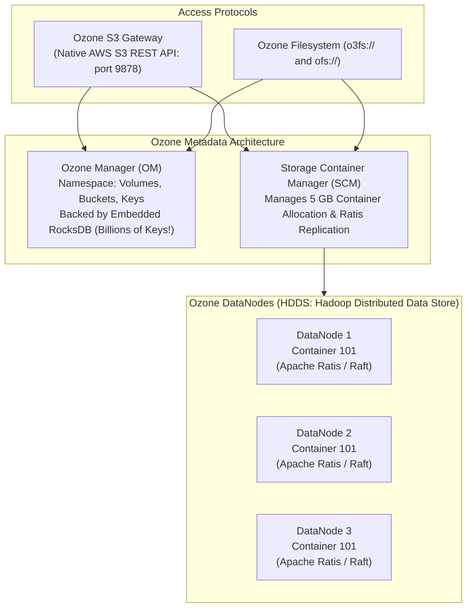
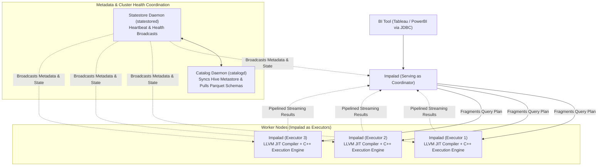
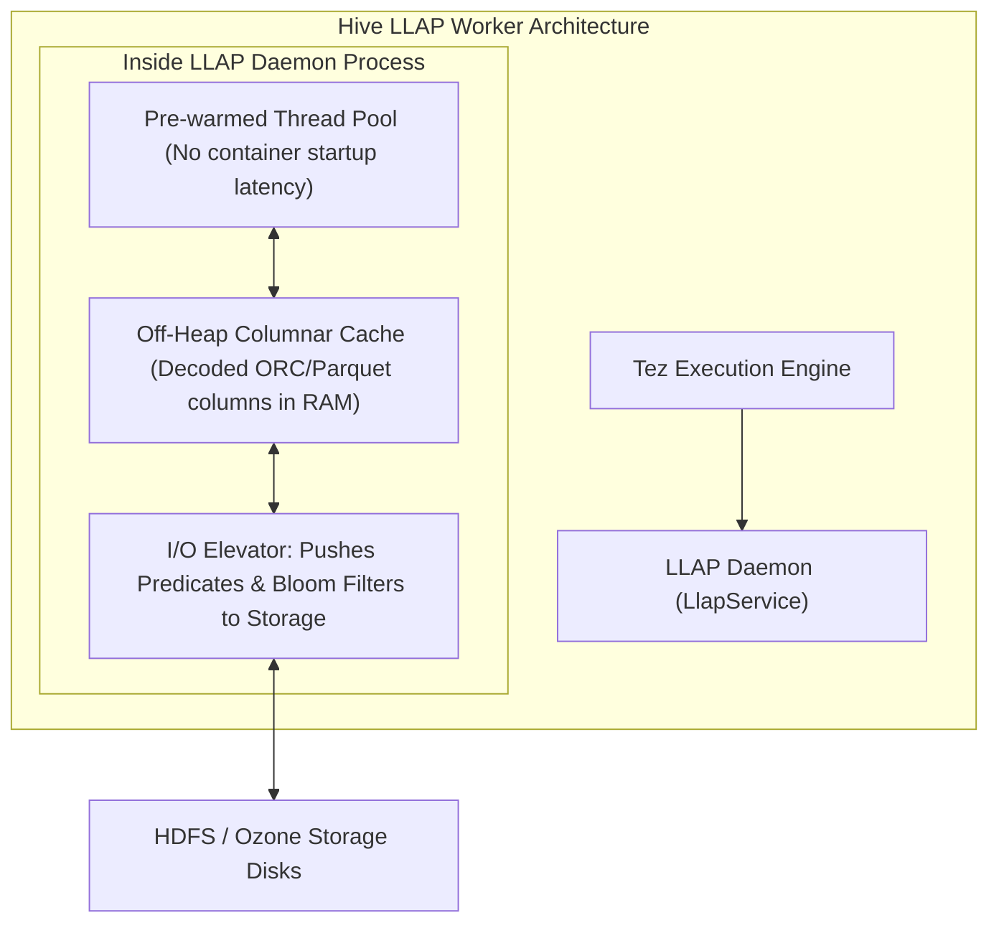

# ⚡ Lecture 03: Query Engines & Modern Storage
### *Apache Ozone, Apache Impala MPP & Hive LLAP Architecture*

---

## 1. Apache Ozone: The Exabyte-Scale Successor to HDFS

While HDFS revolutionized distributed storage, its architecture had a structural ceiling: **all metadata had to fit inside the NameNode JVM heap**. When enterprise clusters approached 500 Million to 1 Billion objects, the NameNode experienced catastrophic garbage collection pauses.

**Apache Ozone** solves this by decoupling the namespace from block allocation and using **RocksDB** on disk rather than JVM heap for metadata.

### HDFS vs. Apache Ozone Comparison

| Dimension | Traditional HDFS | Apache Ozone |
| :--- | :--- | :--- |
| **Object Limit** | ~400–500 Million blocks (JVM heap constrained) | **10+ Billion objects** (Disk-backed RocksDB) |
| **Storage Unit** | Individual blocks (128 MB) tracked by master | **5 GB Storage Containers** (Master tracks containers, not files) |
| **Consensus Protocol** | QJM / Paxos for NameNode edits | **Apache Ratis (Raft protocol)** for block-level replication |
| **Cloud Interface** | WebHDFS (HTTP REST) | **Native AWS S3 API Gateway** |
| **Small Files Handling** | Disastrous (NameNode memory exhaustion) | **Native & Highly Efficient** (Small files packed in containers) |

---

## 2. Apache Impala: MPP Architecture & LLVM Code Generation

Apache Impala is a Massively Parallel Processing (MPP) SQL engine designed for sub-second business intelligence queries directly over HDFS, Ozone, and Cloud Object Stores.

### The 3 Daemons of Impala
1. **`impalad` (Impala Daemon)**:
   - Runs on every worker node.
   - Any `impalad` can act as a **Coordinator** for a query: it parses the SQL, requests metadata from `catalogd`, constructs the distributed execution fragments, and aggregates results.
   - All other `impalad` instances act as **Executors**, reading local blocks and evaluating predicates.
2. **`statestored` (Statestore Daemon)**:
   - Collects heartbeats from all `impalad` instances and broadcasts health changes. If a node crashes, the Statestore notifies all Coordinators so no future query fragments are assigned to it.
3. **`catalogd` (Catalog Service Daemon)**:
   - Watches the Hive Metastore and HDFS NameNode. Translates table alterations and broadcasts cache invalidations to all `impalad` instances.

### Why Impala is Ultra-Fast: LLVM Runtime Code Generation
Unlike Hive or early Spark which executed Java bytecode, Impala is written in **native C++**. 
- During query planning, Impala uses **LLVM (Low-Level Virtual Machine)** to dynamically compile query inner loops into native x86 machine code at runtime.
- For example, evaluating `WHERE (tax * 0.15) + shipping > 50` is converted directly into machine register instructions, avoiding all abstraction penalties and instruction cache misses.

---

## 3. Apache Hive LLAP (Low Latency Analytical Processing)

Hive LLAP bridges the gap between long-running batch ETL and low-latency interactive SQL.

### Key Technical Advantages of LLAP
1. **Pre-Warmed Long-Lived Daemons**: Eliminates the 5–15 second container startup penalty inherent in classic YARN/Tez container allocation.
2. **Columnar In-Memory Cache**: LLAP does not just cache raw files; it caches **decompressed, decoded columnar formats (ORC/Parquet)** in off-heap memory. Repeated analytical queries read raw typed columns directly from RAM.
3. **Hybrid Execution**: If a massive batch query arrives that exceeds the capacity of LLAP daemons, Hive seamlessly allocates additional standard YARN containers to scale out dynamically.
