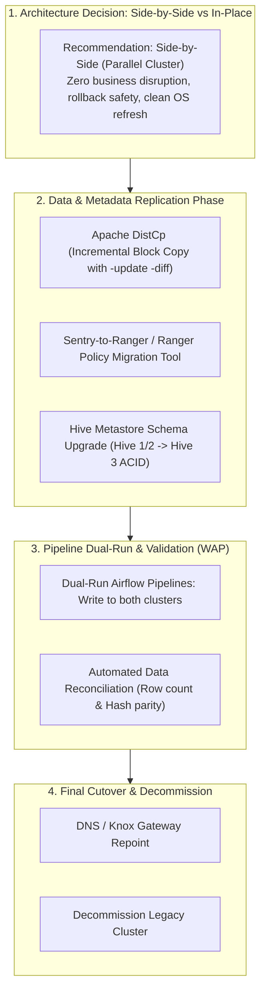
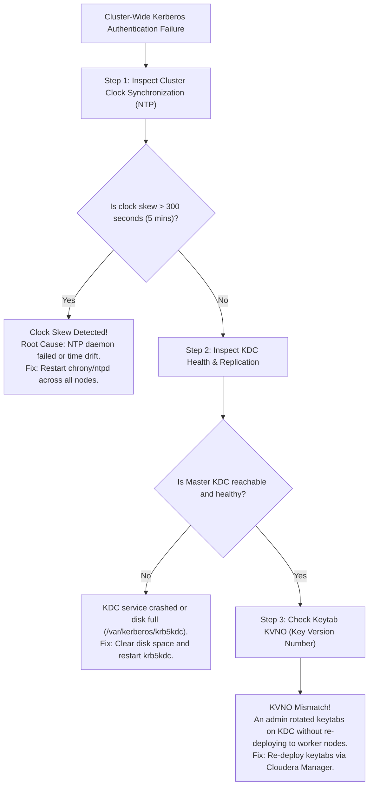

# 🎯 Lecture 04: Cloudera & CDP Interview Mastery
### *Enterprise Migration Strategies, Kerberos Forensics, and Multi-Tenancy Architecture*

---

## 🏆 Question 1: Enterprise Migration from Legacy CDH / HDP to CDP

> **The Prompt**:  
> *"You are the Principal Architect tasked with migrating a Fortune 100 enterprise from a 500-node legacy CDH 5.16 / HDP 2.6 cluster (storing 15 PB of data across 80,000 Hive tables and 2,000 daily Airflow/Spark jobs) to Cloudera Data Platform (CDP 7.x). Walk me through your migration strategy: In-place vs Side-by-Side, governance translation, and cutover execution."*

### The Staff Architect Migration Blueprint



#### Key Technical Decisions to Articulate in the Interview:
1. **Side-by-Side over In-Place**:
   - Upgrading in-place across major OS versions (CentOS 7 to RHEL 8/9) and Java versions (Java 8 to Java 11/17) carries unacceptable risk for a 15 PB mission-critical cluster.
   - Deploy a modern, clean CDP cluster alongside the legacy cluster.
2. **The Sentry-to-Ranger Policy Migration**:
   - Legacy CDH used Apache Sentry (privilege inheritance based on role hierarchies). CDP uses Apache Ranger.
   - Utilize Cloudera's `sentry-to-ranger-migration-tool` to parse Sentry database grants and map them to Ranger resource-based JSON policies before cutover.
3. **Hive 2 to Hive 3 Managed Tables Transition**:
   - In CDP Hive 3, all managed tables become **ACID transactional tables** stored in ORC format with specific directory ownership (`hive:hive`).
   - If legacy tables were external or stored in non-acid formats, identify which tables must remain `EXTERNAL` with `table_type = 'EXTERNAL_TABLE'` to maintain Spark/Impala compatibility.
4. **Bandwidth-Throttled `DistCp` Replication**:
   - Replicating 15 PB across data centers will saturate network backbones.
   - Configure `hadoop distcp -bandwidth 250 -m 100` to cap bandwidth consumption to 250 MB/s per mapper.

---

## 🚨 Question 2: Kerberos Cluster-Wide Authentication Failure

> **The Prompt**:  
> *"At 02:00 AM on Sunday, every single Spark, Hive, and Impala job on your 200-node secure cluster fails simultaneously with `GSSException: No valid credentials provided (Mechanism level: Failed to find any Kerberos tgt)`. How do you triage and resolve this under high pressure?"*



### Forensic Triaging Checklist
1. **Clock Skew (90% of Kerberos Outages)**:
   - Kerberos tickets contain timestamps to prevent replay attacks. If the clock difference between any node and the KDC exceeds `clockskew` (default **300 seconds / 5 minutes**), Kerberos rejects all tickets outright:
     ```bash
     # Check time across all nodes
     ansible all -m shell -a "date && chronyc tracking"
     ```
2. **Key Version Number (KVNO) Mismatch**:
   - If an automated script regenerated principals on the Active Directory/MIT KDC, the **KVNO** on the server is incremented (e.g., from 3 to 4).
   - The worker nodes still have keytabs on disk with KVNO 3. The KDC rejects tickets with `KRB5KDC_ERR_BAD_PVNO`.
   - **Verification**: Run `klist -ekt /etc/security/keytabs/spark.keytab` and compare with `kvno spark/host@REALM`.
3. **Expired Kerberos Ticket Granting Ticket (TGT)**:
   - Long-running Spark streaming applications must renew their TGT via the driver principal. If `renew_lifetime` is exceeded without renewal, the application dies with a TGT expired error.

---

## 🛡️ Question 3: Multi-Tenant Enterprise Security Blueprint

> **The Prompt**:  
> *"Design a multi-tenant isolation model on CDP for two competing departments: Healthcare (HIPAA governed) and Marketing. Marketing must never see Healthcare data. Marketing analysts may only query aggregated statistics with patient names and social security numbers completely masked."*

### The Staff Architect Solution
1. **Storage-Level Permissions (HDFS / Ozone ACLs)**:
   - Set POSIX/NFSv4 ACLs on storage directories:
     `/data/healthcare` permissions `700` owned by `healthcare:healthcare`.
     `/data/marketing` permissions `750` owned by `marketing:marketing`.
2. **Ranger Tag-Based Dynamic Masking (SDX)**:
   - In Apache Atlas, tag the columns `ssn` and `patient_name` with the classification tag `HIPAA_RESTRICTED`.
   - In Apache Ranger, create a single Tag-Based Policy on `HIPAA_RESTRICTED`:
     - **User/Group**: `marketing_analysts`
     - **Action**: Dynamic Masking $\rightarrow$ **Hash (SHA-256)** for SSN, and **Partial Mask (Show first character only)** for patient names.
3. **YARN Queue Manager Multi-Tenant Throttling**:
   - Create two hierarchical queues:
     `root.healthcare` (Guaranteed capacity: 60%, Max capacity: 100%, high priority).
     `root.marketing` (Guaranteed capacity: 40%, Max capacity: 60%, preemptible).
   - If Healthcare jobs spike at midnight, YARN automatically preempts Marketing containers to guarantee Healthcare meets its regulatory SLA.
