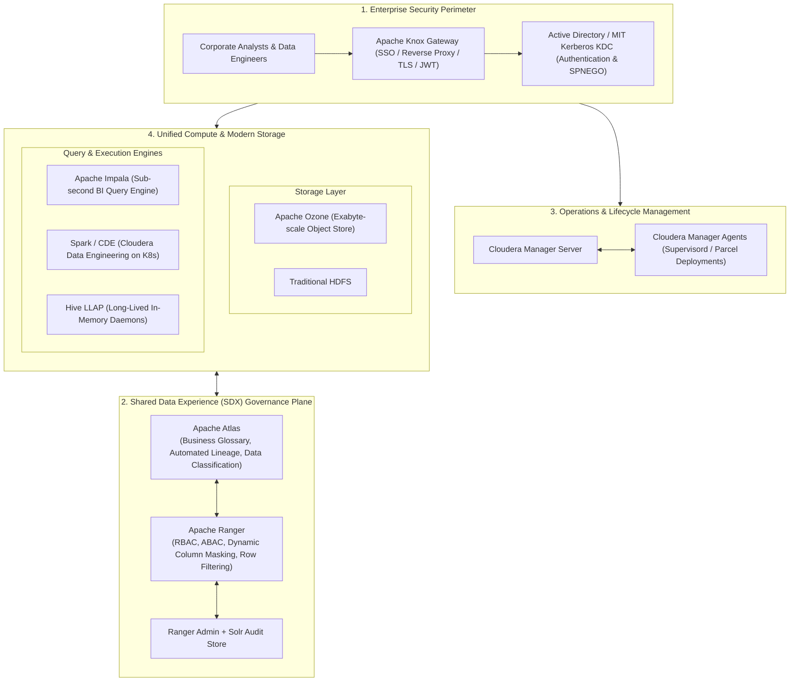

# 🏢 Cloudera Enterprise & CDP (Cloudera Data Platform)

> *"In enterprise Fortune 500 environments, data infrastructure is never just a bare open-source engine. It is wrapped in strict corporate governance, perimeter defense, Kerberos authentication, and automated lifecycle management. CDP represents the enterprise battle-testing of the open-source big data stack."*  
> — **Professor's Field Note**

---

## 🏛️ CDP Enterprise Control Plane Architecture

---

## 📖 Lecture Chapters

1. **[01. CDP Architecture & Evolution](file:///d:/self-learning/cloudera/01_cdp_architecture_and_evolution.md)**
   - The Great Merger: Unifying Cloudera CDH and Hortonworks HDP into CDP.
   - CDP Private Cloud (Base bare-metal vs Data Services on OpenShift / Kubernetes).
   - CDP Public Cloud: Compute elasticity on AWS, Azure, and GCP.
   - Cloudera Manager Internals: Heartbeats, Supervisord process supervision, Parcels, and API automation.

2. **[02. SDX Security: Ranger, Atlas, Knox & Kerberos](file:///d:/self-learning/cloudera/02_sdx_ranger_atlas_knox_security.md)**
   - Shared Data Experience (SDX) architecture.
   - Apache Ranger: Role-Based (RBAC) & Attribute-Based (ABAC) Access Control, Dynamic Column Masking (SHA-256, Partial, Nullify), and Row-Level Filtering.
   - Apache Atlas: Entity modeling, Kafka lineage ingestion hooks, classification tags (e.g., `PII`, `PCI-DSS`).
   - Apache Knox Gateway: Reverse proxy routing, Kerberos encapsulation, and token exchange.
   - Kerberos Deep Dive: Ticket-Granting Tickets (TGT), Service Tickets, Keytabs, SPNEGO, and clock skew.

3. **[03. Query Engines & Modern Storage (Impala, Hive LLAP, Ozone)](file:///d:/self-learning/cloudera/03_cloudera_query_engines_and_storage.md)**
   - Apache Ozone: High-performance distributed object store scaling past NameNode 500M block limits (Ozone Manager + Storage Container Manager).
   - Apache Impala: MPP architecture, `impalad` (Coordinator vs Executor), `statestored`, `catalogd`, and LLVM runtime code generation.
   - Apache Hive 3 & LLAP: Long-Lived and Process daemons, hybrid execution, in-memory caching, and ACID transactional tables.

4. **[04. Cloudera / CDP Interview Mastery](file:///d:/self-learning/cloudera/04_interview_mastery_cloudera_cdp.md)**
   - Enterprise migration strategy: Upgrading legacy CDH 5/6 & HDP 2/3 clusters to CDP 7.x.
   - Kerberos post-mortem: Diagnosing `GSSException: No valid credentials provided` and expired keytabs.
   - Multi-tenant resource isolation: Integrating YARN Queue Manager with Ranger tag-based policies.
