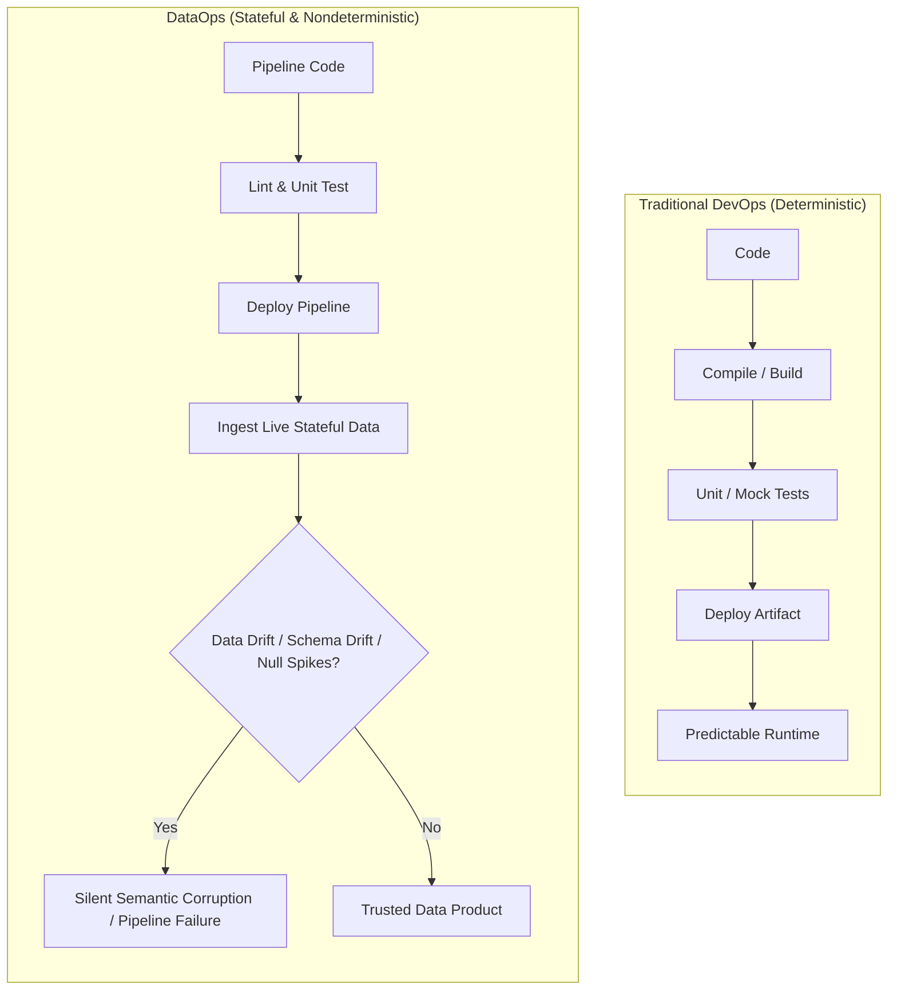
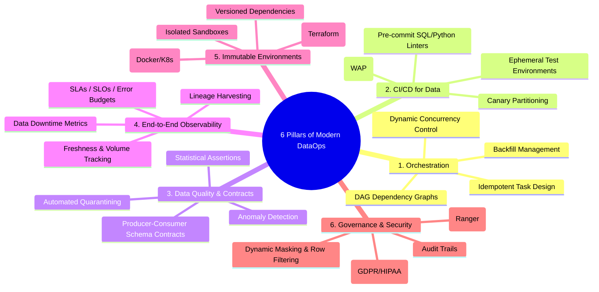
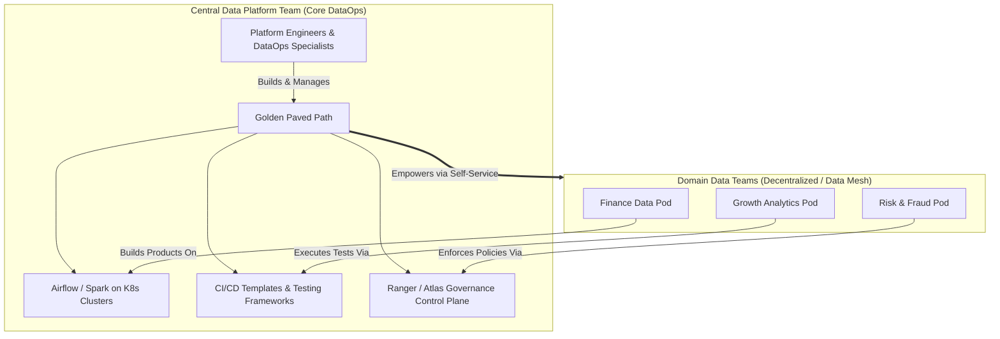

# 🏛️ Lecture 01: DataOps Philosophy, Principles & Lifecycle
### *Prof. DataOps — 20-Year Distributed Systems Perspective*

---

## 1. Why DevOps Fails When Naively Applied to Big Data

In traditional software engineering (DevOps):
$$\text{Code} + \text{Environment} \longrightarrow \text{Predictable Binary / Artifact}$$

Software tests are largely deterministic. If unit tests and integration tests pass in a CI/CD container, the application binary will almost certainly behave predictably in production, assuming identical infrastructure.

In Big Data systems (DataOps):
$$\text{Code} + \text{Environment} + \mathbf{Stateful\ Data} \longrightarrow \mathbf{Unpredictable\ Analytics\ Output}$$

### The Fundamental Differentiators

| Dimension | Traditional Software (DevOps) | Data Pipelines (DataOps) |
| :--- | :--- | :--- |
| **Primary Artifact** | Compiled binary, microservice, container | Living, evolving datasets & ML models |
| **Statefulness** | Services are encouraged to be stateless | Entire system exists to mutate and preserve state |
| **Failure Mode** | Crashes, 500 errors, stack traces (Visible) | **Silent corruption**: wrong numbers, duplicate rows (Invisible) |
| **Testing Target** | Logic, memory leaks, API contracts | Logic **plus** data distribution, schema drift, nullability, volume |
| **Feedback Loop** | Milliseconds to seconds (Unit test runner) | Hours (Running a 50 TB Spark batch job) |
| **Reproducibility** | Git commit hash guarantees identical code | Commit hash does **not** guarantee identical inputs (data changes constantly) |

---

## 2. The 6 Pillars of Modern Enterprise DataOps

### Deep Dive into the 6 Pillars

1. **Automated Orchestration & Lineage**: Workflows must be modeled as Directed Acyclic Graphs (DAGs) where tasks are atomic, idempotent, and emit metadata on completion.
2. **Continuous Integration & Ephemeral Sandboxes**: Every Git Pull Request modifying pipeline code must be automatically validated against isolated, temporary staging environments before touching production tables.
3. **Data Quality & Schema Contracts**: Data entering the platform must be validated at the boundary. Changes to schemas must follow semantic versioning. Data failing validation is quarantined, never dropped or silently ingested.
4. **Data Observability & SRE Metrics**: Monitoring is not just CPU and RAM. It encompasses the **5 Pillars of Data Observability**: Freshness, Volume, Schema, Distribution, and Lineage.
5. **Infrastructure as Code & Environment Parity**: Compute clusters (Spark on K8s/YARN), orchestrators (Airflow), and metastores must be provisioned via Terraform, Helm, or Ansible. No snowflake configurations.
6. **Built-in Governance & Security**: Data security (Apache Ranger/Atlas) is not an afterthought bolted on post-deployment. Policies must be declared as code alongside pipeline definitions.

---

## 3. The DataOps Maturity Model

In technical interviews at big firms (FAANG, tier-1 investment banks), interviewers love asking: *"Where does your current organization sit on the DataOps maturity curve, and how would you take it to the next level?"*

```mermaid
gantt
    title Enterprise DataOps Maturity Model
    dateFormat X
    axisFormat Level %s

    section Level 0: Reactive
    Manual scripts, SSH to nodes, Silent failures :0, 1
    section Level 1: Siloed Automation
    Cron jobs, basic Airflow, no CI/CD, manual fixes :1, 2
    section Level 2: CodeOps for Data
    Git, CI/CD for Airflow DAGs, unit tests, staging DB :2, 3
    section Level 3: Proactive DataOps
    Automated DQ gates, WAP pattern, column lineage, SLOs :3, 4
    section Level 4: Autonomous DataOps
    Self-healing pipelines, automated schema evolution, AI anomaly detection :4, 5
```

### Detailed Breakdown of Levels

- **Level 0 (Ad-Hoc / Reactive)**:
  - Pipelines are triggered via local cron jobs or manually via shell scripts.
  - Data errors are reported by angry business stakeholders or executive dashboard users.
  - Fixes are applied directly in production (`hotfixing` SQL in production databases).
- **Level 1 (Scripted & Siloed)**:
  - Airflow or Oozie is introduced, but DAGs are edited directly on the server or pushed without automated tests.
  - Basic alerts sent to Slack on task failure, but zero visibility into data quality or freshness.
- **Level 2 (CodeOps for Data)**:
  - Code lives in Git. Automated CI pipelines run linters (`sqlfluff`, `flake8`) and unit tests.
  - Separate Dev, Stage, and Prod environments exist, but staging data is stale or mock-only.
- **Level 3 (Proactive DataOps - The Industry Standard for Big Tech)**:
  - Write-Audit-Publish (WAP) pattern implemented: data is written to hidden branches/staging partitions and audited by automated quality suites (Great Expectations/Soda) before publication.
  - Column-level lineage tracked across all transformations (OpenLineage/Atlas).
  - Data contracts enforced between upstream engineering producers and downstream data platforms.
- **Level 4 (Autonomous / Self-Healing)**:
  - Pipelines automatically adapt resources (Spark Adaptive Query Execution, dynamic cluster autoscale).
  - Outliers and anomalous records are automatically diverted to dead-letter queues (DLQs) while the main pipeline finishes on time.
  - Automated backfill reconciliation using snapshot isolation.

---

## 4. Organizational Topologies: Platform DataOps vs. Domain Teams

How do high-performing engineering organizations structure DataOps?

> **The Professor's Golden Rule**:  
> *"The Central DataOps team should NEVER write business logic or SQL transformations. The Central DataOps team builds the **Golden Paved Path**—the self-service CI/CD pipelines, test harnesses, compute clusters, and observability tooling—so that domain data engineers can deploy data products safely in minutes without filing support tickets."*

---

## 5. The 20-Year Veteran's War Stories: 3 Fatal Anti-Patterns

### Anti-Pattern 1: The "Green Pipeline, Garbage Data" Syndrome
- **Symptom**: Airflow shows all tasks green. Spark job exited with code 0. Yet the CEO's dashboard shows $0 revenue for yesterday.
- **Root Cause**: The source database had a network timeout, returning an empty JSON array `[]`. The Spark transformation happily processed 0 records, overwrote the daily partition with an empty table, and succeeded cleanly.
- **The DataOps Fix**: Hard assertions on row count thresholds and statistical distributions before committing output partitions (Zero-row assert fail-safes).

### Anti-Pattern 2: The "Production Staging Divergence" Trap
- **Symptom**: A Spark optimization works flawlessly in Stage, but causes massive OOM (Out Of Memory) crashes and 4-hour GC pauses in Production.
- **Root Cause**: Stage was tested with a 1 GB sample file containing uniform keys. Production received 10 TB with severe data skew (e.g., 40% of records having `user_id = NULL`).
- **The DataOps Fix**: Ephemeral testing using synthetic skew injection or zero-copy read-only clones of real production partition metadata.

### Anti-Pattern 3: The "Unversioned Metadata" Nightmare
- **Symptom**: A developer changes an upstream column type from `INT` to `BIGINT`. Downstream parquet readers fail with `SchemaEvolutionException`, halting 45 dependent downstream pipelines.
- **Root Cause**: Lack of formal Data Contracts and schema enforcement in the CI pipeline.
- **The DataOps Fix**: Automated schema validation in CI using Schema Registry or contract testing tools before merge approval.
