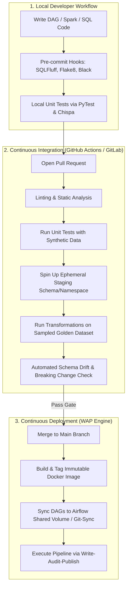

# 🚀 Lecture 02: CI/CD for Data Pipelines
### *Automating Quality, Testing, and Deployment in Big Data Systems*

---

## 1. The Modern Data CI/CD Pipeline Architecture

Deploying changes in a modern data platform requires a dual-track CI/CD architecture: **Code CI/CD** (testing logic and templates) and **Data CI/CD** (verifying schema integrity, migrations, and data state).



---

## 2. Unit Testing Big Data Logic: PySpark & Chispa

A classic junior engineer mistake is deploying Spark jobs directly to a cluster to "see if it works." A senior DataOps engineer tests all business transformations locally inside lightweight pytest suites.

### Testing Transformations with PySpark & Chispa

```python
# transformations.py
from pyspark.sql import DataFrame
from pyspark.sql import functions as F

def clean_and_normalize_transactions(df: DataFrame) -> DataFrame:
    """
    Cleans raw transactions:
    1. Filters out records with null transaction_id
    2. Converts amount to absolute value
    3. Normalizes currency to UPPERCASE
    """
    return (
        df.filter(F.col("transaction_id").isNotNull())
          .withColumn("amount", F.abs(F.col("amount")))
          .withColumn("currency", F.upper(F.col("currency")))
    )
```

```python
# test_transformations.py
import pytest
from pyspark.sql import SparkSession
from chispa.dataframe_comparer import assert_df_equality
from transformations import clean_and_normalize_transactions

@pytest.fixture(scope="session")
def spark():
    return (
        SparkSession.builder
        .master("local[2]")
        .appName("dataops-unit-tests")
        .config("spark.ui.enabled", "false")
        .config("spark.sql.shuffle.partitions", "2")
        .getOrCreate()
    )

def test_clean_and_normalize_transactions(spark):
    source_data = [
        ("tx_01", -150.50, "usd"),
        (None, 200.00, "eur"),          # Should be filtered out
        ("tx_03", 50.00, "gbp")
    ]
    source_df = spark.createDataFrame(source_data, ["transaction_id", "amount", "currency"])

    expected_data = [
        ("tx_01", 150.50, "USD"),
        ("tx_03", 50.00, "GBP")
    ]
    expected_df = spark.createDataFrame(expected_data, ["transaction_id", "amount", "currency"])

    result_df = clean_and_normalize_transactions(source_df)
    
    # Assert schema and data equality with precision tolerance
    assert_df_equality(result_df, expected_df, ignore_row_order=True)
```

---

## 3. The Write-Audit-Publish (WAP) Architectural Pattern

The **Write-Audit-Publish (WAP)** pattern is the gold standard for zero-downtime, zero-corruption data pipelines in high-stakes environments.

```mermaid
sequenceDiagram
    autonumber
    actor Scheduler as Airflow / Orchestrator
    participant Compute as Spark Processing Engine
    participant Staging as Staging Branch / Partition
    participant Auditor as Data Quality Gate (Great Expectations/Soda)
    participant Production as Production Table (Iceberg / Delta)
    actor Consumers as Downstream BI & Dashboards

    Scheduler->>Compute: Trigger Daily Batch Run
    Compute->>Staging: Write data to ephemeral branch or staging partition
    Note over Staging: Data is isolated; production queries cannot see it
    Scheduler->>Auditor: Run automated audit suite on Staging
    
    alt Audit Passes (All assertions 100% OK)
        Auditor-->>Scheduler: Audit SUCCESS
        Scheduler->>Production: Fast-Forward / Atomic Metadata Commit
        Note over Production: Table metadata points to new snapshot
        Consumers->>Production: Query updated trusted data
    else Audit Fails (Null check failed or row count delta > 50%)
        Auditor-->>Scheduler: Audit FAILURE (Alert emitted)
        Scheduler->>Staging: Drop staging branch / Quaratine records
        Note over Production: Production table untouched; consumers read previous clean snapshot
    end
```

### Implementing WAP with Apache Iceberg / Delta Lake

```sql
-- Step 1: Create an ephemeral branch on the target Iceberg table
ALTER TABLE prod_db.fact_transactions CREATE BRANCH audit_branch_20261004;

-- Step 2: Spark writes new records exclusively into the branch
INSERT INTO prod_db.fact_transactions.branch_audit_branch_20261004
SELECT * FROM stage_transactions;

-- Step 3: Run Data Quality checks against the branch
SELECT COUNT(*) FROM prod_db.fact_transactions.branch_audit_branch_20261004 WHERE transaction_id IS NULL;
-- (Must return 0)

-- Step 4: If audit passes, atomically fast-forward production main branch
CALL prod_db.system.fast_forward(
  table => 'prod_db.fact_transactions', 
  branch => 'main', 
  to => 'audit_branch_20261004'
);
```

---

## 4. Production CI/CD Workflow: GitHub Actions Example

Here is an enterprise-grade GitHub Actions workflow demonstrating linting, testing, and DAG validation.

```yaml
name: DataOps CI Pipeline

on:
  pull_request:
    branches: [ main ]
    paths:
      - 'dags/**'
      - 'sql/**'
      - 'transforms/**'

jobs:
  code-quality-and-lint:
    runs-on: ubuntu-latest
    steps:
      - uses: actions/checkout@v3

      - name: Set up Python
        uses: actions/setup-python@v4
        with:
          python-version: '3.10'

      - name: Install Linting Tools
        run: |
          pip install flake8 black sqlfluff

      - name: Lint Python Code
        run: |
          black --check dags/ transforms/
          flake8 dags/ transforms/ --max-line-length=120

      - name: Lint SQL Transformations
        run: |
          sqlfluff lint sql/ --dialect sparksql

  unit-and-dag-tests:
    runs-on: ubuntu-latest
    needs: code-quality-and-lint
    steps:
      - uses: actions/checkout@v3

      - name: Set up Java & Python
        uses: actions/setup-java@v3
        with:
          distribution: 'temurin'
          java-version: '17'

      - name: Install Dependencies
        run: |
          pip install pyspark pytest chispa apache-airflow

      - name: Test Airflow DAG Integrity (No Cyclic Dependencies / Syntax Errors)
        run: |
          python -m pytest tests/test_dag_integrity.py

      - name: Run Spark Unit Tests
        run: |
          python -m pytest tests/unit/
```

### The DAG Integrity Test (`test_dag_integrity.py`)

A vital test in every enterprise repository to catch syntax errors and cyclic dependencies before Airflow loads them:

```python
import os
import pytest
from airflow.models import DagBag

def test_dag_bag_import():
    """Verify that all DAGs compile with ZERO import errors or cycles."""
    dag_bag = DagBag(dag_folder="dags/", include_examples=False)
    
    assert len(dag_bag.import_errors) == 0, f"DAG import failures: {dag_bag.import_errors}"
    
    for dag_id, dag in dag_bag.dags.items():
        # Check for cycles
        assert not dag.test_cycle(), f"Cycle detected in DAG: {dag_id}"
        # Ensure owner is assigned
        assert dag.default_args.get("owner") is not None, f"DAG {dag_id} missing owner"
        # Ensure retries are configured
        assert dag.default_args.get("retries", 0) >= 1, f"DAG {dag_id} has no retry policy"
```
