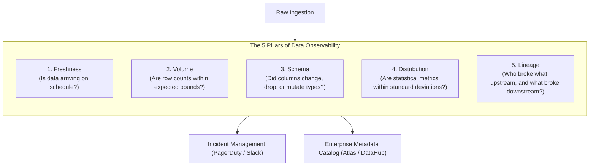
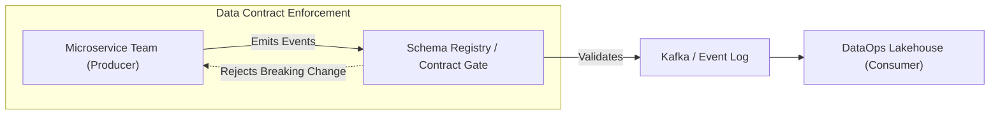
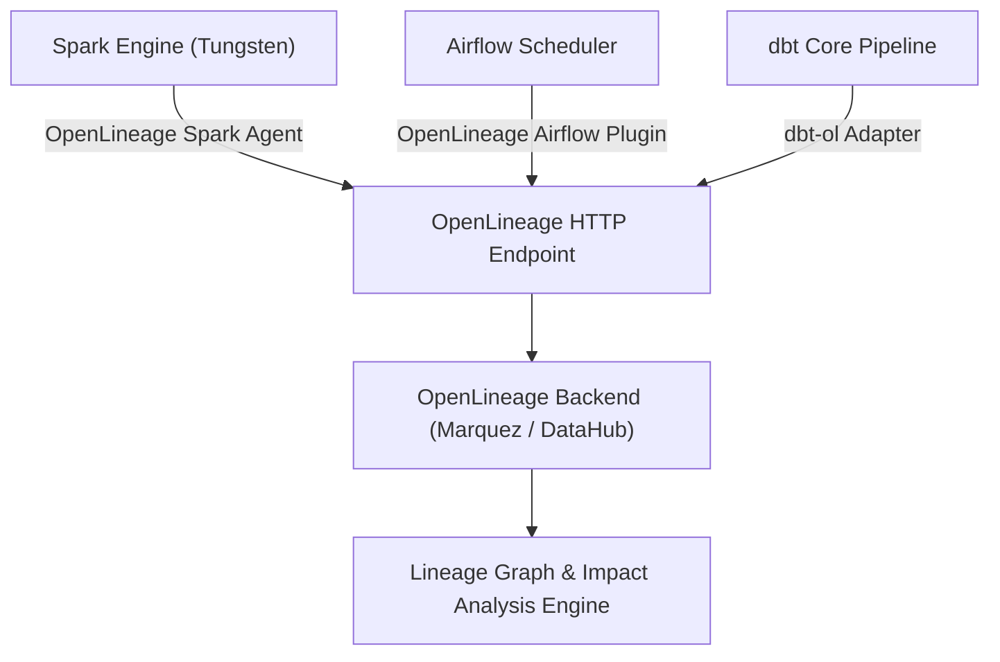

# 📊 Lecture 03: Data Quality, Contracts & Observability
### *The 5 Pillars of Observability, Automated Assertions, and Lineage*

---

## 1. The 5 Pillars of Data Observability

Monitoring infrastructure (CPU, memory, disk I/O) only tells you if the servers are alive. **Data Observability** tells you if the **data itself** is trustworthy.



### Breakdown of the 5 Pillars

| Pillar | Metric / Indicator | Detection Mechanism | Example Failure Caught |
| :--- | :--- | :--- | :--- |
| **1. Freshness** | Pipeline latency, partition timestamp vs wall clock | Max timestamp checks, SLA sensors | Upstream Kafka consumer lagged 6 hours |
| **2. Volume** | Row counts, byte size per partition | Rolling average $\pm 3\sigma$ Z-score | Upstream API paginated improperly, losing 80% records |
| **3. Schema** | Column presence, data types, nullability | Schema diffing vs catalog contract | Mobile app release changed `user_id` from INT to UUID string |
| **4. Distribution** | % Nulls, min/max bounds, cardinality, mean/median | Histogram profiling, Great Expectations | Currency conversion bug produced negative account balances |
| **5. Lineage** | Column-level DAG lineage, dataset dependencies | OpenLineage hooks, Spark execution plans | Upstream deprecation breaks 3 Tableau executive dashboards |

---

## 2. Data Contracts: The Producer-Consumer Pact

The leading cause of data pipeline outages across tech companies is **unannounced upstream changes** (e.g., software engineers modifying a PostgreSQL table column or backend microservice payload).

A **Data Contract** is an explicit, versioned, API-like agreement between the software team producing data and the data platform team consuming it.



### Anatomy of an Enterprise Data Contract (YAML Specification)

```yaml
version: 1.0.0
dataset: orders_v2
owner: team-checkout@enterprise.com
sla:
  freshness_minutes: 15
  availability_percent: 99.9

schema:
  - column: order_id
    type: string
    description: "UUID v4 unique transaction identifier"
    constraints:
      not_null: true
      unique: true
  - column: order_amount_cents
    type: bigint
    description: "Total order value in cents (prevents floating point errors)"
    constraints:
      not_null: true
      min_value: 0
      max_value: 5000000
  - column: currency
    type: string
    constraints:
      enum: ["USD", "EUR", "GBP", "CAD", "JPY"]

compatibility_mode: BACKWARD
```

---

## 3. Data Quality in Action: Soda Core & Great Expectations

### 1. Declarative Testing with Soda Core

```yaml
# checks_transactions.yml
checks for fact_transactions:
  # Freshness assertion
  - freshness(created_at) < 1h
  
  # Volume anomaly detection
  - row_count between 10000 and 500000
  
  # Completeness assertions
  - missing_count(transaction_id) = 0
  - missing_percent(user_id) < 0.1%
  
  # Validity & Business logic
  - invalid_count(currency) = 0:
      valid values: ['USD', 'EUR', 'GBP']
  - min(amount) >= 0.00
  - duplicate_count(transaction_id) = 0
```

### 2. Great Expectations Checkpoint Execution in Python

```python
import great_expectations as gx

context = gx.get_context()

# Load expectation suite
suite = context.get_expectation_suite("prod_transactions_suite")

# Set up batch request
batch_request = {
    "datasource_name": "spark_lakehouse",
    "data_connector_name": "default_runtime_connector",
    "data_asset_name": "fact_transactions",
    "runtime_parameters": {"query": "SELECT * FROM prod.fact_transactions WHERE partition_date = current_date()"},
    "batch_identifiers": {"default_identifier_name": "daily_partition"}
}

# Run Checkpoint
checkpoint = context.run_checkpoint(
    checkpoint_name="daily_transactions_checkpoint",
    batch_request=batch_request,
    expectation_suite_name="prod_transactions_suite"
)

if not checkpoint["success"]:
    raise ValueError("❌ Data Quality Gate FAILED! Halting publication to main branch.")
print("✅ Data Quality validation PASSED.")
```

---

## 4. End-to-End Lineage with OpenLineage & Metadata Architecture



- When a Spark job executes, the `openlineage-spark` agent hooks into Spark's `QueryExecution` listener.
- It parses the logical plan, extracts the exact source tables, target tables, filter predicates, and column mappings, and emits standard JSON events:
  - `START` event (job name, run ID, inputs).
  - `COMPLETE` event (output dataset, row count, byte size, schema).
  - `FAIL` event (exception stack trace).

---

## 5. Defining SLAs, SLOs, and Error Budgets for Data

| Metric Type | Service Level Indicator (SLI) | Service Level Objective (SLO) | Action on Error Budget Depleted |
| :--- | :--- | :--- | :--- |
| **Freshness** | Minutes elapsed between midnight and table update | 99% of days table is ready by 06:00 AM EST | Freeze feature releases; engineer pipeline acceleration |
| **Accuracy** | % of records passing all schema & business assertions | $\ge 99.95\%$ valid records per batch | Divert bad records to quarantine; fail job if error rate $> 0.05\%$ |
| **Completeness** | Ratio of ingested records vs producer event count | $\ge 99.999\%$ reconciliation rate | Trigger automated backfill from source change log |
| **Availability** | % of successful read queries executed against table | 99.9% uptime (Max 43 mins downtime/mo) | Auto-scale query engine replicas (Impala/Trino) |
