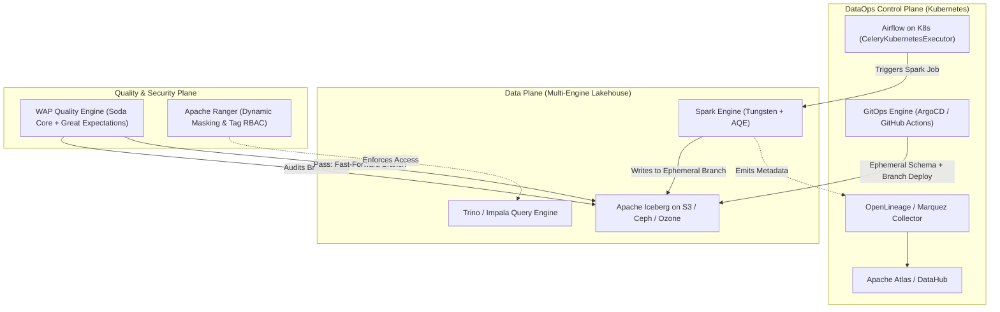
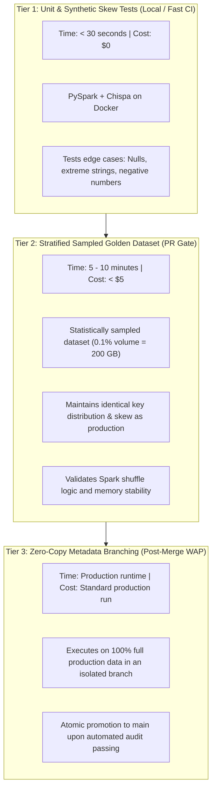

# 🎯 Lecture 04: DataOps Interview Mastery
### *Tier-1 Firm System Design, Incident Post-Mortems, and Architectural Scenarios*

---

## 🏆 Tier-1 Technical Interview Question 1: System Design

> **The Prompt**:  
> *"You are the Lead DataOps Architect at a global FinTech processing 25 TB of streaming transactions and 150 TB of analytical warehouse data daily. You have 300 data analysts and engineers deploying models and DAGs. Design an end-to-end DataOps platform that provides automated testing, zero-downtime deployments, data observability, and contract enforcement."*

### The Staff/Principal Answer Blueprint



#### Key Architecture Components to Highlight
1. **Isolated Testing via Zero-Copy Metadata Branching**:
   - Never copy 150 TB of physical data for testing.
   - Utilize Apache Iceberg / Delta Lake **table branching**. A branch takes only bytes of metadata pointer storage while providing full read/write isolation.
2. **Write-Audit-Publish (WAP) Engine**:
   - The production pipeline writes new partition data to an uncommitted branch or staging table.
   - Automated quality gates (Soda/Great Expectations) validate constraints (referential integrity, distribution bounds, null checks).
   - If tests pass, perform an atomic metadata swap. Downstream BI queries never experience dirty reads or table locks.
3. **Automated Lineage Harvesting**:
   - Implement OpenLineage agent listeners on Spark `SparkListener` and Airflow DAGs.
   - When a failure or schema alteration occurs, the control plane immediately executes graph traversal to identify impacted downstream consumers and issues targeted alerts.

---

## 🚨 Tier-1 Interview Question 2: The 3 AM Incident Post-Mortem

> **The Prompt**:  
> *"It is Monday morning. The Chief Financial Officer reports that revenue for the last 3 days was underreported by $14 Million on executive dashboards. The pipeline ran green in Airflow. Walk me through your incident response, root cause analysis, backfill strategy, and permanent preventive DataOps controls."*

### Recommended 4-Phase Response

#### Phase 1: Triage & Blast Radius Containment (< 15 mins)
- **Tag the Data**: Immediately flag the affected partitions in the metadata catalog (Atlas/DataHub) with a `QUARANTINED_UNRELIABLE` tag.
- **Alert Downstream Consumers**: Notify executive reporting and analyst channels. Temporarily freeze automated downstream syncing to CRM or financial reporting databases to prevent compounding corrupt data.
- **Identify Affected Time Window**: Query partition commit timestamps to isolate the exact commit where the discrepancy originated.

#### Phase 2: Root Cause Analysis (RCA)
- Compare the row count and distribution of inputs vs outputs across the historical 30-day baseline:
  ```sql
  -- Checking volume drop
  SELECT partition_date, COUNT(*), SUM(transaction_amount) 
  FROM fact_revenue 
  WHERE partition_date >= CURRENT_DATE - INTERVAL 7 DAYS 
  GROUP BY 1 ORDER BY 1 DESC;
  ```
- **The Discovery**: An upstream microservice team migrated their database from MySQL to PostgreSQL. A status field changed from `COMPLETED` to `completed` (lowercase). The Spark SQL pipeline had a hardcoded `WHERE status = 'COMPLETED'`. The job processed only records from legacy non-migrated nodes, dropping 70% of real transactions silently!

#### Phase 3: Idempotent Backfill Strategy
- **Fix the Code**: Update the filter to case-insensitive comparison (`UPPER(status) = 'COMPLETED'`).
- **Leverage Snapshot Isolation & WAP**:
  - Do **not** run an in-place `DELETE WHERE partition_date IN (...)` on the live table!
  - Write the corrected data to an Iceberg branch: `fact_revenue.branch_backfill_202610`.
  - Validate the backfilled numbers match raw bank settlement ledgers down to the cent.
  - Execute an atomic partition replacement (`REPLACE INTO` or fast-forward commit).

#### Phase 4: Permanent DataOps Safeguards
- **Implement a Volume Anomaly Gate**:
  - Add a Soda check: `row_count between (previous_7_day_avg * 0.85) and (previous_7_day_avg * 1.15)`. If row count drops $>15\%$, pipeline automatically fails before publishing.
- **Formalize Data Contracts**:
  - Enforce schema enum constraints on upstream producers using Avro/Protobuf Schema Registry. Changes to enum casing trigger automated build breaks in the producer's repository.

---

## ⚡ Tier-1 Interview Question 3: Ephemeral CI/CD for Multi-Petabyte Pipelines

> **The Prompt**:  
> *"Our data pipeline runs on 200 TB of data with complex Spark join graphs. Running tests on the full dataset in CI is cost-prohibitive ($5,000 per PR) and takes 4 hours. Testing on 10 rows of mock data fails to catch edge-case bugs and data skew. How do you design an ephemeral testing strategy that is both fast, cost-effective, and mathematically representative?"*

### The Principal Architect Solution: The "3-Tier Test Pyramid for Data"



1. **Stratified Sampling over Random Sampling**:
   - Random sampling (`df.sample(0.01)`) destroys join keys and referential integrity! If you sample 1% of table A and 1% of table B, only $0.01 \times 0.01 = 0.0001$ (0.01%) of join keys match.
   - Use **Stratified Hash Sampling**: Hash the primary join key (`hash(user_id) % 100 == 0`). This guarantees 100% of related records across all joined tables are preserved in the sample.
2. **Metadata-Only Branching for Full-Scale Validation**:
   - Run production executions exclusively on write-audit-publish branches. This combines the safety of staging with the veracity of full production data.
