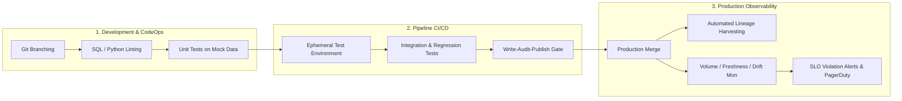

# ⚙️ DataOps Foundations & Modern Lifecycle

> *"DataOps is not just DevOps for data. Code is deterministic; data is dirty, stateful, unbounded, and unpredictable. Applying CI/CD to data requires treating data state as a first-class citizen."*  
> — **Professor's Field Note**

## 📚 Module Overview

DataOps is an automated, process-oriented methodology used by data leaders to improve the quality and reduce the cycle time of data analytics. While traditional software engineering focuses on compiling, testing, and shipping code artifacts, DataOps must continuously validate **code + configuration + evolving stateful data**.

---

## 📖 Lecture Chapters

1. **[01. Philosophy, Principles & Lifecycle](file:///d:/self-learning/dataops/01_dataops_philosophy_and_lifecycle.md)**
   - Core thesis: Why DevOps failed when applied directly to Big Data.
   - The 6 foundational pillars of enterprise DataOps.
   - The DataOps Maturity Model (Level 0 to Level 4).
   - Team Topologies: Platform DataOps vs Embedded Data Engineers.

2. **[02. CI/CD for Data Pipelines](file:///d:/self-learning/dataops/02_cicd_for_data_pipelines.md)**
   - Continuous Integration: Pre-commit hooks, SQLFluff, Pytest for Spark/Python transforms.
   - Ephemeral testing environments (zero-copy cloning vs sampled sandboxes).
   - The **Write-Audit-Publish (WAP)** pattern with open table formats.
   - Automated deployment strategies: Blue/Green vs Canary deployments for data pipelines.

3. **[03. Data Quality, Contracts & Observability](file:///d:/self-learning/dataops/03_data_quality_and_observability.md)**
   - The 5 Pillars of Data Observability: Freshness, Volume, Schema, Distribution, Lineage.
   - Data Quality Frameworks: Great Expectations, Soda Core, and dbt tests.
   - Data Contracts: Schema Registry, Protobuf/JSON schema enforcement between producers and consumers.
   - OpenLineage & Metadata Architecture: Tracing column-level lineage end-to-end.
   - Defining SLIs, SLOs, and Error Budgets for data products.

4. **[04. DataOps Interview Mastery](file:///d:/self-learning/dataops/04_interview_mastery_dataops.md)**
   - Real-world FAANG / Tier-1 technical interview questions.
   - Architecture scenario: Designing an enterprise DataOps platform processing 10 TB/day.
   - Post-mortem walkthrough: How to respond when corrupted data silently leaks into executive dashboards.
