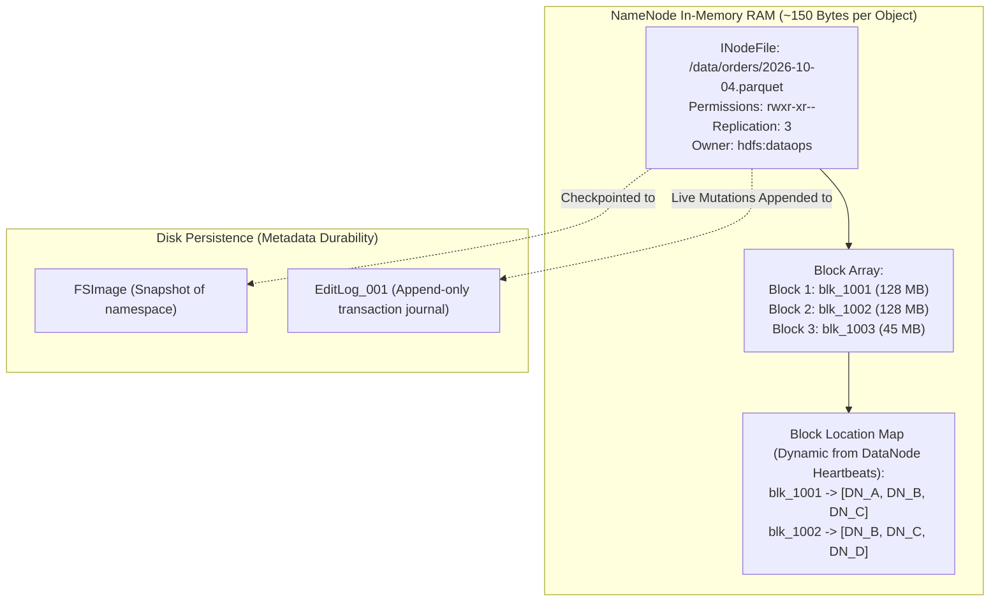
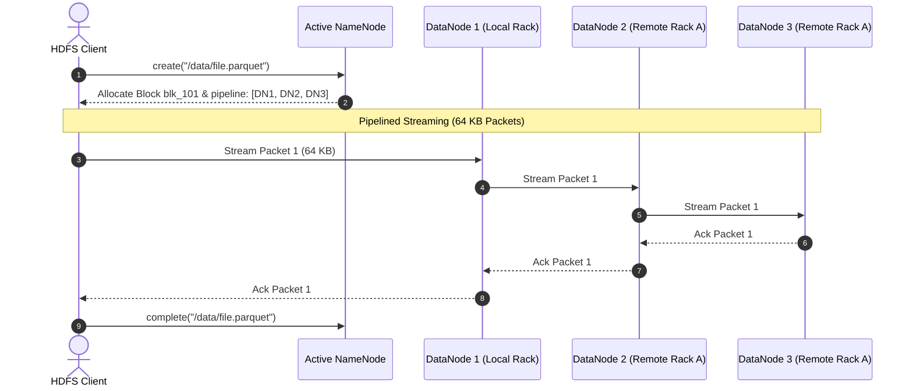

# 🏛️ Lecture 01: HDFS Architecture & Internals
### *The Mechanics of Scalable Distributed Storage*

---

## 1. The Core Philosophy of HDFS

Hadoop Distributed File System (HDFS) was conceived with three foundational assumptions:
1. **Hardware Failure is the Norm, Not the Exception**: When running on thousands of commodity servers, multiple drives and nodes will fail every single day. The file system must self-heal without human intervention.
2. **Streaming Data Access over Random Access**: Applications are designed for batch processing rather than interactive OLTP. High sustained read throughput is prioritized over low random-access latency.
3. **Write-Once, Read-Many (WORM)**: Files cannot be updated in-place (no random writes). Appends are supported, but typical workloads write complete files once and read them hundreds of times.

---

## 2. NameNode Metadata Architecture: Memory Layout

The NameNode is the master node of HDFS. It does **not** store actual file data. It stores the file system namespace and the mapping of files to blocks in memory (JVM Heap).



### The 150-Byte Inode Rule & Heap Sizing Calculation

In enterprise HDFS, every file, directory, and individual block consumes approximately **150 bytes of NameNode JVM heap**.

$$\text{NameNode Memory} \approx (\text{NumFiles} + \text{NumDirectories} + \text{NumBlocks}) \times 150\text{ bytes}$$

#### ⚠️ The Small Files Catastrophe
Consider storing **100 Million files**, each 10 KB in size:
- **Total Data on Disk**: $100{,}000{,}000 \times 10\text{ KB} = 1\text{ TB}$ (Trivial).
- **NameNode RAM Consumed**:
  $$100{,}000{,}000\text{ files} + 100{,}000{,}000\text{ blocks} = 200{,}000{,}000\text{ objects}$$
  $$200{,}000{,}000 \times 150\text{ bytes} \approx 30\text{ GB of Heap}$$
The NameNode will collapse under garbage collection pauses, despite having 99% of its storage disks empty!

---

## 3. High Availability (HA) & Quorum Journal Manager (QJM)

In early Hadoop (v1), the NameNode was a single point of failure (SPOF). In Hadoop 2.x and 3.x, **Active/Standby High Availability** is achieved using the **Quorum Journal Manager (QJM)** and **ZooKeeper**.

```mermaid
flowchart TB
    subgraph HA_Control["HA & Leader Election"]
        ZK["ZooKeeper Ensemble (3 or 5 nodes)"]
        ZKFC_Active["ZKFC (Active Watcher)"]
        ZKFC_Standby["ZKFC (Standby Watcher)"]
        ZK <--> ZKFC_Active
        ZK <--> ZKFC_Standby
    end

    subgraph MasterNodes["NameNode Pair"]
        ActiveNN["Active NameNode (Serving Reads/Writes)"]
        StandbyNN["Standby NameNode (Warm Backup)"]
        ZKFC_Active <--> ActiveNN
        ZKFC_Standby <--> StandbyNN
    end

    subgraph Quorum["Quorum Journal Nodes (QJM)"]
        JN1["JournalNode 1"]
        JN2["JournalNode 2"]
        JN3["JournalNode 3"]
    end

    ActiveNN -->|1. Append Edits (Majority Quorum Ack)| JN1
    ActiveNN -->|1. Append Edits (Majority Quorum Ack)| JN2
    ActiveNN -->|1. Append Edits (Majority Quorum Ack)| JN3

    JN1 -->|2. Pull & Replay Edits| StandbyNN
    JN2 -->|2. Pull & Replay Edits| StandbyNN
    JN3 -->|2. Pull & Replay Edits| StandbyNN

    DN["DataNodes (Cluster Fleet)"] -->|Heartbeats & Block Reports| ActiveNN
    DN -->|Heartbeats & Block Reports| StandbyNN
```

### The Fencing Mechanism (Preventing Split-Brain)
A **split-brain** occurs when network partitions cause both NameNodes to believe they are the Active master. If both accept writes, metadata is permanently corrupted.

HDFS enforces fencing:
1. **Epoch Numbers**: The JournalNodes assign an incremental epoch number to the active master. Any edit from an older epoch is rejected by the quorum.
2. **Fencing Scripts**: ZKFC invokes fencing scripts (e.g., executing `ssh` to kill the old process or cutting IPMI power to the server).

---

## 4. Block Placement Policy & The Pipelined Write

Default block size is **128 MB** (or **256 MB** for large analytical clusters). By default, replication factor is **3**.



### The 3-Replica Placement Algorithm
1. **Replica 1**: Placed on the local node where the client process is running (if the client is a DataNode); otherwise, placed on a randomly chosen node in the cluster.
2. **Replica 2**: Placed on a **different rack** from Replica 1 (protects against complete Top-of-Rack [ToR] switch or rack power failure).
3. **Replica 3**: Placed on a **different node in the same rack as Replica 2** (optimizes cross-rack switch bandwidth during write pipelining while preserving multi-rack redundancy).

---

## 5. SafeMode: The Boot Sequence

When the NameNode boots:
1. It loads the `FSImage` from disk into RAM.
2. It replays uncommitted transactions from `EditLogs`.
3. It enters **SafeMode** (Read-Only mode). During SafeMode, the NameNode does **not** allow any block creations or deletions.
4. DataNodes connect and transmit their **Block Reports** (the list of blocks physically stored on their local drives).
5. SafeMode exits only when:
   $$\frac{\text{Reported Blocks}}{\text{Total Namespace Blocks}} \ge \text{dfs.namenode.safemode.threshold-pct (Default: 0.999)}$$
   and the minimum live DataNode count threshold is satisfied.
