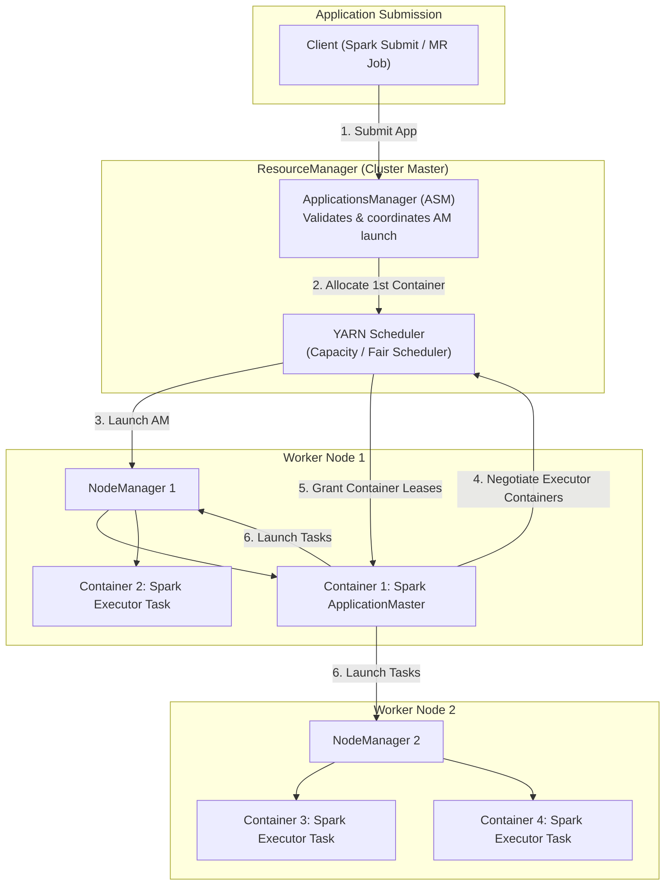
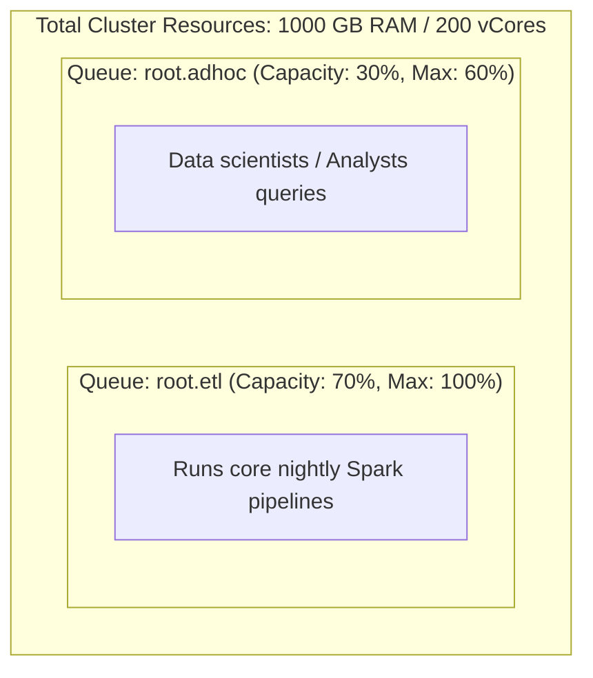
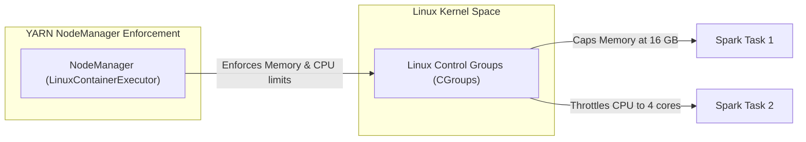

# ⚙️ Lecture 02: YARN Resource Management
### *Distributed Resource Scheduling, Containers & Multi-Tenancy*

---

## 1. The Genesis of YARN (MapReduce v1 vs. YARN)

In Hadoop 1.x, resource management was coupled to the MapReduce programming model via the `JobTracker` and `TaskTracker`. This had catastrophic limits:
1. **Single JobTracker Bottleneck**: Scalability capped at ~4,000 nodes and 40,000 concurrent tasks.
2. **Fixed Slots Architecture**: Nodes were statically partitioned into "Map Slots" and "Reduce Slots". If 1,000 Map slots were idle and 1,000 Reduce jobs were queued, the cluster sat idle.
3. **Monolithic Programming Model**: You could only run MapReduce. No Spark, no Flink, no MPI.

**YARN (Yet Another Resource Negotiator)** separated resource management from compute execution.



---

## 2. Complete Application Submission Lifecycle

1. **Submission**: Client contacts the `ApplicationsManager` (ASM) with the application package and resource specifications.
2. **AM Container Allocation**: ASM validates security tokens (Kerberos) and requests a container from the `YARN Scheduler` to run the `ApplicationMaster` (AM).
3. **AM Launch**: The designated `NodeManager` spawns the AM container.
4. **Resource Negotiation**: The AM contacts the YARN Scheduler, requesting containers across specific racks/nodes based on data locality.
5. **Execution**: The AM communicates with NodeManagers across the cluster to launch containers and execute task code.
6. **Completion & Deallocation**: The AM unregisters with the RM, and all allocated container resources are reclaimed.

---

## 3. Schedulers: Capacity vs. Fair Scheduler

| Feature | Capacity Scheduler (Standard in CDP / Enterprise) | Fair Scheduler |
| :--- | :--- | :--- |
| **Primary Philosophy** | Guaranteed minimum capacity for departments; elastic borrowing of idle capacity | Maximize equal resource sharing dynamically among active jobs |
| **Hierarchy** | Deep tree of hierarchical queues (`root.prod.etl`, `root.analytics`) | Hierarchical pools / queues |
| **Preemption** | Supported (reclaims borrowed capacity if queue demand rises) | Supported (preempts containers if a queue stays below fair share for $T$ seconds) |
| **Multi-Tenancy** | Rigid user limits (`minimum-user-limit-percent`), ACL controls | Dynamic weights assigned to queues |

### Capacity Scheduler Elasticity in Action



- When `root.adhoc` is idle at night, `root.etl` can burst up to **100%** of cluster resources.
- The instant an analyst submits a query to `root.adhoc`, YARN either assigns newly freed containers or **preempts** (terminates) lower-priority ETL containers to return `root.adhoc` to its guaranteed 30%.

---

## 4. Node Sizing & Resource Allocation Mathematics

A critical skill tested in Big Data Principal Engineer interviews is configuring NodeManager memory and CPU allocations without crashing the OS.

### Worker Node Hardware Baseline Example
Suppose each worker node has:
- **RAM**: 256 GB physical ECC RAM.
- **CPU**: 32 Physical Cores (64 vCores with Hyperthreading).
- **Disks**: 12 x 4 TB JBOD SAS Drives.

#### Step 1: Reserve Memory for OS and Co-Located Daemons
```
OS & Kernel System Cache:             16 GB
HDFS DataNode Heap:                   4 GB
YARN NodeManager Heap:                4 GB
Other Daemons (Ranger Agent, Metrics): 4 GB
------------------------------------------------
Total Reserved:                       28 GB
```

#### Step 2: Calculate Usable YARN Memory
$$\text{yarn.nodemanager.resource.memory-mb} = (256\text{ GB} - 28\text{ GB}) \times 1024 = 233{,}472\text{ MB} \approx 228\text{ GB}$$

#### Step 3: Calculate Usable YARN vCores
Reserve 2–4 physical cores for the OS, DataNode, and NodeManager threads:
$$\text{yarn.nodemanager.resource.cpu-vcores} = 64\text{ hyperthreaded cores} - 8\text{ reserved} = 56\text{ vCores}$$

---

## 5. Resource Isolation: Linux CGroups

Without CGroups, a single rogue task (e.g., a buggy C++ native library invoked via JNI or an unbounded PySpark memory leak) could allocate all physical RAM on a worker node, triggering the Linux kernel **OOM Killer** (`out_of_memory`), which might terminate the `DataNode` or `NodeManager` process itself!



### Essential `yarn-site.xml` CGroups Configuration

```xml
<configuration>
  <!-- Use LinuxContainerExecutor for strict kernel isolation -->
  <property>
    <name>yarn.nodemanager.container-executor.class</name>
    <value>org.apache.hadoop.yarn.server.nodemanager.LinuxContainerExecutor</value>
  </property>
  
  <!-- Enable CGroups for CPU isolation and throttling -->
  <property>
    <name>yarn.nodemanager.linux-container-executor.cgroups.mount</name>
    <value>true</value>
  </property>
  <property>
    <name>yarn.nodemanager.linux-container-executor.resources-handler.class</name>
    <value>org.apache.hadoop.yarn.server.nodemanager.util.CgroupsLCEResourcesHandler</value>
  </property>

  <!-- Prevent CPU starvation: strict limits prevent containers from consuming >100% allocated -->
  <property>
    <name>yarn.nodemanager.linux-container-executor.cgroups.strict-resource-usage</name>
    <value>true</value>
  </property>
</configuration>
```
