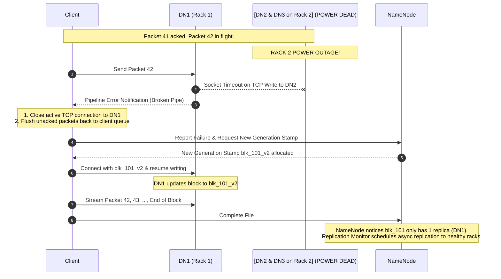

# 🎯 Lecture 04: Hadoop Interview Mastery
### *Tier-1 Distributed Systems Interview Scenarios & Whiteboard Solutions*

---

## 🏆 Question 1: NameNode JVM Sizing & GC Architecture

> **The Prompt**:  
> *"We are designing an on-premises HDFS cluster intended to store 600 Million files with an average of 1.2 blocks per file and a replication factor of 3. What is the required NameNode heap size? Which Java Garbage Collector would you configure, and why?"*

### The Staff Engineer Solution

#### 1. Calculate the Total Inode and Block Metadata Objects
- **Files**: $600{,}000{,}000$
- **Directories** (assuming ~10% ratio): $60{,}000{,}000$
- **Total Blocks** (Namespace block objects): 
  $$\text{Blocks} = 600{,}000{,}000 \times 1.2 = 720{,}000{,}000\text{ blocks}$$
- **Total Objects in NameNode In-Memory Tree**:
  $$\text{Total Objects} = 600\text{M} + 60\text{M} + 720\text{M} = 1{,}380{,}000{,}000\text{ objects (1.38 Billion)}$$

#### 2. Apply the 150-Byte Rule
Each metadata object (inode and block descriptor) occupies approximately **150 bytes** of memory:
$$\text{Raw Metadata Footprint} = 1{,}380{,}000{,}000 \times 150\text{ bytes} \approx 207{,}000{,}000{,}000\text{ bytes} \approx 192.7\text{ GB}$$

#### 3. Account for JVM Operational Overhead (RPC buffers, GC headroom)
Never size JVM heap to 100% of live data. Add **30%–40% headroom** for RPC connection queues, DataNode block report processing buffers, and GC generational copying spaces:
$$\text{Recommended Heap} \approx 193\text{ GB} \times 1.35 \approx 260\text{ GB}$$

#### 4. Garbage Collector Selection
- **Do NOT use ParallelGC**: A 260 GB heap running Stop-The-World mark-sweep will trigger multi-minute pauses, causing ZooKeeper heartbeats to timeout and inducing false failovers!
- **Use G1GC (Garbage-First GC) or ZGC**:
  ```bash
  -Xms260g -Xmx260g -XX:+UseG1GC 
  -XX:InitiatingHeapOccupancyPercent=45 
  -XX:MaxGCPauseMillis=200 
  -XX:G1ReservePercent=15
  ```

---

## 🚨 Question 2: Power Outage on Active Write Pipeline

> **The Prompt**:  
> *"A client is streaming a 256 MB block into HDFS across the pipeline `Client -> DN1 (Rack 1) -> DN2 (Rack 2) -> DN3 (Rack 2)`. While writing packet 42, the entire Rack 2 loses power simultaneously (killing both DN2 and DN3). Walk me through the exact network and protocol recovery steps taken by the client and the NameNode."*



### Key Recovery Mechanics
1. **Pipeline Error Handling**: The client detects the socket failure when packet acknowledgments stop flowing back.
2. **Generation Stamp Bump**: The client contacts the NameNode to increment the block's **Generation Stamp**. This invalidates any partial or stale fragments sitting on the crashed DataNodes if they ever reboot.
3. **Degraded Pipeline Continuation**: The client can either request a replacement node from the NameNode or continue writing with the remaining healthy DataNode (DN1) alone, provided minimum replication constraints (`dfs.client.block.write.replace-datanode-on-failure.policy`) are satisfied.
4. **Asynchronous Self-Healing**: Once the file is closed, the NameNode's internal `UnderReplicatedBlocks` queue detects that block `blk_101` has only 1 replica (less than target of 3). The NameNode commands DN1 to replicate the block to two other live nodes on different racks asynchronously.

---

## 💥 Question 3: The 50-Million Small Files Production Emergency

> **The Prompt**:  
> *"You join a company where thousands of IoT devices dump 2 KB JSON files directly into HDFS every 10 seconds. The cluster currently has 50 Million files. The NameNode is constantly hanging, GC pauses exceed 40 seconds, and query performance has ground to a halt. You cannot afford downtime. How do you resolve this?"*

### Immediate Triage (< 24 Hours)
1. **Hadoop Archive (HAR) Tool**:
   - Run a distributed MapReduce job to pack directory trees into Hadoop Archives:
     ```bash
     hadoop archive -archiveName telemetry_202610.har -p /data/raw_iot/2026-10 /data/archived_iot
     ```
   - A HAR file acts like a virtual filesystem containing a single index file and combined data blocks, reducing thousands of inodes to 1 block on the NameNode.

### Long-Term Architectural Remediation
1. **Buffer & Microbatch at Ingestion (DataOps Fix)**:
   - Introduce **Apache Kafka + Kafka Connect / Spark Structured Streaming** upstream of HDFS.
   - Buffer IoT events in Kafka and write them out to HDFS/Lakehouse in compressed **128 MB Apache Parquet** files using 15-minute microbatches.
2. **Modernization to Apache Ozone**:
   - For workloads that fundamentally require billions of small objects, migrate from HDFS to **Apache Ozone**.
   - Ozone separates namespace management (Ozone Manager) from block storage (Storage Container Manager), scaling comfortably to **10 Billion+ objects** without NameNode memory limits.
