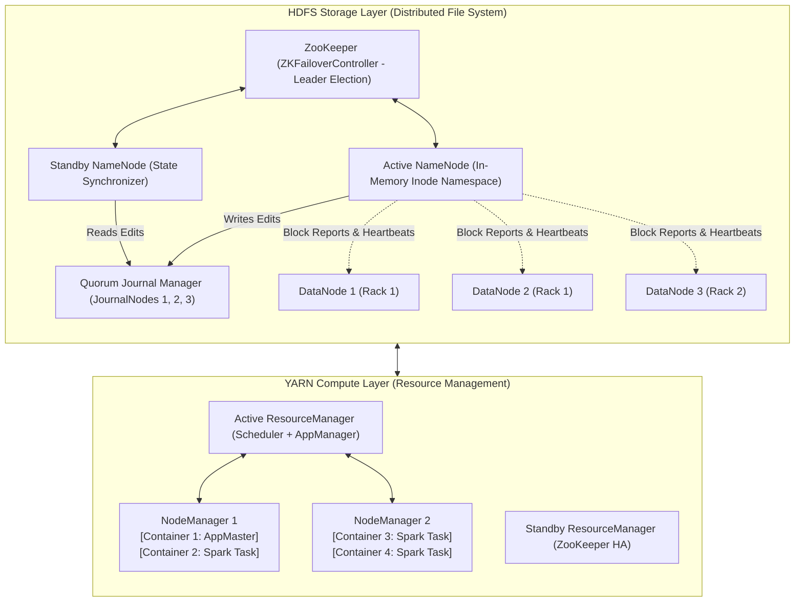

# 🐘 Hadoop & Distributed Systems Foundations

> *"Anyone who tells you Hadoop is dead has never audited the core infrastructure of the world's top 10 investment banks, telecom networks, or healthcare conglomerates. Furthermore, every modern system—Spark, Kafka, Flink, Iceberg, Ozone—was built on top of or in direct reaction to the core design principles of HDFS, YARN, and the MapReduce shuffle."*  
> — **Professor's Field Note**

---

## 🏛️ Hadoop Distributed Architecture Blueprint

---

## 📖 Lecture Chapters

1. **[01. HDFS Architecture & Internals](file:///d:/self-learning/hadoop/01_hdfs_architecture_and_internals.md)**
   - NameNode metadata architecture: Inodes, EditLogs, FSImage, and checkpointing.
   - Block placement policy (Rack Awareness algorithm & pipeline streaming).
   - High Availability: Quorum Journal Manager (QJM), JournalNodes, and ZKFailoverController.
   - SafeMode mechanics, Block replication management, and the Small Files Disaster.

2. **[02. YARN Resource Management](file:///d:/self-learning/hadoop/02_yarn_resource_management.md)**
   - Components: ResourceManager (Scheduler vs ApplicationMaster), NodeManager, Container abstraction.
   - Schedulers compared: Capacity Scheduler vs Fair Scheduler vs FIFO.
   - Resource isolation: Linux CGroups, memory overcommit, and vCores allocation mathematics.
   - Application submission lifecycle: From CLI to distributed container allocation.

3. **[03. MapReduce Internals & The Shuffle Phase](file:///d:/self-learning/hadoop/03_mapreduce_and_shuffle_deep_dive.md)**
   - InputSplit vs HDFS Block: RecordReader and deserialization mechanics.
   - The Map Phase: In-memory circular buffer (`io.sort.mb`), soft limit spilling (80%), and partition sorting.
   - The Shuffle & Sort Phase: Netty HTTP pull, multi-pass external merge sort, and Combiners.
   - Speculative execution, data skew, and the Straggler problem.

4. **[04. Hadoop Interview Mastery](file:///d:/self-learning/hadoop/04_interview_mastery_hadoop.md)**
   - Exact mathematical formula for sizing NameNode JVM heap based on block counts.
   - How to recover from a Split-Brain scenario in an enterprise HDFS cluster.
   - The 100-Million Small Files post-mortem: Architectural remediation strategies (HAR, Ozone, SequenceFiles).
