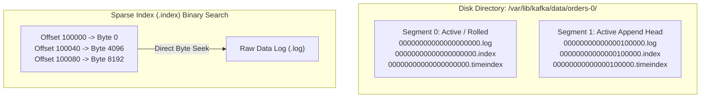
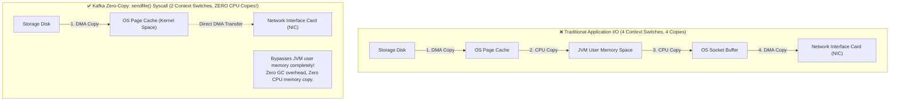
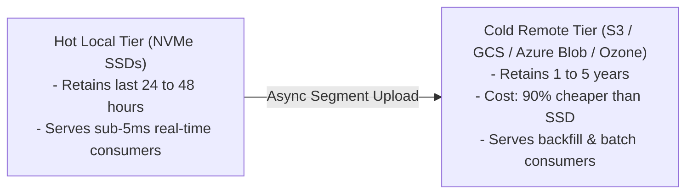

# ⚙️ Lecture 01: Kafka Internals & Broker Architecture
### *The Commit Log, Zero-Copy Syscalls, ISR Consensus & Tiered Storage*

---

## 1. The Append-Only Commit Log & Sparse Indexes

In Apache Kafka, a **Topic** is a logical category, and a **Partition** is the physical unit of parallelism and storage. A partition is stored on disk as an **ordered, immutable sequence of records** broken into **Log Segments**.



### The Sparse Index Mechanism
- Storing an index entry for every single message would consume excessive RAM.
- Kafka uses a **Sparse Memory-Mapped Index** (`.index`): It writes an index entry only every $N$ bytes (configured by `index.interval.bytes`, default **4096 bytes / 4 KB**).
- **The 4-Byte Relative Offset Optimization**: Inside `.index`, Kafka stores **relative offsets** ($\text{Absolute Offset} - \text{Segment Base Offset}$) using 4-byte integers (`int`) rather than full 8-byte integers (`long`). This cuts the index memory footprint by **50%**.
  - In `00000000000000100000.index` (base offset 100,000), offset 100,040 is stored as relative offset `40`.
- To read offset `100065`:
  1. Kafka executes an in-memory **binary search** on the memory-mapped `.index` file to find the largest indexed relative offset $\le 65$ (finding relative offset `40` at Byte `4096`).
  2. It performs a fast sequential disk read starting at byte `4096` in the `.log` file, scanning forward until it hits offset `100065`.

---

## 2. Why Kafka is Blazingly Fast: Page Cache & Zero-Copy

Engineers often ask: *"How can a Java application written on the JVM saturate a 40 Gbps network interface writing to spinning disks?"*

Kafka achieves this through two hardware-level optimizations:



1. **Avoid JVM Heap for Data**:
   - Storing gigabytes of data in Java heap introduces massive object overhead and long Garbage Collection pauses.
   - Kafka keeps the JVM heap small (typically 6–8 GB) and lets the **Linux OS Page Cache** manage all message data in physical RAM.
2. **Zero-Copy Network Transfer (`sendfile()` Syscall)**:
   - When a consumer reads data, Kafka invokes the Linux `sendfile()` system call.
   - The OS kernel copies data directly from the OS page cache to the Network Interface Card (NIC) buffer via **Direct Memory Access (DMA)**, completely bypassing JVM user-space memory!

---

## 3. High Availability: ISR, LEO & High Watermark

Every partition has one **Leader Broker** and zero or more **Follower Brokers**.

```mermaid
flowchart TB
    subgraph ISR_Group["Partition 0 (Replication Factor = 3)"]
        direction TB
        Leader["Broker 1: Leader<br/>LEO = 100 | HW = 98"]
        Follower1["Broker 2: Follower (In-Sync)<br/>LEO = 98"]
        Follower2["Broker 3: Follower (Lagging / Out-of-Sync)<br/>LEO = 80"]
    end

    Client["Consumer Group (Default)"] -->|Reads committed offsets < HW| Leader
    Follower1 -->|1. FetchRequest (Pulls Data)| Leader
    Leader -->|2. FetchResponse (Streams Bytes)| Follower1
    Leader -. 3. Lag > replica.lag.time.max.ms: Evicts from ISR .-> Follower2
    
    subgraph ClosestReplica["KIP-392: Rack-Aware Fetching"]
        AZConsumer["Multi-AZ Consumer (client.rack=az-b)"] -. Reads from local AZ follower .-> Follower1
    end
```

### Essential Architectural Definitions
- **Log End Offset (LEO)**: The offset of the next record to be written into a broker's local partition log (i.e., highest recorded offset + 1).
- **In-Sync Replicas (ISR)**: The set of replicas currently caught up with the leader within `replica.lag.time.max.ms` (default **30,000 ms / 30 seconds**).
- **High Watermark (HW)**: The minimum LEO across all replicas in the ISR:
  $$\mathbf{HW = \min_{r \in \text{ISR}}(\text{LEO}_r)}$$
- **Consumer Read Safety**: Consumers can **only read records with offset $< \mathbf{HW}$** (i.e., offsets up to $\mathbf{HW - 1}$).
  - *Example*: In the diagram above, Leader LEO is 100, Follower 1 LEO is 98, so $\mathbf{HW = 98}$. Consumers can read offsets **0 through 97**. Offsets 98 and 99 cannot be read yet because they are not yet durably acknowledged by all in-sync replicas.
- **Leader Follower Replication Flow**: Replicas do **not** receive pushed data from the Leader. Instead, followers act like consumers, continuously issuing `FetchRequest` calls to pull log segments from the Leader.

### ⚠️ The Flaw in HW & The Leader Epoch Solution (KIP-101)
In legacy Kafka (prior to KIP-101), relying exclusively on the High Watermark during replica failure caused **silent log divergence and data loss**:
- If a follower crashed and restarted, it truncated its log back to its local High Watermark.
- If the leader crashed before the follower caught up, an unclean leader election could overwrite uncommitted offsets.
- **The Modern Fix**: Modern Kafka uses **Leader Epochs** (`leader-epoch-checkpoint`). When a follower reconnects, it queries the leader for the start offset of the current Leader Epoch, ensuring it only truncates records that were truly not committed under the previous leader.

### The Zero Data Loss Configuration Formula
To guarantee mathematically zero data loss during any single broker failure:
```properties
# Producer must wait for all in-sync replicas to acknowledge write
acks = all   # (or -1)

# Cluster requires at least 2 replicas to acknowledge before accepting write
min.insync.replicas = 2

# Topic replication factor must be at least 3
replication.factor = 3
```
> **⚠️ Staff Interview Note on `min.insync.replicas`**:  
> Never set `min.insync.replicas = 3` on a 3-replica topic! If you do, losing even a single broker means only 2 replicas remain in the ISR ($< 3$), immediately causing all producer writes with `acks=all` to fail with `NotEnoughReplicasException`. Sizing `replication.factor=3` and `min.insync.replicas=2` allows the cluster to tolerate **1 full broker failure** with zero write downtime and zero data loss.

---

## 4. Modern Tiered Storage (KIP-405)

Historically, keeping 1 year of data in Kafka required hundreds of terabytes of expensive local NVMe SSDs.

**Tiered Storage** decouples real-time low latency from historical retention:



---

## 5. ⚠️ The 20-Year Veteran's Warning: When Zero-Copy Breaks!

In technical interviews at big tech firms, interviewers love to test if you truly understand how `sendfile()` works under the hood:

> *"Does Kafka always use Zero-Copy in production?"*

**The Answer**: **NO! Zero-Copy is bypassed in two common enterprise scenarios:**
1. **TLS / SSL Encryption (`SSL://` or `SASL_SSL://`)**:
   - Because `sendfile()` copies data directly from the OS page cache to the network card buffer, the data never enters JVM user memory.
   - But if SSL encryption is enabled, the Kafka broker **must encrypt the payload** using Java's `SSLEngine`. The bytes must be copied from OS page cache into the JVM heap, encrypted in user-space, and then written back out to the socket. This disables Zero-Copy and increases CPU overhead!
2. **Message Format / Compression Conversion**:
   - If a producer sends messages compressed in `Snappy` or `GZIP`, but a downstream consumer requests uncompressed messages or an older message format version, the broker must decompress and down-convert the message in JVM RAM, disabling Zero-Copy.
