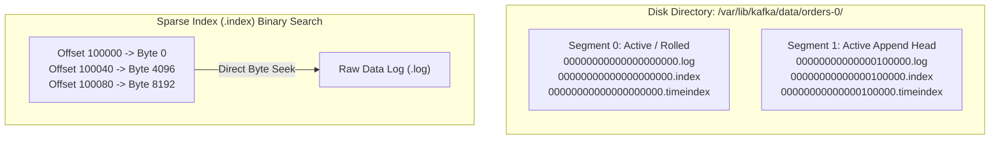
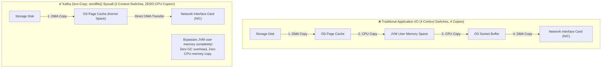
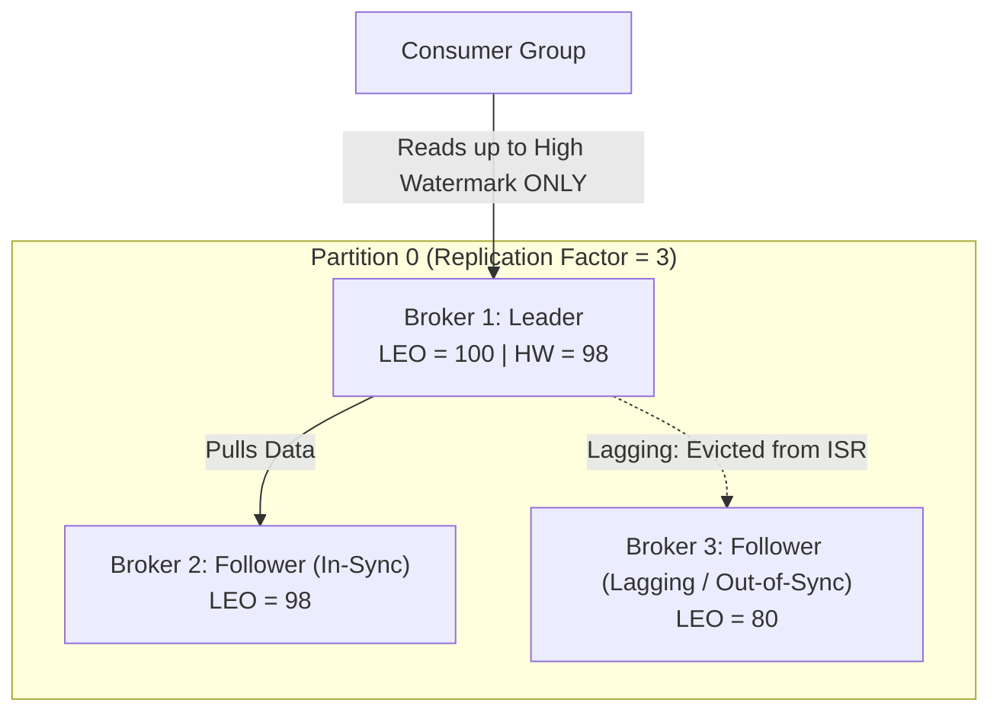
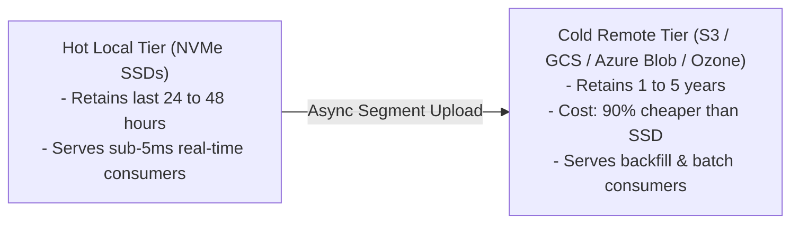

# ⚙️ Lecture 01: Kafka Internals & Broker Architecture
### *The Commit Log, Zero-Copy Syscalls, ISR Consensus & Tiered Storage*

---

## 1. The Append-Only Commit Log & Sparse Indexes

In Apache Kafka, a **Topic** is a logical category, and a **Partition** is the physical unit of parallelism and storage. A partition is stored on disk as an **ordered, immutable sequence of records** broken into **Log Segments**.



### The Sparse Index Mechanism
- Storing an index entry for every single message would consume excessive RAM.
- Kafka uses a **Sparse Memory-Mapped Index** (`.index`): It writes an index entry only every $N$ bytes (configured by `index.interval.bytes`, default **4096 bytes / 4 KB**).
- To read offset `100065`:
  1. Kafka executes an in-memory **binary search** on the `.index` file to find the largest indexed offset $\le 100065$ (finding `100040` at Byte `4096`).
  2. It performs a fast sequential disk read starting at byte `4096` in the `.log` file, scanning forward until it hits offset `100065`.

---

## 2. Why Kafka is Blazingly Fast: Page Cache & Zero-Copy

Engineers often ask: *"How can a Java application written on the JVM saturate a 40 Gbps network interface writing to spinning disks?"*

Kafka achieves this through two hardware-level optimizations:



1. **Avoid JVM Heap for Data**:
   - Storing gigabytes of data in Java heap introduces massive object overhead and long Garbage Collection pauses.
   - Kafka keeps the JVM heap small (typically 6–8 GB) and lets the **Linux OS Page Cache** manage all message data in physical RAM.
2. **Zero-Copy Network Transfer (`sendfile()` Syscall)**:
   - When a consumer reads data, Kafka invokes the Linux `sendfile()` system call.
   - The OS kernel copies data directly from the OS page cache to the Network Interface Card (NIC) buffer via **Direct Memory Access (DMA)**, completely bypassing JVM user-space memory!

---

## 3. High Availability: ISR, LEO & High Watermark

Every partition has one **Leader Broker** and zero or more **Follower Brokers**.



### Essential Architectural Definitions
- **Log End Offset (LEO)**: The offset of the next record to be written into a broker's local partition log.
- **In-Sync Replicas (ISR)**: The set of followers currently caught up with the leader within `replica.lag.time.max.ms` (default **30,000 ms / 30 seconds**).
- **High Watermark (HW)**: The minimum LEO across all replicas in the ISR.
  $$\mathbf{HW = \min_{r \in \text{ISR}}(\text{LEO}_r)}$$
- **Consumer Read Safety**: Consumers are strictly forbidden from reading past the High Watermark. This guarantees that any record returned to a consumer has already been durably replicated across all in-sync brokers.

### The Zero Data Loss Configuration Formula
To guarantee mathematically zero data loss during any single broker failure:
```properties
# Producer must wait for all in-sync replicas to acknowledge write
acks = all   # (or -1)

# Cluster must require at least 2 replicas to acknowledge before accepting write
min.insync.replicas = 2

# Topic replication factor must be at least 3
replication.factor = 3
```

---

## 4. Modern Tiered Storage (KIP-405)

Historically, keeping 1 year of data in Kafka required hundreds of terabytes of expensive local NVMe SSDs.

**Tiered Storage** decouples real-time low latency from historical retention:


