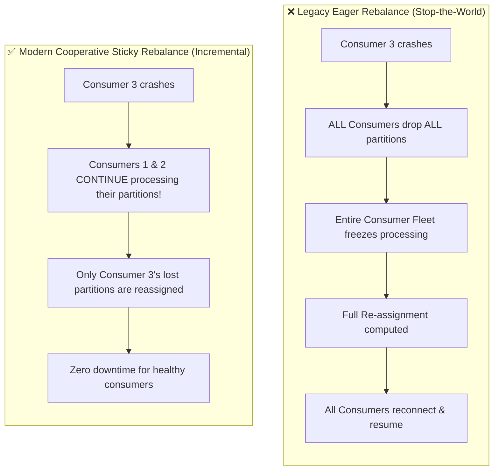
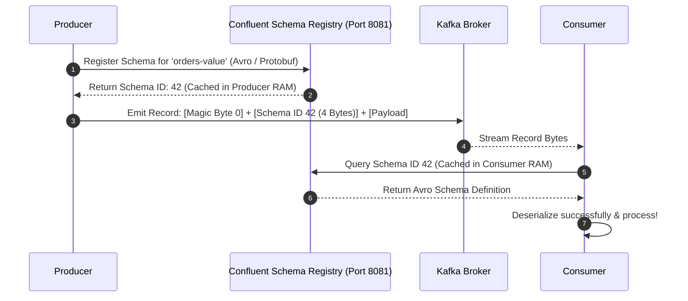
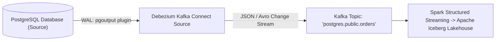

# 🚀 Lecture 02: Producers, Consumers & Stream DataOps
### *Idempotence, Cooperative Rebalancing & Schema Governance*

---

## 1. Producer Reliability & The Idempotent Pipeline

```mermaid
flowchart LR
    AppCode["Application Event"] --> Partitioner["Partitioner (Hash / Sticky)"]
    Partitioner --> Accumulator["RecordAccumulator (batch.size: 64 KB, linger.ms: 10)"]
    Accumulator --> Sender["Sender Network Thread"]
    
    subgraph IdempotentDeduplication["Broker Deduplication Engine"]
        Sender -->|PID 42, Seq 101| Broker["Kafka Broker Partition"]
        Sender -. Retry due to network timeout .->|PID 42, Seq 101| Broker
        Note1["Broker detects Duplicate Sequence #101<br/>Acknowledges write; DOES NOT APPEND DUPLICATE!"]
    end
```

### The 3 Core Delivery Guarantees
1. **At-Most-Once**: `acks=0`. Messages can be lost if network drops; zero duplicates.
2. **At-Least-Once**: `acks=all`, `retries=Integer.MAX_VALUE`. No data loss, but network retries can introduce duplicates.
3. **Exactly-Once Semantics (EOS)**: 
   ```properties
   enable.idempotence = true
   acks = all
   max.in.flight.requests.per.connection <= 5
   retries = 2147483647
   ```
   - When idempotence is enabled, the broker assigns each producer a unique **Producer ID (PID)** and tracks monotonic **Sequence Numbers** per topic partition.
   - If a network glitch occurs after the broker commits the record but before the ACK reaches the producer, the producer retries. The broker recognizes the duplicate sequence number and discards it without throwing an error.

---

## 2. Consumer Groups & The Cooperative Rebalance Protocol

When consumers join or leave a group, partitions must be redistributed.



### Configuring Cooperative Sticky Rebalancing
In your consumer configuration:
```properties
partition.assignment.strategy = org.apache.kafka.clients.consumer.CooperativeStickyAssignor
```

### Sizing Consumer Heartbeats & Timeouts
A common production failure is the **False Rebalance Loop**: A consumer takes too long processing a heavy batch of records and misses its poll interval.
- `session.timeout.ms` (e.g., `45000` / 45s): Time the coordinator waits for heartbeats before declaring a consumer dead.
- `heartbeat.interval.ms` (e.g., `15000` / 15s): Sent by the background consumer thread (must be $\le \frac{1}{3}$ of session timeout).
- `max.poll.interval.ms` (e.g., `300000` / 5 mins): Maximum time allowed between calls to `consumer.poll()`. If your processing logic takes longer than this, the consumer leaves the group, triggering a rebalance!
- `max.poll.records` (e.g., `250`): Tune down to ensure records can be processed within `max.poll.interval.ms`.

---

## 3. Schema Registry: Enterprise Data Governance as Code

Without a Schema Registry, a producer can emit `{ "user_id": 12345 }` (Integer) and later change it to `{ "user_id": "usr_12345" }` (String), causing downstream Spark and Flink streaming jobs to crash with deserialization errors.



### Schema Compatibility Modes

| Compatibility Mode | Definition | Upgrade Order |
| :--- | :--- | :--- |
| **BACKWARD (Default)** | Consumers using the **new schema** can read data written by producers using the **old schema**. (Allows adding optional fields with defaults). | **Upgrade Consumers First**, then Producers. |
| **FORWARD** | Consumers using the **old schema** can read data written by producers using the **new schema**. (Allows deleting optional fields). | **Upgrade Producers First**, then Consumers. |
| **FULL** | Backward and Forward compatible simultaneously. | Upgrade in **any order**. Safe for decoupled enterprise teams. |

---

## 4. Change Data Capture (CDC) via Kafka Connect & Debezium

**Change Data Capture (CDC)** streams raw database transaction logs (MySQL Binlog, PostgreSQL WAL) directly into Kafka topics without modifying application code.



### Debezium Event Structure
Unlike traditional ETL queries that only show current row state, CDC events capture row history:
```json
{
  "before": { "order_id": 101, "status": "PENDING", "amount": 99.00 },
  "after":  { "order_id": 101, "status": "SHIPPED", "amount": 99.00 },
  "source": { "version": "2.4.0", "table": "orders", "ts_ms": 1728038400000 },
  "op": "u" // 'c' = create, 'u' = update, 'd' = delete
}
```
This enables downstream lakehouses to maintain full point-in-time audit logs and implement Slowly Changing Dimensions (SCD Type 2) automatically.
