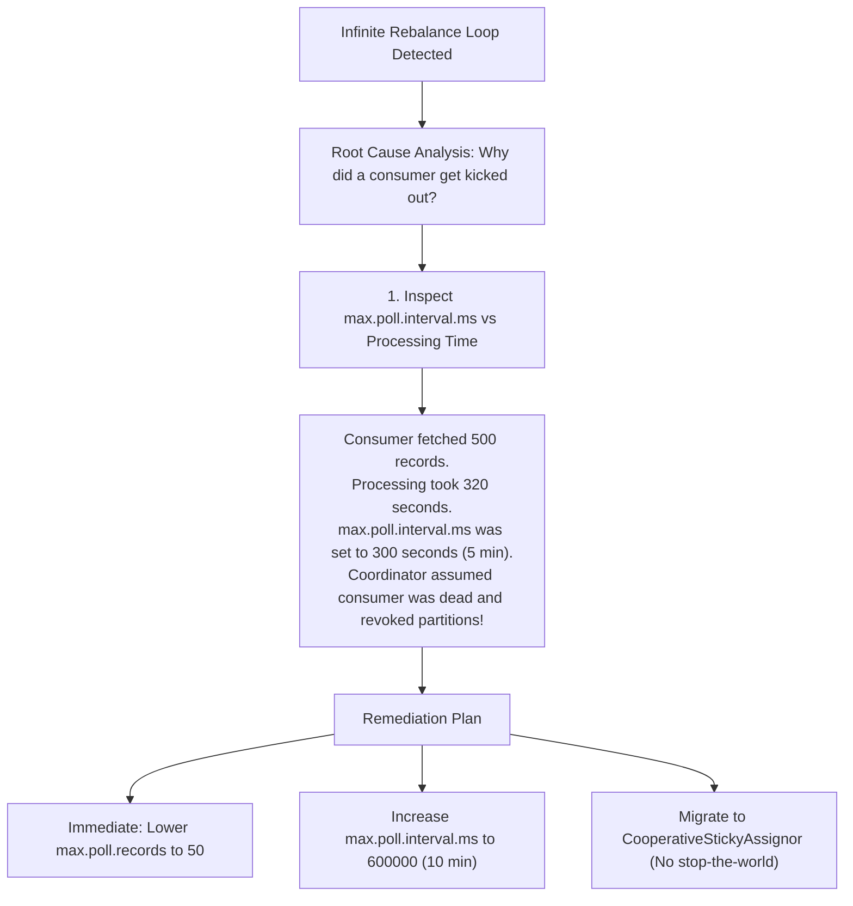
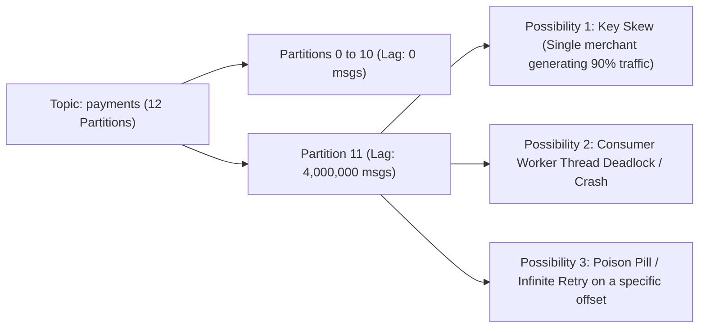
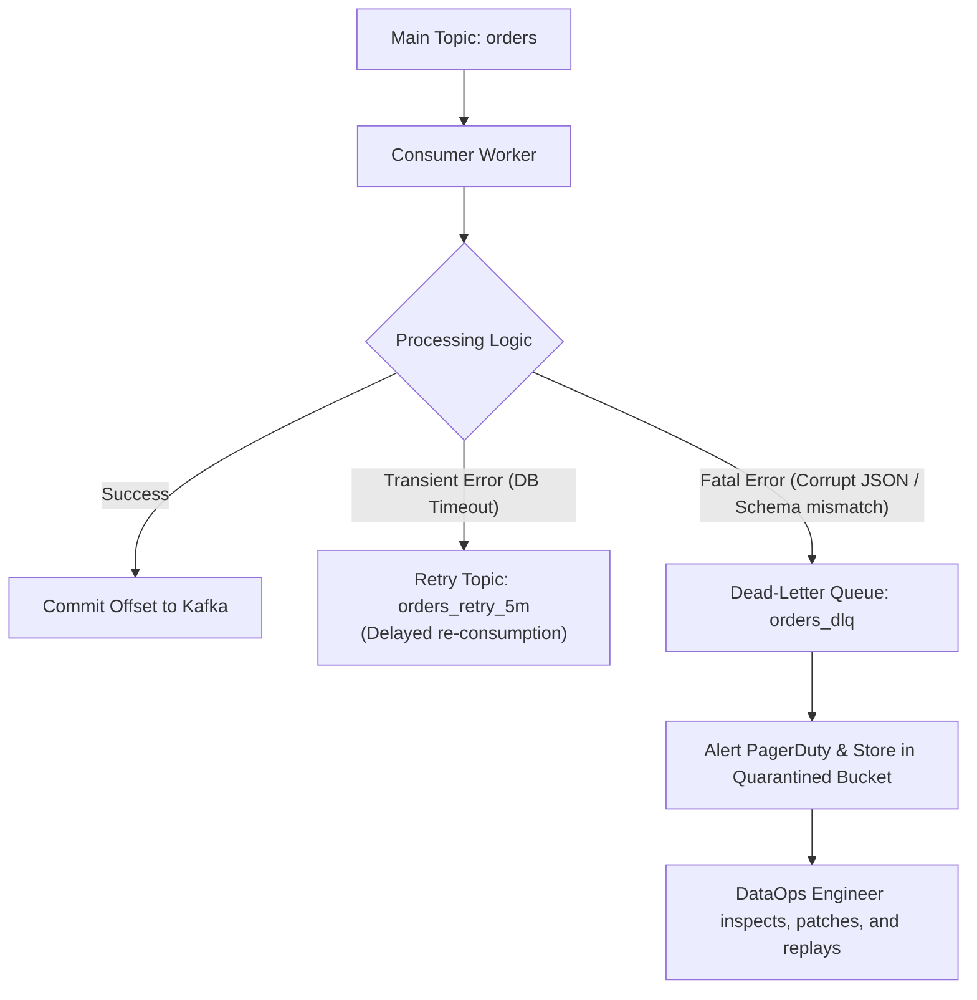

# 🎯 Lecture 03: Kafka Interview Mastery
### *Rebalance Storms, Consumer Lag Forensics, and Under-Replicated Partitions*

---

## 🏆 Question 1: The Infinite Consumer Rebalance Storm

> **The Prompt**:  
> *"In production, our order processing consumer group (10 consumer instances across 40 partitions) has entered an infinite rebalance storm. The application has processed 0 messages for 45 minutes. Every few minutes, logs show `CommitFailedException` and `PreparingRebalance`. How do you stop the bleeding immediately, identify the root cause, and permanently prevent this?"*

### The Staff Engineer Incident Triage

### Forensic Explanation for the Interviewer
- **The Culprit**: The **Processing Time per Batch** exceeded `max.poll.interval.ms`.
  - When the consumer finally finished processing the batch and attempted to commit offsets via `consumer.commitSync()`, the broker rejected the commit with `CommitFailedException` because the consumer had already been kicked out of the group.
  - The revoked partitions were assigned to Consumer 2.
  - Consumer 2 received the same heavy batch, also timed out after 5 minutes, and was also evicted.
  - This created a **cascading poison loop** that paralyzed the entire cluster fleet.

### The Permanent Architectural Fix
1. **Decouple Ingestion from Processing via Worker Thread Pools**:
   - The polling thread does **nothing** except call `consumer.poll()` and place raw records into an in-memory `BlockingQueue`.
   - A dedicated pool of worker threads reads from the queue and executes business logic.
   - The poller thread never misses its heartbeat or poll deadline.
2. **Switch to Cooperative Sticky Assignor**:
   - `partition.assignment.strategy = CooperativeStickyAssignor`. Only reassigned partitions are stopped during rebalances.

---

## 🚨 Question 2: Consumer Lag Forensics: Isolated Partition Lag

> **The Prompt**:  
> *"You monitor consumer lag across topic `payments` with 12 partitions. Partitions 0 through 10 have zero lag. Partition 11 has a lag of 4,000,000 messages and is growing rapidly. What are the potential causes, and how do you resolve it?"*

### Forensic Triaging Steps
1. **Check Consumer Thread State**:
   - Capture a JVM thread dump (`jstack <pid>`) of the consumer assigned to Partition 11.
   - Is the worker thread stuck on an external HTTP call or database lock? If yes, enforce strict socket timeouts (`connectTimeout=2000`, `readTimeout=5000`).
2. **Check Key Distribution (Data Skew)**:
   - Use `kafka-run-class.sh kafka.tools.GetOffsetShell` or a lightweight probe consumer to inspect the keys on Partition 11.
   - If 95% of records have `key = "MERCHANT_APPLE"`, hashing `hash("MERCHANT_APPLE") % 12` will always send all Apple traffic to Partition 11.
   - **Resolution**: Use a **Composite Key** (`MERCHANT_APPLE_uuid`) or custom round-robin partitioner for massive merchants.
3. **Check for Poison Pill Loops**:
   - Inspect consumer logs for repeated unhandled exceptions on a single offset. If a poison pill is stuck, route it to a Dead-Letter Queue.

---

## 🛡️ Question 3: The Dead-Letter Queue (DLQ) Architecture

> **The Prompt**:  
> *"How do you design an enterprise-grade Poison Pill and retry architecture in Kafka without losing data or stalling stream consumers?"*

### Key Engineering Guardrails
1. **Never drop unparseable messages silently**: Write them to the DLQ along with contextual headers:
   - `x-error-message`: The exception stack trace.
   - `x-original-topic`: `orders`.
   - `x-original-partition`: `11`.
   - `x-original-offset`: `4829104`.
   - `x-timestamp`: Timestamp when failure occurred.
2. **Exponential Backoff Topics**: Use separate retry topics (`orders_retry_1m`, `orders_retry_10m`) to prevent transient network hiccups from flooding downstream databases.
