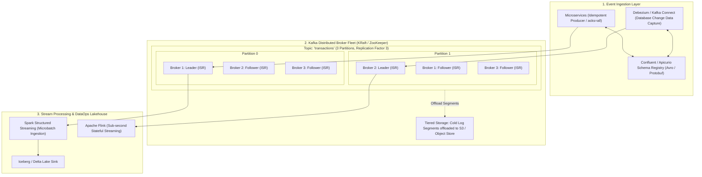

# 📨 Apache Kafka & Real-Time Stream DataOps

> *"Kafka is not a message queue like RabbitMQ or ActiveMQ. It is a distributed, horizontally scalable, crash-resilient, replicated append-only commit log. If you treat it like a traditional queue, you will fail every systems interview."*  
> — **Professor's Field Note**

---

## 🏛️ Kafka Distributed Cluster Architecture Blueprint

---

## 📖 Lecture Chapters

1. **[01. Kafka Internals & Broker Architecture](file:///d:/self-learning/kafka/01_kafka_internals_and_architecture.md)**
   - The Append-Only Commit Log: Log segments, `.index`, and `.timeindex`.
   - Why Kafka is blazingly fast: OS Page Cache, Sequential Disk I/O, and the Zero-Copy `sendfile()` syscall.
   - Replication mechanics: Leader, Followers, In-Sync Replicas (ISR), and the High Watermark (HW).
   - Log Compaction mechanics and Modern Tiered Storage.

2. **[02. Producers, Consumers & Schema Governance](file:///d:/self-learning/kafka/02_producers_consumers_and_stream_dataops.md)**
   - Producer reliability: `acks=0`, `acks=1`, and `acks=all` (`-1`).
   - The Idempotent Producer (`enable.idempotence=true`) and 2-Phase Commit Transactional API.
   - Consumer Groups: The Rebalance Protocol (Eager Stop-the-World vs Cooperative Sticky Rebalance).
   - Schema Registry: Enforcing Data Contracts via Avro/Protobuf compatibility modes (Backward, Forward, Full).
   - Change Data Capture (CDC) via Kafka Connect & Debezium.

3. **[03. Kafka Interview Mastery](file:///d:/self-learning/kafka/03_interview_mastery_kafka.md)**
   - Diagnosing and eliminating Consumer Rebalance Storms in production.
   - Consumer Lag troubleshooting: Partition imbalance vs slow downstream database sinks.
   - Under-Replicated Partitions (URP) emergency response and disk saturation triage.
   - Poison Pill message handling: Dead-Letter Queues (DLQ) vs Header-based routing.
