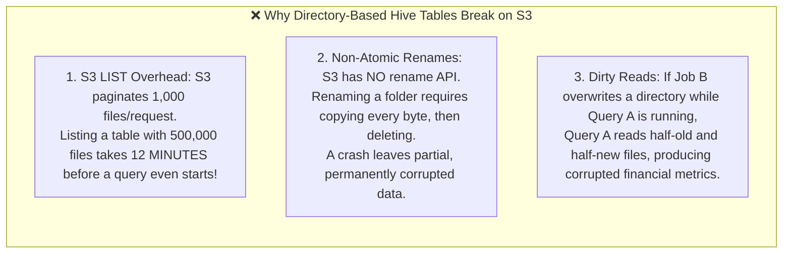
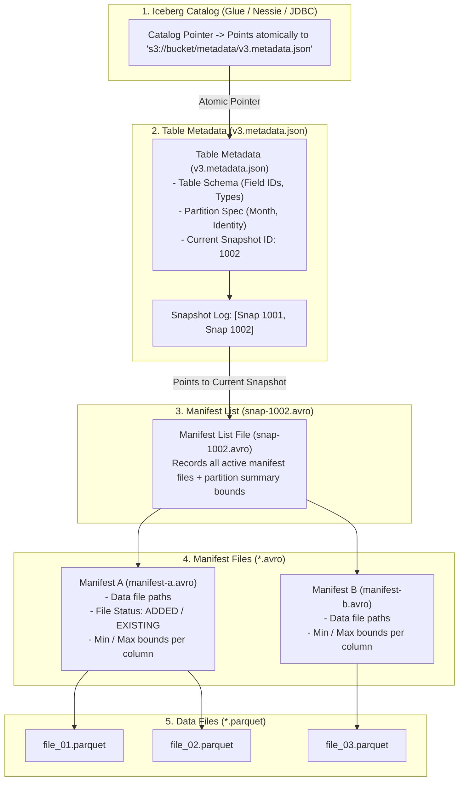
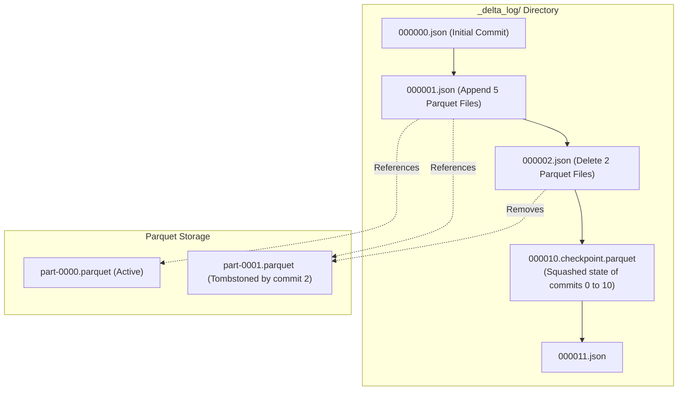

# 🏛️ Lecture 01: Open Table Formats: Apache Iceberg vs. Delta Lake
### *The Mechanics of Snapshot Isolation, Metadata Trees & ACID Transactions*

---

## 1. Why Hive Tables Failed on Cloud Object Storage

For 15 years, Big Data relied on the **Hive Metastore Table Format**. A Hive table was defined as:
$$\text{Hive Table} \equiv \text{A Directory of Files on Disk}$$

When organizations migrated from bare-metal HDFS to Cloud Object Storage (Amazon S3, Azure ADLS, Google Cloud Storage), this directory-based model collapsed:



---

## 2. Apache Iceberg: The Metadata Tree Architecture

Apache Iceberg discarded the directory model entirely. In Iceberg:
$$\text{Iceberg Table} \equiv \mathbf{An\ Immutable\ Tree\ of\ Metadata\ Files}$$



### The 4 Layers of Iceberg Metadata
1. **The Catalog**: Stores a single string pointing to the current `metadata.json` file. Updating a table is a **Compare-and-Swap (CAS)** operation on this pointer.
2. **Table Metadata File (`vX.metadata.json`)**: Tracks schema definitions, partition specifications, and historical snapshot IDs.
3. **Manifest List (`snap-ID.avro`)**: Represents a specific snapshot. It lists all active manifest files and includes **partition summaries**. 
   - *Optimization*: If a query filters for `date = '2026-10'`, Iceberg inspects the manifest list and prunes entire manifest files without opening them!
4. **Manifest File (`*.avro`)**: Stores individual data file paths, row counts, and **column-level upper/lower bounds** (e.g., `min(user_id) = 1`, `max(user_id) = 50000`).
   - *Optimization*: If a query asks for `user_id = 99999`, Iceberg uses the manifest bounds to skip reading `file_01.parquet` entirely.

---

## 3. Delta Lake: The Transaction Log Protocol

Delta Lake implements ACID transactions using an ordered **JSON commit log** and periodic **Checkpoint Parquet files**.



### The Delta Commit Mechanics
1. **Optimistic Concurrency Control (OCC)**:
   - When a writer begins, it notes the latest commit version (e.g., Version `10`).
   - It writes new Parquet data files to storage.
   - It attempts to write `000011.json`.
   - If another writer committed Version `11` first, the writer checks whether the concurrent transaction mutated the same partitions. If not, it automatically retries and commits Version `12`.
2. **Checkpoints**:
   - Replaying hundreds of JSON files to find the current state would become slow.
   - Every **10 commits**, Delta automatically compacts the entire log state into a single **Checkpoint Parquet file** (`000010.checkpoint.parquet`). Query engines only read the latest checkpoint plus subsequent JSON files.

---

## 4. ACID Guarantees & Time-Travel Queries

Because every snapshot is immutable, both Iceberg and Delta Lake provide native **Snapshot Isolation** and **Time-Travel**.

```sql
-- Query the exact state of the table as of 2 hours ago
SELECT * FROM prod.fact_orders 
TIMESTAMP AS OF '2026-10-04 10:00:00';

-- Query a specific snapshot ID after a known ETL job finished
SELECT * FROM prod.fact_orders 
VERSION AS OF 1002;
```

### How Time-Travel Enables Instant Incident Rollbacks
If a rogue ETL pipeline writes bad data at 11:00 AM:
```sql
-- Instantly revert production table to the snapshot before the incident!
-- Execution time: < 1 second (atomic metadata pointer swap)
CALL prod.system.rollback_to_snapshot('prod.fact_orders', 1001);
```
No physical files are moved or deleted. The table pointer immediately points back to snapshot `1001`, instantly restoring clean data for downstream consumers.
