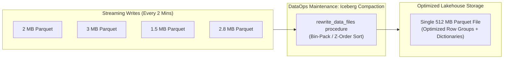
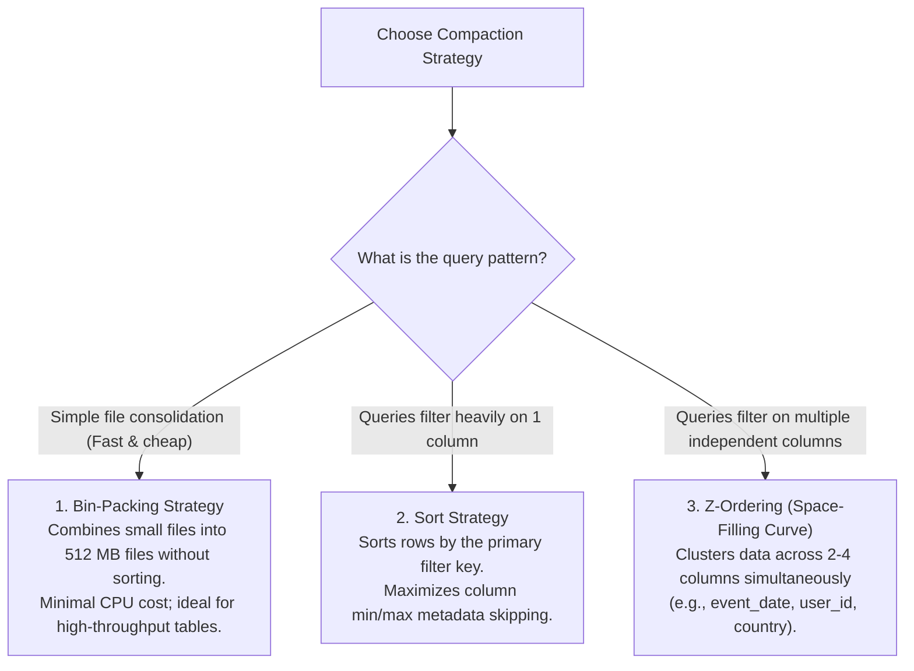
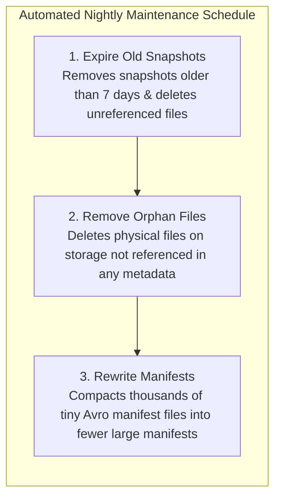

# 🛠️ Lecture 02: Lakehouse DataOps & Table Maintenance
### *Compaction, Z-Ordering, Hidden Partitioning & Table Branching*

---

## 1. The Small Files Dilemma in Streaming Lakehouses

When streaming engines (Spark Structured Streaming or Apache Flink) commit data every 2 minutes, they generate **720 files per partition per day**. Across 100 partitions, that is **72,000 tiny files daily**.

Query engines opening thousands of tiny 2 MB Parquet files suffer severe overhead:
- Millions of HTTP `GET` requests to S3 / Object Storage.
- High deserialization and Parquet footer reading overhead.
- Degradation of query performance by $10\times$ to $50\times$.



---

## 2. Compaction Strategies: Bin-Packing vs. Z-Ordering



### Executing Compaction in Apache Iceberg via Spark SQL

```sql
-- 1. Execute Bin-Pack Compaction to target 512 MB files
CALL prod.system.rewrite_data_files(
  table => 'prod.orders',
  strategy => 'binpack',
  options => map('target-file-size-bytes', '536870912') -- 512 MB
);

-- 2. Execute Z-Order Compaction on multidimensional columns
CALL prod.system.rewrite_data_files(
  table => 'prod.orders',
  strategy => 'sort',
  sort_order => 'zorder(customer_id, country_code)',
  options => map('target-file-size-bytes', '536870912')
);
```

---

## 3. Automated Table Garbage Collection & Orphan Cleanup

Over time, snapshots accumulate, and failed Spark tasks leave unreferenced files on disk. A production DataOps engineer runs regular maintenance procedures:



### Maintenance SQL Commands

```sql
-- 1. Retain only the last 7 days of snapshots for time-travel
CALL prod.system.expire_snapshots(
  table => 'prod.orders',
  older_than => TIMESTAMP '2026-09-27 00:00:00'
);

-- 2. Clean up orphan files left behind by crashed write tasks
CALL prod.system.remove_orphan_files(
  table => 'prod.orders',
  older_than => TIMESTAMP '2026-10-01 00:00:00'
);

-- 3. Optimize metadata manifest reading latency
CALL prod.system.rewrite_manifests('prod.orders');
```

---

## 4. Iceberg's Hidden Partitioning & Partition Evolution

### The Hive Partitioning Flaw
In traditional Hive:
- You had to create an explicit partition column: `ALTER TABLE orders ADD PARTITION (order_date='2026-10-04')`.
- If an analyst queried: `SELECT * FROM orders WHERE created_at >= '2026-10-04 00:00:00'`, Hive **scanned the entire multi-terabyte dataset** because the query didn't mention `order_date`!

### Iceberg's Hidden Partitioning
In Apache Iceberg, you define a **transform** on the underlying column:

```sql
CREATE TABLE prod.orders (
  order_id STRING,
  customer_id STRING,
  amount DECIMAL(10, 2),
  event_time TIMESTAMP
)
USING iceberg
PARTITIONED BY (days(event_time));
```

- When the analyst writes `WHERE event_time >= '2026-10-04 00:00:00'`, Iceberg's query planner automatically applies the `days()` function to the predicate and **prunes 99.9% of partitions automatically**! The analyst never needs to know how the table is partitioned.

### Partition Evolution Without Rewriting Historical Data
Suppose after 3 years of growth, daily partitioning produces files that are too large (10 GB per day). You need **hourly** partitioning:

```sql
-- Evolve partition spec to hours!
ALTER TABLE prod.orders SET PARTITION SPEC (hours(event_time));
```
- In Hive, this was impossible without creating a new table and rewriting 3 years of petabytes.
- In Iceberg, this takes **10 milliseconds**!
  - Historical data remains safely partitioned by day.
  - New incoming data is partitioned by hour.
  - Query engines read both seamlessly via snapshot metadata.
