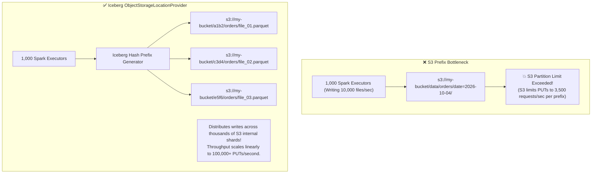
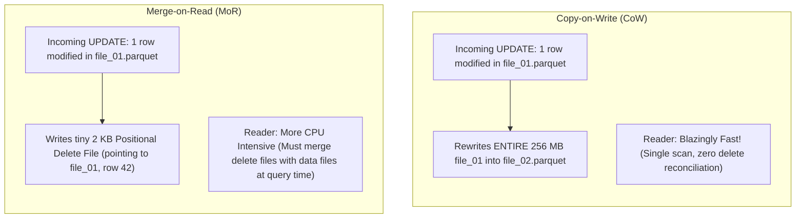

# 🎯 Lecture 03: Lakehouse Interview Mastery
### *Table Format Selection Matrix, S3 503 Forensics, and CoW vs. MoR Tradeoffs*

---

## 🏆 Question 1: Iceberg vs. Delta Lake vs. Apache Hudi

> **The Prompt**:  
> *"You are advising the Chief Data Officer on selecting the foundational table format for a next-generation multi-cloud enterprise lakehouse. Walk me through your architectural comparison between Apache Iceberg, Delta Lake, and Apache Hudi. Which do you recommend and why?"*

### The Staff Architect Decision Matrix

| Evaluation Dimension | Apache Iceberg | Delta Lake | Apache Hudi |
| :--- | :--- | :--- | :--- |
| **Governance & Independence** | **100% Apache Foundation**; neutral multi-vendor community (Netflix, Apple, Google, Snowflake, Tabular). | Linux Foundation; heavily driven by Databricks roadmap. | Apache Foundation; historically incubated at Uber. |
| **Multi-Engine Support** | **First-Class Uniform Support**: Spark, Trino, Flink, Impala, Presto, Snowflake, BigQuery. | Deepest integration with Spark & Databricks; Presto/Trino via connectors. | Strong in Spark and Flink; more complex with Trino/Presto. |
| **Partitioning Model** | **Hidden Partitioning & Partition Evolution** (Superior; zero rewrite needed to change spec). | Generated columns & partition transforms (Requires re-partitioning). | Standard explicit Hive-style partitioning. |
| **Catalog Architecture** | Completely pluggable (REST Catalog, Nessie, Glue, DynamoDB, Hive, JDBC). | Unity Catalog / Hive Metastore / AWS Glue. | Hive Metastore / AWS Glue. |
| **CDC / Upsert Specialization** | Native Equality & Positional Deletes (Iceberg v2 format). | Change Data Feed (CDF) + Liquid Clustering. | **Deepest specialized indexing** (HBase, Bloom filters) for ultra-low latency record-level updates. |

### The Recommendation Pitch
- **If Databricks-centric**: Delta Lake offers the smoothest single-vendor experience with tight photon engine integration.
- **If Multi-Engine / Cloud-Agnostic (Enterprise Gold Standard)**: **Apache Iceberg**. Its open REST Catalog specification, vendor independence, hidden partitioning, and seamless interoperability across Spark, Trino, and Snowflake make it the undisputed long-term choice for enterprise data platforms.

---

## 🚨 Question 2: Resolving AWS S3 `503 SlowDown` Errors

> **The Prompt**:  
> *"You run a 1,000-executor Spark job writing 10 TB of data to an S3-backed Lakehouse table. After 10 minutes, hundreds of tasks fail with `AmazonS3Exception: 503 Slow Down (Service: Amazon S3; Status Code: 503)`. Why is this happening, and how do you re-architect the storage layer to fix it?"*



### Technical Root Cause
- AWS S3 automatically scales by partitioning storage keys on **prefix names**.
- Each individual prefix supports up to **3,500 PUT/POST/DELETE requests/second** and **5,500 GET/HEAD requests/second**.
- In traditional directory partitioning (`s3://bucket/orders/2026/10/04/`), all 1,000 executors write to the exact same prefix string, quickly blowing past the 3,500 PUT limit and triggering exponential backoff throttling (`503 Slow Down`).

### The Iceberg Solution: Object Storage Location Provider
Configure Iceberg to use randomized hash prefixes for data file storage:

```sql
ALTER TABLE prod.orders SET TBLPROPERTIES (
  'write.object-storage.enabled' = 'true',
  'write.data.path' = 's3://my-bucket/orders/data'
);
```
- Iceberg automatically injects an MD5 hash prefix into the S3 key path (e.g., `s3://my-bucket/orders/data/4f2a/part-001.parquet`).
- Because Iceberg tracks files via its metadata tree rather than directories, **physical file paths on S3 do not need to follow a directory hierarchy**. S3 distributes the writes across hundreds of internal physical drives, completely eliminating 503 errors.

---

## ⚡ Question 3: Copy-on-Write (CoW) vs. Merge-on-Read (MoR)

> **The Prompt**:  
> *"When ingesting real-time Change Data Capture (CDC) streams with frequent row-level updates and deletes into Iceberg, how do you choose between Copy-on-Write and Merge-on-Read? Walk through the read and write amplification tradeoffs."*



### The Engineering Tradeoff Breakdown

| Metric | Copy-on-Write (CoW) | Merge-on-Read (MoR) |
| :--- | :--- | :--- |
| **Write Latency** | **High** (High write amplification; rewrites full Parquet files for a single row update). | **Ultra-Low** (Appends tiny delete files; writes complete in seconds). |
| **Read Latency** | **Fastest** (Zero merge overhead; pure sequential columnar Parquet scans). | **Slower** (Query engine must maintain a hash set of deleted row IDs in RAM). |
| **Storage Cost** | High temporary churn during frequent updates. | Low storage churn. |
| **Compaction Requirement** | Minimal. | **Mandatory** (Background compaction must regularly squash delete files into clean data files). |
| **Optimal Use Case** | Batch updates, historical revisions, read-heavy analytical dashboards. | **Near real-time streaming CDC ingestion (Kafka $\rightarrow$ Iceberg)**. |
