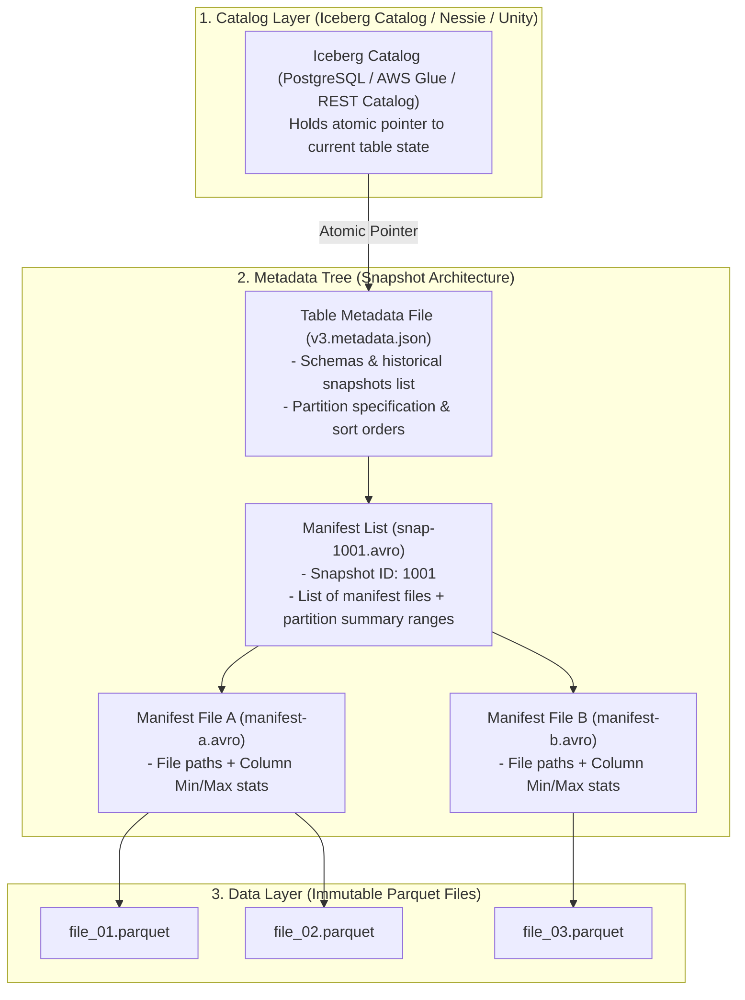

# 🧊 Modern Lakehouse & Open Table Formats
### *Apache Iceberg, Delta Lake & Next-Generation Lakehouse Architecture*

---

> *"The defining revolution of modern big data is the death of the Hive Metastore directory layout. Treating a folder of files as a database table on cloud object storage was fundamentally broken. Open table formats bring database primitives—ACID transactions, snapshot isolation, and schema evolution—directly to distributed files."*  
> — **Professor's Field Note**

---

## 🏛️ Modern Lakehouse Metadata Architecture Blueprint

---

## 📖 Lecture Chapters

1. **[01. Open Table Formats: Apache Iceberg vs. Delta Lake](file:///d:/self-learning/lakehouse/01_table_formats_iceberg_and_delta.md)**
   - Why traditional directory-based Hive tables fail on Cloud Object Stores (S3/ADLS/GCS).
   - The Apache Iceberg Metadata Tree: Catalog $\rightarrow$ Metadata File $\rightarrow$ Manifest List $\rightarrow$ Manifest Files $\rightarrow$ Data Files.
   - Delta Lake Architecture: The `_delta_log` transaction protocol and Checkpoint Parquet files.
   - ACID transactions, Snapshot Isolation, and Time-Travel queries.

2. **[02. Lakehouse DataOps & Table Maintenance](file:///d:/self-learning/lakehouse/02_lakehouse_dataops_and_maintenance.md)**
   - The Streaming Small-Files Problem in Lakehouses.
   - Compaction strategies: Bin-Packing vs Sort & Z-Ordering (Multidimensional clustering).
   - Snapshot Expiration, Metadata Cleanup, and Orphan File pruning.
   - Iceberg's Hidden Partitioning & Zero-Downtime Partition Evolution.
   - Implementing Write-Audit-Publish (WAP) natively via Iceberg Table Branching.

3. **[03. Lakehouse Interview Mastery](file:///d:/self-learning/lakehouse/03_interview_mastery_lakehouse.md)**
   - Staff-level comparison: Hive vs Iceberg vs Delta Lake vs Hudi.
   - Copy-on-Write (CoW) vs Merge-on-Read (MoR): Choosing the optimal engine for high-frequency CDC ingestion.
   - Overcoming AWS S3 `503 SlowDown` rate limits in multi-terabyte Spark writes.
   - Post-mortem walkthrough: Rolling back corrupt production table updates instantaneously.
