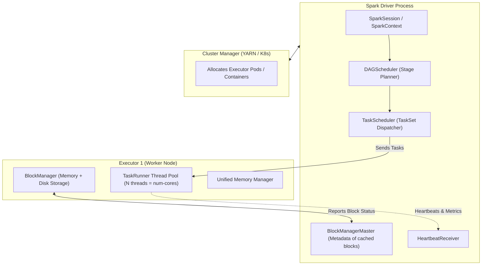
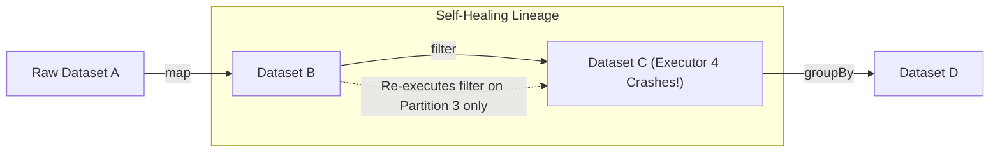

# ⚙️ Lecture 01: Spark Core Engine Internals
### *Driver, Executors, DAG Lineage, and Task Scheduling*

---

## 1. Spark Driver & Executor Responsibilities

An Apache Spark application runs as an independent set of processes on a cluster, coordinated by the **SparkContext / SparkSession** in your Driver program.



### The Driver
- **Brain of the Application**: Translates user code into a Directed Acyclic Graph (DAG) of stages and tasks.
- **Catalyst Optimizer**: Converts high-level DataFrame queries into optimized Java bytecode.
- **Central Coordinator**: Schedules tasks on executors based on **data locality** (`PROCESS_LOCAL`, `NODE_LOCAL`, `RACK_LOCAL`).
- **Single Point of Bottleneck**: If you run `.collect()` on a 50 GB DataFrame, all 50 GB flows into Driver RAM, triggering an immediate `OutOfMemoryError: Java heap space`.

### The Executor
- **Worker Process**: Runs inside a YARN container or Kubernetes Pod.
- **Multi-Threaded**: Launches multiple tasks concurrently within the same JVM (each executor core = 1 concurrent task thread).
- **BlockManager**: Stores cached data (DataFrames marked `.cache()`) and intermediate shuffle spill files.

---

## 2. The DAGScheduler: Narrow vs. Wide Dependencies

The DAGScheduler transforms a logical execution graph into physical execution **Stages**. The boundary between stages is determined strictly by whether an operation requires a **Shuffle**.

```mermaid
flowchart LR
    subgraph Stage1["Stage 1 (Narrow Dependencies - Pipelined in Memory)"]
        direction TB
        R1["Raw Input Partitions (HDFS / S3)"] -->|filter()| R2["Filtered Partitions"]
        R2 -->|map()| R3["Mapped Partitions"]
    end

    subgraph ShuffleExchange["Shuffle Boundary (Network Exchange)"]
        R3 -->|groupByKey / join / repartition| ShuffleWire["SortShuffleManager (Disk + Netty Network)"]
    end

    subgraph Stage2["Stage 2 (Wide Dependency - New Stage)"]
        direction TB
        ShuffleWire --> R4["Aggregated / Joined Partitions"]
        R4 -->|select()| R5["Final Output Partitions"]
    end
```

### Narrow Dependencies (Zero Network Shuffle)
- Each partition of the parent RDD is used by **at most one** partition of the child RDD.
- Examples: `map()`, `filter()`, `flatMap()`, `mapPartitions()`, `union()`.
- **Optimization**: Spark pipelines these operations together in the same thread. A record read from disk flows through `filter` and `map` inside CPU registers without ever touching memory or disk!

### Wide Dependencies (Shuffle Dependency)
- Multiple child partitions depend on data from multiple parent partitions.
- Examples: `groupBy()`, `reduceByKey()`, `join()`, `distinct()`, `repartition()`.
- **Cost**: Requires writing intermediate data to local disk, sorting by hash code, transmitting across the cluster network over Netty HTTP, and merging on the target executor.
- **Stage Boundary**: The DAGScheduler cuts the stage here and creates a new stage.

---

## 3. The TaskScheduler & Locality Levels

Once the DAGScheduler splits the DAG into stages, it hands a **TaskSet** to the `TaskScheduler`. A TaskSet contains one individual `Task` for each partition in that stage.

### Data Locality Hierarchy
The TaskScheduler attempts to schedule each task as close to the physical data as possible, falling back through lower levels if busy:

```mermaid
flowchart TD
    L1["1. PROCESS_LOCAL (Best)<br/>Data is cached in the same JVM executor where the task thread runs."]
    L2["2. NODE_LOCAL<br/>Data is on the same physical host (e.g., local DataNode disk or OS buffer cache)."]
    L3["3. NO_PREF<br/>Data has no preference (e.g., querying an external API)."]
    L4["4. RACK_LOCAL<br/>Data is on a different node, but inside the same network rack / top-of-rack switch."]
    L5["5. ANY (Worst)<br/>Data must cross inter-rack network switches."]

    L1 -->|Wait timeout (spark.locality.wait)| L2
    L2 -->|Wait timeout| L4
    L4 -->|Wait timeout| L5
```

> **⚡ Performance Tip**: If your Spark UI shows tasks falling back to `RACK_LOCAL` or `ANY` while the cluster has high load, tune `spark.locality.wait` (default `3s`). Increasing it gives executors a few more seconds to finish prior tasks and achieve `NODE_LOCAL` execution, saving massive network bandwidth.

---

## 4. Fault Tolerance via Lineage Reconstruction

Unlike Hadoop MapReduce, which wrote intermediate data to disk after every single step for fault tolerance, Spark relies on **Deterministic Lineage Graphs**.



If an executor crashes and loses Partition 3 of Dataset C:
1. Spark does **not** re-run the entire pipeline.
2. The DAGScheduler identifies the lost partition.
3. Because all transformations are deterministic, Spark simply re-schedules the task for **Partition 3 only**, re-reading Partition 3 of Dataset B and executing the filter step.
