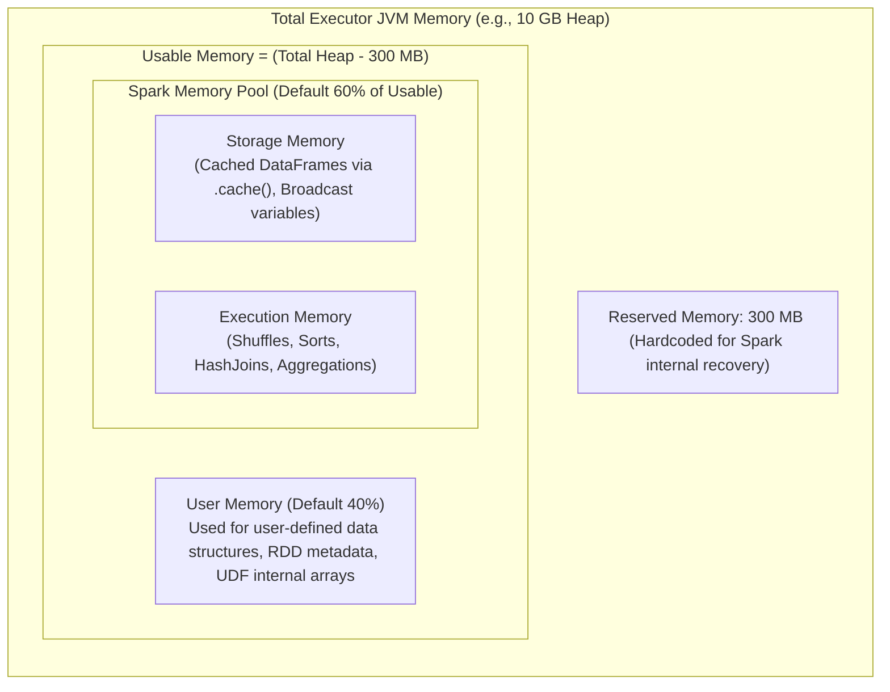
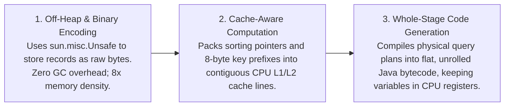

# 🧠 Lecture 02: Memory Management & Project Tungsten
### *Unified Memory Architecture, Catalyst Optimizer & Whole-Stage CodeGen*

---

## 1. The Unified Memory Manager Architecture

In early Spark (prior to 1.6), memory was statically divided. If you ran out of execution memory for joins, tasks spilled to disk even if 10 GB of storage cache sat completely empty.

Spark introduced the **Unified Memory Manager**, establishing dynamic memory borrowing between execution and storage.



### The Exact Memory Allocation Formula

Given an executor with `spark.executor.memory = 10g`:
1. **Total Available Heap**: $10\text{ GB} = 10{,}240\text{ MB}$.
2. **Reserved Memory**: Fixed at **300 MB** (cannot be configured).
3. **Usable Memory**: $10{,}240\text{ MB} - 300\text{ MB} = 9{,}940\text{ MB}$.
4. **Spark Memory Pool** (`spark.memory.fraction`, default **0.60**):
   $$\text{Spark Pool} = 9{,}940\text{ MB} \times 0.60 = 5{,}964\text{ MB}$$
5. **User Memory** ($1 - \text{fraction} = 0.40$):
   $$\text{User Pool} = 9{,}940\text{ MB} \times 0.40 = 3{,}976\text{ MB}$$
6. **Storage vs. Execution Boundary** (`spark.memory.storageFraction`, default **0.50**):
   $$\text{Storage Space} = 5{,}964\text{ MB} \times 0.50 = 2{,}982\text{ MB}$$
   $$\text{Execution Space} = 5{,}964\text{ MB} \times 0.50 = 2{,}982\text{ MB}$$

### Dynamic Borrowing Rules (The Asymmetric Eviction Rule)
- **Rule 1**: If Execution needs memory and Storage has idle space, Execution borrows from Storage.
- **Rule 2**: If Storage needs memory and Execution has idle space, Storage borrows from Execution.
- **Rule 3 (The Asymmetry)**:
  - If Execution needs memory that Storage borrowed, **Execution can forcibly evict Storage blocks to disk**.
  - But if Storage needs memory that Execution borrowed, **Storage CANNOT evict Execution**! Active join/sort tasks cannot be interrupted; Storage must wait or drop caches.

---

## 2. Project Tungsten: Mechanical Sympathy

Project Tungsten was designed to overcome JVM performance bottlenecks:
1. **Java Object Overhead**: A 4-byte ASCII string `"abcd"` in Java consumes **48 bytes** of RAM due to object headers, byte alignment padding, and pointer indirection.
2. **GC Pauses**: Tracking billions of individual Java objects on a 100 GB heap causes multi-minute Stop-The-World GC pauses.
3. **CPU Cache Misses**: Java objects are scattered across RAM. Traversing object pointers causes constant CPU L1/L2 cache misses.

### Tungsten's 3 Innovations



### Whole-Stage Code Generation (WSCG) in Action
Traditional query engines use the **Volcano Iterator Model**: each operator calls `.next()` on the child operator. This introduces millions of virtual function calls.

Tungsten flattens the query. For example:
```sql
SELECT user_id, SUM(amount) FROM transactions WHERE status = 'COMPLETED' GROUP BY user_id
```

Instead of separate `FilterOperator`, `ProjectOperator`, and `AggregateOperator` objects, Tungsten generates a single synthetic Java loop compiled directly via **Janino**:

```java
// Generated JVM Bytecode (Simplified representation)
int[] hashCodes = ...;
long[] aggregatedSum = ...;

while (recordIterator.hasNext()) {
    byte[] record = recordIterator.nextRawBytes();
    // Inlined Filter: Check status == 'COMPLETED' directly in binary
    if (recordMatchesStatus(record)) {
        long amount = extractAmount(record);
        int userId = extractUserId(record);
        // Inlined Aggregate in CPU registers / L1 cache
        int slot = hash(userId) & mask;
        aggregatedSum[slot] += amount;
    }
}
```

---

## 3. The Catalyst Optimizer Architecture

The Catalyst Optimizer is the compiler that transforms DataFrame / SQL code into optimized execution bytecode.

```mermaid
flowchart TD
    SQL["DataFrame / SQL Query AST"] --> UP["Unresolved Logical Plan"]
    UP -->|1. Analyzer: Resolves tables/columns via Catalog/Metastore| RLP["Resolved Logical Plan"]
    RLP -->|2. Logical Optimization: Predicate pushdown, projection pruning| OLP["Optimized Logical Plan"]
    OLP -->|3. Physical Planning: Generates candidate physical plans| PP["Candidate Physical Plans"]
    PP -->|4. Cost-Based Optimizer (CBO): Selects optimal join strategy| SPP["Selected Physical Plan"]
    SPP -->|5. Whole-Stage CodeGen (Tungsten)| Bytecode["Executable JVM Bytecode"]
```

### The 4 Phases of Catalyst

1. **Analysis**: Resolves table and column names by querying the Hive Metastore, Iceberg Catalog, or schema repository. If a column doesn't exist, it throws an `AnalysisException` here before executing any code.
2. **Logical Optimization**: Applies rule-based transformations:
   - **Predicate Pushdown**: Pushes `WHERE date = '2026-10-04'` down to the Parquet reader level so unneeded blocks are never read from disk.
   - **Projection Pruning**: Discards unused columns immediately after reading.
   - **Constant Folding**: Replaces `1 + 1` with `2` at compile time.
3. **Physical Planning**: Generates multiple valid physical plans (e.g., executing a join via Sort-Merge Join vs Broadcast Hash Join).
4. **Cost-Based Optimizer (CBO)**: Uses table statistics (number of rows, column cardinality, histograms) to estimate execution costs and select the cheapest physical plan.
