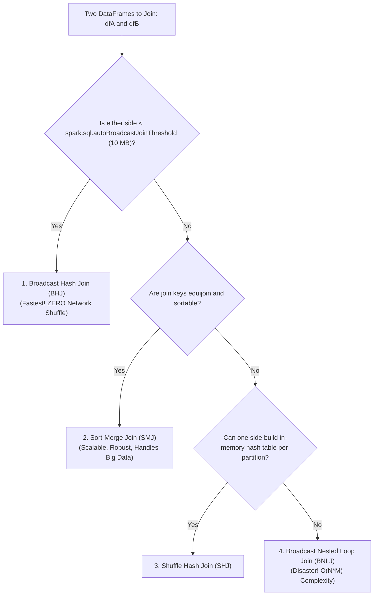
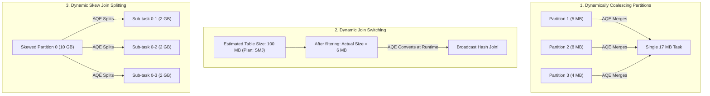

# 🔀 Lecture 03: Shuffling, Partitioning & Skew Mitigation
### *SortShuffleManager, Join Algorithms & Adaptive Query Execution (AQE)*

---

## 1. SortShuffleManager Internals: The Disk & Network Flow

The Shuffle is the single most expensive operation in distributed computing. Understanding how Spark stores and serves shuffle data on local disk is essential for performance tuning.

```mermaid
flowchart TB
    subgraph MapTask["Map Task on Executor 1"]
        Buffer["In-Memory Shuffle Append Buffer"] --> Sorter["External Sorter (Sort by Partition ID, then Key)"]
        Sorter --> Spill["Spills to Local JBOD Disks (/tmp/blockmgr-...)"]
        Spill --> FinalMerge["Multi-Pass Merge"]
        FinalMerge --> DataFile["shuffle_0_0_0.data (Contiguous partition bytes)"]
        FinalMerge --> IndexFile["shuffle_0_0_0.index (8-byte partition offsets)"]
    end

    subgraph ReduceTask["Reduce Tasks on Remote Executors"]
        Red0["Reduce Task (Partition 0)"]
        Red1["Reduce Task (Partition 1)"]
    end

    DataFile -. Byte Range 0..1024 (via Netty) .-> Red0
    DataFile -. Byte Range 1024..4096 (via Netty) .-> Red1
    IndexFile -. Tells Reducers Where to Read .-> Red0
    IndexFile -. Tells Reducers Where to Read .-> Red1
```

### The Role of the External Shuffle Service (ESS)
When **Dynamic Allocation** is enabled (`spark.dynamicAllocation.enabled = true`), idle executors are terminated to save cluster resources. 
- If Executor 1 ran Map tasks and wrote shuffle files to its local disk, terminating Executor 1 would destroy those shuffle files, forcing downstream Reducers to fail and trigger full stage re-computations!
- **The Solution**: The **External Shuffle Service (ESS)** runs as an independent daemon on the worker node (or via Kubernetes Push-Based Shuffle). It serves shuffle blocks over Netty even after the worker executor has been terminated.

---

## 2. Partition Sizing: The 100 MB–200 MB Golden Rule

A default Spark setting that causes countless production failures is:
```properties
spark.sql.shuffle.partitions = 200 # DEFAULT
```
- **Scenario A (Too Small)**: You process 2 TB of data. With 200 partitions, each partition is **10 GB**! This will immediately exhaust executor execution memory, cause massive disk spilling, and trigger `OutOfMemoryError: Java heap space`.
- **Scenario B (Too Large)**: You process 500 MB of data. With 200 partitions, each partition is **2.5 MB**! The scheduling overhead, TaskSet serialization, and index file creation dwarf the actual computation time.

### The Formula for Shuffle Partitions
$$\text{Target Shuffle Partitions} = \frac{\text{Total Input Data Size After Filtering}}{\text{Target Partition Size (128 MB to 200 MB)}}$$

*Example*: If your query reads 256 GB of data after filters:
$$\text{Partitions} = \frac{256 \times 1024\text{ MB}}{128\text{ MB}} = \frac{262{,}144}{128} = 2{,}048\text{ partitions}$$

---

## 3. Distributed Join Strategies Compared



### 1. Broadcast Hash Join (BHJ)
- **Mechanism**: The Driver collects the small table and broadcasts it to every executor. Each executor builds an in-memory hash table. The large table is streamed without any network shuffle.
- **Tuning**: Increase threshold if memory permits:
  ```properties
  spark.sql.autoBroadcastJoinThreshold = 104857600 # 100 MB
  ```

### 2. Sort-Merge Join (SMJ)
- **Mechanism**: Both tables are shuffled across the cluster using `hash(join_key) % num_partitions`. Each partition on each executor is sorted by join key. The executor iterates through both sorted streams in a single merge pass.
- **Advantage**: Does not require holding full tables in RAM; spills gracefully to disk if needed.

---

## 4. Adaptive Query Execution (AQE) in Spark 3.x+

AQE fundamentally transformed Spark by re-optimizing query plans **at runtime** based on actual completed stage statistics.

```properties
spark.sql.adaptive.enabled = true
```

### The 3 Core Features of AQE



---

## 5. Manual Skew Mitigation: Key Salting

When a dataset has extreme skew (e.g., `user_id = NULL` or a major retailer like Amazon having 50% of all order volume), a single executor receives 50% of the shuffle data, causing the entire job to hang at 99% progress.

If AQE is not available or the skew exceeds its parameters, use **Salting**.

```mermaid
flowchart LR
    subgraph SkewedTable["Skewed Large Table (Transactions)"]
        Key1["Key: 'AMAZON'"] -->|Add Salt: random(0, 3)| S0["AMAZON_0"]
        Key1 --> S1["AMAZON_1"]
        Key1 --> S2["AMAZON_2"]
        Key1 --> S3["AMAZON_3"]
    end

    subgraph SmallTable["Dimension Table (Merchants)"]
        KeyM["Key: 'AMAZON'"] -->|Explode Salt: [0, 1, 2, 3]| M0["AMAZON_0"]
        KeyM --> M1["AMAZON_1"]
        KeyM --> M2["AMAZON_2"]
        KeyM --> M3["AMAZON_3"]
    end

    S0 <-->|Join| M0
    S1 <-->|Join| M1
    S2 <-->|Join| M2
    S3 <-->|Join| M3
```

### PySpark Salting Implementation

```python
from pyspark.sql import functions as F

# Step 1: Add a salt between 0 and 3 to the skewed large table
skewed_df = large_transactions_df.withColumn(
    "salt", F.concat(F.col("merchant_id"), F.lit("_"), F.floor(F.rand() * 4))
)

# Step 2: Explode the small dimension table across all salt values [0, 1, 2, 3]
salt_array = F.array([F.lit(i) for i in range(4)])
dimension_df = merchants_df.withColumn("salt_val", F.explode(salt_array)) \
                           .withColumn("salt", F.concat(F.col("merchant_id"), F.lit("_"), F.col("salt_val")))

# Step 3: Join on the salted composite key
# Skewed records are now evenly distributed across 4 separate executor partitions!
salted_joined_df = skewed_df.join(dimension_df, on="salt", how="inner") \
                            .drop("salt", "salt_val")
```
