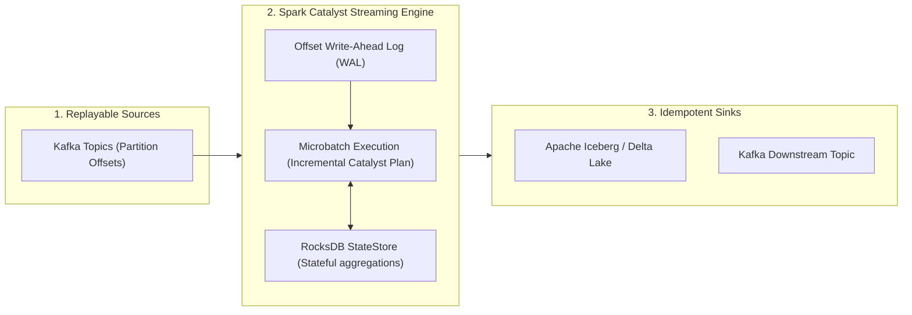
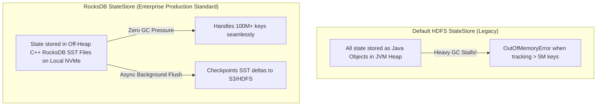
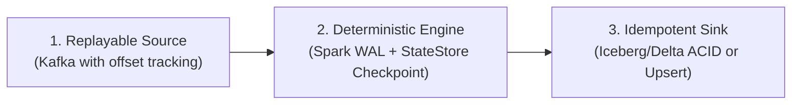

# 🌊 Lecture 04: Structured Streaming & Exactly-Once Semantics
### *Microbatch Engines, Watermarks, RocksDB StateStores & Idempotent Sinks*

---

## 1. Structured Streaming Core Architecture

Spark Structured Streaming unifies streaming and batch computation under the same Catalyst Engine. The stream is modeled as an **unbounded, continuously appended table**.



---

## 2. Event-Time Processing & Watermarking

In real-world distributed systems, network latency causes events to arrive out-of-order. A record generated at 10:01 AM might arrive at the cluster at 10:14 AM.

### The Watermark Concept
A **Watermark** is a moving threshold that trails the maximum event time observed by the engine:
$$\text{Watermark} = \max(\text{EventTime Seen}) - \text{Allowed Late Delay}$$

```mermaid
gantt
    title Event-Time Windowing & Watermark Eviction
    dateFormat X
    axisFormat %s min

    section Window [10:00 - 10:10]
    Events arrive :0, 15
    Watermark passes 10:10 (State Evicted) :15, 16

    section Window [10:10 - 10:20]
    Events arrive :10, 25
    Watermark trails by 10 mins :25, 26
```



### PySpark Watermarking Implementation

```python
from pyspark.sql import functions as F

# Stream processing with 10-minute watermark
streaming_df = (
    spark.readStream
    .format("kafka")
    .option("kafka.bootstrap.servers", "kafka-broker:9092")
    .option("subscribe", "transactions")
    .load()
    .selectExpr("CAST(value AS STRING) as json_payload")
    .select(F.from_json("json_payload", schema).alias("data"))
    .select("data.*")
    # Define event-time column and allowed lateness
    .withWatermark("event_time", "10 minutes")
    # 10-minute tumbling window on event-time
    .groupBy(
        F.window("event_time", "10 minutes"),
        F.col("merchant_id")
    )
    .agg(F.sum("amount").alias("total_revenue"))
)
```

---

## 3. StateStore Providers: Default vs. RocksDB

For stateful operations (stream-stream joins, deduplication, running aggregations), Spark maintains intermediate state across batches.



### Enabling the RocksDB StateStore
In enterprise production, **always** configure RocksDB to prevent JVM memory exhaustion on high-cardinality streams:

```properties
spark.sql.streaming.stateStore.providerClass = org.apache.spark.sql.execution.streaming.state.RocksDBStateStoreProvider
```

---

## 4. The 3 Pillars of End-to-End Exactly-Once Guarantees

Many tools claim "exactly-once," but true exactly-once processing requires three independent layers working in harmony:



1. **Replayable Source**: The source must allow reading specific byte/offset ranges again if a crash occurs (e.g., Kafka offset replay).
2. **Deterministic Engine with Checkpoints**: 
   - Before processing batch $N$, Spark writes the target offsets to a persistent Write-Ahead Log (`checkpointLocation/offsets/N`).
   - If the executor crashes halfway through batch $N$, upon restart it reads the WAL, realizes batch $N$ was incomplete, and re-executes the exact same batch.
3. **Idempotent or Transactional Sink**:
   - The sink must either support **ACID atomic commits** (like Apache Iceberg / Delta Lake where the entire batch is committed via a single metadata swap) or **idempotent key overwrites** (like Cassandra / DynamoDB upserts).
   - If a sink uses standard non-idempotent inserts (e.g., plain CSV/JSON append or raw SQL `INSERT`), replaying batch $N$ will produce duplicate records!
