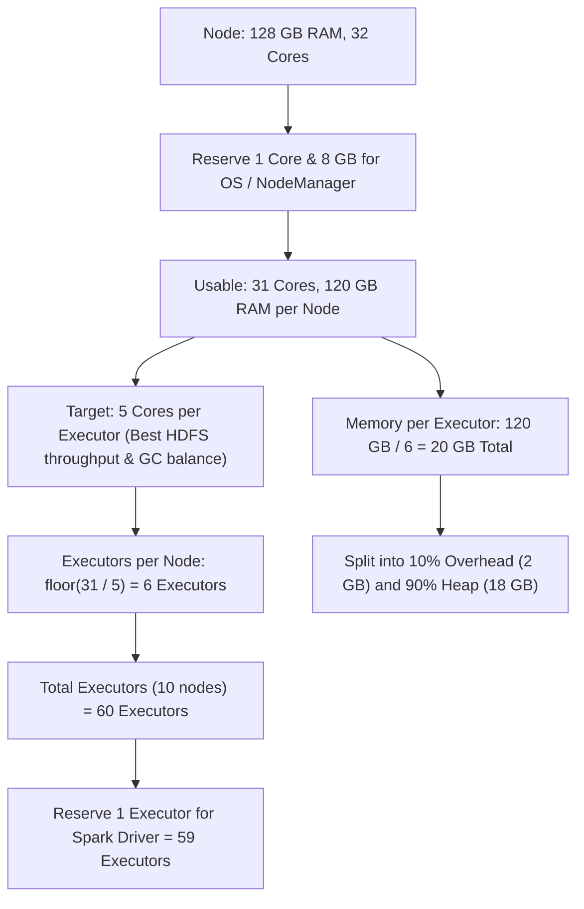
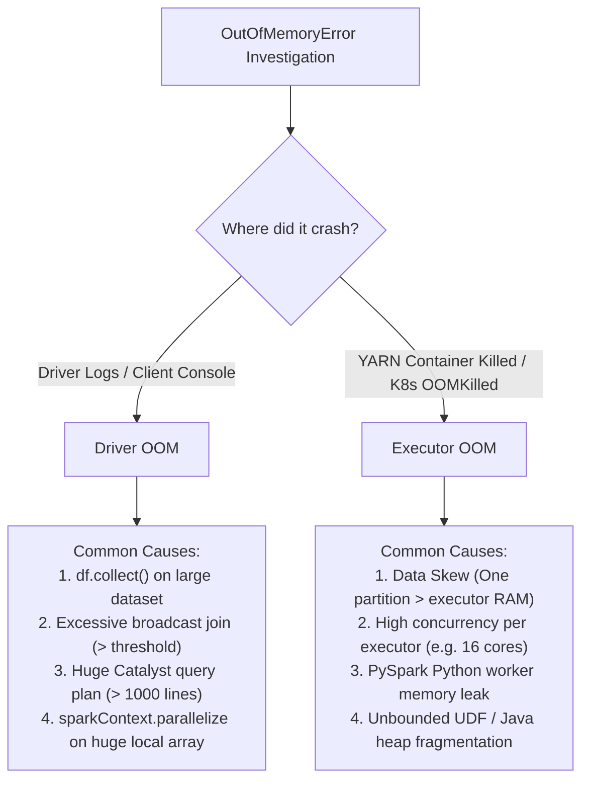

# 🎯 Lecture 05: Spark Interview Mastery
### *Tier-1 Firm Tuning Scenarios, OOM Forensics, and Hardware Sizing Mathematics*

---

## 🏆 Question 1: Sizing Spark Applications on YARN / Kubernetes

> **The Prompt**:  
> *"You are deploying a Spark batch application on a dedicated cluster to process a 5 TB daily workload. The cluster has 10 worker nodes, each with 32 CPU cores and 128 GB RAM. Walk me through the exact mathematical derivation for `--num-executors`, `--executor-cores`, `--executor-memory`, and `--conf spark.executor.memoryOverhead`."*

### The 20-Year Veteran's Sizing Recipe



#### Step 1: Optimize Cores per Executor
- **Rule of Thumb**: Never assign $>5$ cores to a single executor. 
  - Why? More than 5 concurrent task threads inside a single JVM creates severe thread contention on HDFS/S3 I/O channels and causes high JVM Garbage Collection pauses.
  - Fewer than 2 cores hurts multi-threading efficiency. **5 cores per executor is the industry sweet spot**.

#### Step 2: Determine Executors per Node
- Each node has 32 cores. Reserve 1 core for OS/NodeManager $\implies 31$ usable cores.
$$\text{Executors per Node} = \left\lfloor \frac{31\text{ cores}}{5\text{ cores/executor}} \right\rfloor = 6\text{ executors per node}$$
- Remaining 1 core per node remains available for background OS operations.

#### Step 3: Total Cluster Executors
$$\text{Total Executors} = 10\text{ nodes} \times 6\text{ executors/node} = 60\text{ executors}$$
- Reserve **1 executor** to run the Spark `ApplicationMaster / Driver` in cluster mode:
$$\mathbf{--num\text{-}executors = 59}$$
$$\mathbf{--executor\text{-}cores = 5}$$

#### Step 4: Memory per Executor & MemoryOverhead
- Total node RAM is 128 GB. Reserve 8 GB for OS, DataNode, and system page cache $\implies 120$ GB usable per node.
$$\text{Total RAM per Executor} = \frac{120\text{ GB}}{6\text{ executors}} = 20\text{ GB (20,480 MB)}$$
- Every Spark executor requires **off-heap memory overhead** for JVM internal strings, PySpark C-bindings, and network buffers.
- Allocate **10%** to `spark.executor.memoryOverhead` and **90%** to `spark.executor.memory`:
$$\text{Overhead} = 20\text{ GB} \times 0.10 = 2\text{ GB (2,048 MB)}$$
$$\text{Executor Heap} = 20\text{ GB} - 2\text{ GB} = 18\text{ GB (18,432 MB)}$$

$$\mathbf{--executor\text{-}memory\ 18g}$$
$$\mathbf{--conf\ spark.executor.memoryOverhead=2048m}$$

---

## 🚨 Question 2: OOM Forensics: Driver OOM vs. Executor OOM

> **The Prompt**:  
> *"Your Spark job crashes in production with `java.lang.OutOfMemoryError`. How do you immediately identify whether it was the Driver or an Executor that died, what are the primary root causes of each, and how do you resolve them?"*



### Detailed Remediation Matrix

| Failure Type | Log Signature | Root Cause | Engineering Fix |
| :--- | :--- | :--- | :--- |
| **Driver OOM** | `java.lang.OutOfMemoryError: Java heap space` in driver console | Calling `.collect()`, `.toPandas()`, or broadcasting a table larger than `spark.driver.memory` | Replace `.collect()` with `.take(100)` or write directly to storage (`.write.parquet()`). Increase `spark.driver.memory`. |
| **Executor Heap OOM** | `ExecutorLostFailure ... Container killed by YARN for exceeding memory limits` | Executor partition data exceeded available Execution Memory during join/aggregate | Increase `spark.sql.shuffle.partitions`. Enable AQE skew join splitting. Salt skewed keys. |
| **Off-Heap OOM (YARN / K8s)** | `Container [pid=...] is running 21.2 GB beyond the 'PHYSICAL' memory limit` | Python worker processes in PySpark, Netty off-heap buffer leaks, or native libraries | Increase `spark.executor.memoryOverhead` (e.g., from 10% to 25%). Avoid inefficient Python UDFs; use Pandas UDFs (Vectorized PyArrow). |

---

## ⚡ Question 3: The 99% Hang (Skew Join Debugging)

> **The Prompt**:  
> *"In the Spark Web UI, Stage 3 has 200 tasks. 199 tasks completed in 15 seconds. The last task has been running for 2 hours and hasn't finished. What is happening, and how do you fix it?"*

### Root Cause Diagnosis via Spark UI
1. Open the **Spark Web UI** $\rightarrow$ Click on **Stage 3**.
2. Scroll to the **Summary Metrics table** (Min, 25th percentile, Median, 75th percentile, Max).
3. Inspect **Shuffle Read Size** and **Task Duration**:
   - **Median**: Duration = 12 seconds, Shuffle Read = 45 MB.
   - **Max**: Duration = 2.1 hours, Shuffle Read = **38 GB**!
4. **Diagnosis**: Severe **Data Skew**. 38 GB of data mapped to the exact same hash partition key (e.g., a dummy value like `NULL`, `-1`, or `"UNKNOWN"` in the join column).

### Three Levels of Resolution

#### Level 1: Filter Dummy Keys Before Join
```sql
-- Separate known nulls/placeholders from real data
SELECT * FROM orders WHERE customer_id IS NOT NULL 
JOIN customers ON orders.customer_id = customers.customer_id
UNION ALL
SELECT * FROM orders WHERE customer_id IS NULL; -- Append unjoinable records directly
```

#### Level 2: Enable AQE Skew Join Optimization (Spark 3.x)
```properties
spark.sql.adaptive.enabled = true
spark.sql.adaptive.skewJoin.enabled = true
spark.sql.adaptive.skewJoin.skewedPartitionFactor = 5
spark.sql.adaptive.skewJoin.skewedPartitionThresholdInBytes = 268435456 # 256 MB
```

#### Level 3: Salting the Skewed Key (Manual code fix for legacy/unsupported engines)
Add a random numeric suffix (0 to $K-1$) to the skewed key on the left side, and explode the matching key $K$ times on the right side.
